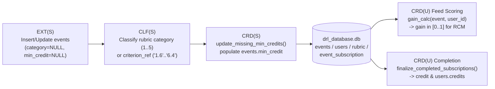

# CRD Module (`src/utility/credit_calculator.py`) — Implementation Summary & Classification Sync Guide

## 1. Executive Summary

This document summarizes the implementation of the **CRD (Credit Calculation)** module on `deploy_server` in [`src/utility/credit_calculator.py`](src/utility/credit_calculator.py) according to [`SYSTEM_ARCHITECTURE.md`](SYSTEM_ARCHITECTURE.md) and **HCMUS Regulation 1028/QĐ-KHTN-CTSV**, and defines how to synchronize **CRD** with the **CLF (Classification)** module.

### Why `feat/module-6-credits` Was Replaced
An audit of the standalone prototype on branch `feat/module-6-credits` (`credits.py`, `server.py`, `index.html`) found that:
1. It used basic substring rules without any LLM API call, **ignored `user_role` completely** (treating every event as a generic participant), and omitted BTC/CTV role tables (`1.7`, `3.14`, `4.4`) as well as organization-level variants (`truong_tro_len`, `khoa`, `lop`).
2. It lacked the **`gain_calc` (`[0..1]`)** recommendation scoring function.
3. It was disconnected from `drl_database.db` and `DRLDatabaseManager` (`events`, `users`, `event_subscription`, `rubric`).

All three gaps are resolved in [`src/utility/credit_calculator.py`](src/utility/credit_calculator.py).

---

## 2. What Was Implemented in `src/utility/credit_calculator.py`

### 2.1. Deterministic Credit Calculation (`credit_calc` & `estimate_event_credit`)
`credit_calc(event_or_id, role='participant', *, db=None) -> int` accepts either an `event_id` (`int`, queried from `drl_database.db`) or an event dictionary (`Mapping[str, Any]`), alongside the user's participation `role`:

| Canonical DB Role | Accepted Aliases | Rubric Mapping |
|---|---|---|
| `'participant'` | `None`, `'attendee'`, `'volunteer'`, `'tnv'`, `'tham gia'`, `'thí sinh'` | Standard participant / volunteer (`1.5`, `1.6`, `1.9`, `2.2`, `2.3`, `3.1`–`3.13`, `4.2`, `4.3`, `4.5`, `4.6`, `5.1`–`5.7`) |
| `'host'` | `'organizer'`, `'btc'`, `'ban tổ chức'` | Redirects `1.5`/`1.6` $\rightarrow$ **`1.7`** (`+10`), `1.9` (`+5`), `3.1`–`3.13` $\rightarrow$ **`3.14`** (`+10` school+, `+5` faculty/class), `4.2`–`4.6` $\rightarrow$ **`4.4`** (`+10` school+, `+5` faculty/class) |
| `'collaborator'` | `'ctv'`, `'cộng tác viên'` | Redirects `1.5`/`1.6` $\rightarrow$ **`1.7`** (`+5`), `1.9` (`+5`), `3.1`–`3.13` $\rightarrow$ **`3.14`** (`+5` school+, `+3` faculty, `0` class), `4.2`–`4.6` $\rightarrow$ **`4.4`** (`+5` school+, `+3` faculty, `0` class) |

**Resolution Pipeline & Provenance (`source`)**:
1. **Mandatory Penalty-Avoidance Guard (`6.4` — Tuần Sinh hoạt Công dân)**: Returns `0` bonus points (`is_credit_eligible = False`, `source = "rule"`), since attendance avoids a `-20/-10` penalty rather than adding positive credits.
2. **Explicit Announcement / Negation Parser (`source = "explicit"`)**: Inspects `award`, `title`, and `description`:
   - Explicit negation (e.g., *"không cộng điểm rèn luyện"*) $\rightarrow$ `0` points (`is_credit_eligible = False`).
   - Role-specific or participant announced points (`1..30`, e.g., `"+8 điểm rèn luyện"`, `"BTC: +12 ĐRL, CTV: +6 ĐRL"`) $\rightarrow$ exact announced credit.
3. **Rule & Attribute Inference (`source = "rule"` vs. `"rule_fallback"`)**:
   - Infers organization scope (`'truong_tro_len'`, `'khoa'`, `'lop'`) from `title`, `description`, and `sources`/`organizer` (prioritizing school and faculty units like *Liên chi Hội / Đoàn Khoa* so they are never shadowed by class-level *Chi hội / Chi đoàn*).
   - Infers volunteering duration (`'lt_24h'`: `5`, `'24h_to_lt_1w'`: `10`, `'ge_1w'`: `15`) from campaign priors (*Mùa hè xanh*, *Xuân tình nguyện*, *Chủ nhật xanh*), explicit duration text, or `event_start_datetime` / `event_end_datetime`.
   - When a required variant (`level`, `duration`, or `award_tier`) cannot be determined from event text, falls back conservatively to `min_points` and marks `source = "rule_fallback"`.

---

### 2.2. Recommendation Gain Calculation (`gain_calc` & `gain_calc_with_details`)
`gain_calc(...) -> float` computes Remaining-Rubric-Aware effective points $P_{\text{eff}}$ for category $c \in \{1..5\}$ against the school's `rubric.max_credit` ($M_c$, default `[30, 20, 25, 25, 30]`) and the `100`-point total semester cap:

$$P_{\text{eff}} = \max\Big(0, \; \min\big(P_{\text{raw}}, \; M_c - U_c, \; 100 - \sum_{i=1}^{5} \min(M_i, U_i)\big)\Big)$$

- If `not credit.is_credit_eligible` or $P_{\text{eff}} \le 0 \implies \text{Gain} = 0.0$.
- Otherwise:

$$P_{\text{use}} = \begin{cases} \min(P_{\text{eff}}, \; 0.7 P_{\text{min}} + 0.3 P_{\text{exp}}) & \text{if } \text{source} = \texttt{rule\_fallback} \\ P_{\text{eff}} & \text{otherwise} \end{cases}$$

$$\text{Gain} = \text{clip}_{[0, 1]} \left( \min\left(1, \frac{P_{\text{use}}}{10.0}\right) \cdot \left(0.5 + 0.5 \cdot \frac{\text{target\_gap}_c}{M_c}\right) \cdot r_{\text{src}} \right)$$

where $r_{\text{src}} \in \{1.00 \; (\texttt{explicit}), \; 0.90 \; (\texttt{rule}), \; 0.80 \; (\texttt{rule\_fallback})\}$ and $\text{target\_gap}_c = \max(0, \min(T_c, M_c) - \min(U_c, M_c))$ (with $T_c = M_c$ by default).

---

### 2.3. `drl_database.db` Lifecycle Functions
- **`update_missing_min_credits(*, backfill_null_category=False, db=None) -> int`** (**CRD(S)**):
  Queries `events` where `is_cancelled = 0 AND min_credit IS NULL` and writes `min_credit = credit_calc(event, role='participant')`.
- **`finalize_completed_subscriptions(user_id=None, *, db=None) -> List[Dict]`** (**CRD(U)**):
  Atomically updates `event_subscription` rows where `status = 'done' AND credit IS NULL`, writing finalized `credit = credit_calc(event_id, role)` and updating `users.credits[category - 1] = min(rubric.max_credit[category - 1], users.credits[category - 1] + credit)` inside a SQLite transaction so completed events are never double-counted.

---

## 3. How to Sync `CRD` with `CLF` (Classification Module)



`src/utility/credit_calculator.py` natively supports **two synchronization contracts** with Classification (`CLF`), depending on whether `CLF` outputs a 1-based category (`1..5` in `drl_database.db`) or a fine-grained rubric sub-item (`"<major>.<minor>"` from the `module-3` kNN pipeline).

### 3.1. Contract A — SQLite Database Sync (`SYSTEM_ARCHITECTURE.md`)
In the central server pipeline (`backend/scheduler.py`), **always run `CLF(S)` immediately before `CRD(S)`**:

1. **`EXT(S)`** inserts/updates active rows in `events` with:
   - `keywords`, `topic`, `format`, `award` populated
   - `category = NULL`, `min_credit = NULL`
   *(Note: If an existing event's content or category is updated by `EXT(S)`, reset `min_credit = NULL` so `CRD(S)` recomputes it.)*
2. **`CLF(S)` (`src/utility/classification.py`)** queries `SELECT * FROM events WHERE is_cancelled = 0 AND category IS NULL`:
   - Classifies the event into `events.category` $\in \{1, 2, 3, 4, 5\}$ (`Muc 1..5`).
   - If the event is non-credit or mandatory penalty-avoidance (`6.4` Tuần SHCD) or `NO_MATCH`, leaves `events.category = NULL`.
3. **`CRD(S)` (`src/utility/credit_calculator.py`)** runs `update_missing_min_credits()`:
   - When `events.category` is `1..5`, `infer_rubric_item(event)` **locks sub-item resolution strictly inside that category** (`1` $\rightarrow$ `1.5/1.6/1.8/1.9`, `2` $\rightarrow$ `2.2/2.3`, `3` $\rightarrow$ `3.1..3.13`, `4` $\rightarrow$ `4.2/4.3/4.5/4.6`, `5` $\rightarrow$ `5.1..5.7`) using `title`, `description`, `topic`, `format`, and `keywords`.
   - Populates `events.min_credit` (`INT >= 0`).

```python
from database import get_drl_db
from src.utility.credit_calculator import (
    finalize_completed_subscriptions,
    gain_calc,
    update_missing_min_credits,
)

db = get_drl_db()

# --- Server Cron (08:00, 14:00, 20:00 UTC+7): run AFTER CLF(S) sets events.category ---
# 1. classify_unclassified_events(db=db)   # CLF(S) sets events.category in 1..5
# 2. CRD(S) populates events.min_credit where min_credit IS NULL
updated_count = update_missing_min_credits(db=db)

# --- Client / Feed Recommendation (CRD(U) -> RCM(U)) ---
candidate_events = db.fetch_all(
    "SELECT * FROM events WHERE is_cancelled = 0;",
    table="events",
)
for ev in candidate_events:
    gain_score = gain_calc(ev, user_or_id="u_01", role="participant", db=db)
    # Pass `gain_score` ([0.0..1.0]) into RCM: w = w1*gain + w2*fit + w3*interested + w4*urgency

# --- Client / Completion Finalization (after PRG sets status='done' & confirms role) ---
finalized_rows = finalize_completed_subscriptions(user_id="u_01", db=db)
```

---

### 3.2. Contract B — Fine-Grained Sub-Item Sync (`origin/module-3` 2-Stage kNN Classifier)
If integrating the Hierarchical 2-Stage kNN classifier (`src/classification` on `origin/module-3`), each classified event carries:
```json
{
  "classification": {
    "status": "PREDICTED",
    "predicted_group_id": "C1",
    "predicted_criterion_ref": "1.6"
  }
}
```

`infer_rubric_item(event)` in [`src/utility/credit_calculator.py`](src/utility/credit_calculator.py#L430-L462) already reads this contract directly:
1. **Direct In-Memory Handoff**:
   - If `event["classification"]["status"]` is `"NO_MATCH"`, `"SKIPPED_NOT_EVENT"`, or `"REJECTED"` $\rightarrow$ `CRD` immediately returns `0` credit and `Gain = 0.0` (`is_credit_eligible = False`).
   - If `event["classification"]["predicted_criterion_ref"]` (or top-level `rubric_item_id` / `predicted_criterion_ref`) is a valid ref such as `"1.6"`, `"3.1"`, `"4.3"`, or `"6.4"` $\rightarrow$ `CRD` **skips keyword category guessing** and uses that exact sub-item directly while still applying `CRD`'s role redirection (`'host'` $\rightarrow$ `1.7`/`3.14`/`4.4`, `'collaborator'` $\rightarrow$ `1.7`/`3.14`/`4.4`), level/duration variants, explicit points, and caps.
2. **Persisting `module-3` Classifier Output into `drl_database.db`**:
   - Map `predicted_group_id` (`"C1".."C5"`) or the major digit of `predicted_criterion_ref` (`"1".."5"`) to `events.category` (`1..5`).
   - For `"6.4"` (`group = "P"`), `"NO_MATCH"`, or `"SKIPPED_NOT_EVENT"`, keep `events.category = NULL` and set `events.min_credit = 0` so `CRD(S)` does not re-estimate positive credit for rejected/mandatory items.
   - *(Optional schema extension)*: If exact sub-item persistence across restarts is desired without re-inferring minor codes inside `C1..C5`, store `predicted_criterion_ref` in `events.keywords` (e.g., `"ref:1.6"`) or add a nullable `rubric_ref TEXT` column to `events` and pass it as `rubric_item_id`.

| Classifier Output (`CLF`) | `events.category` in DB | `CRD` Behavior (`credit_calc` & `gain_calc`) |
|---|---|---|
| `C1`..`C5` (e.g., `category = 1` or `ref = "1.6"`) | `1..5` | Resolves exact sub-item + `role` (`participant`/`host`/`collaborator`) + level/duration + caps |
| `6.4` (Tuần SHCD, `group = "P"`) | `NULL` | `credit = 0`, `is_credit_eligible = False`, `gain = 0.0` |
| `NO_MATCH` / `SKIPPED_NOT_EVENT` | `NULL` (`min_credit = 0`) | `credit = 0`, `is_credit_eligible = False`, `gain = 0.0` |
| `NEEDS_REVIEW` (low margin) | `1..5` (top-1 group) or `NULL` | If `predicted_criterion_ref` is passed, evaluates conservatively; if `category = NULL`, falls back to deterministic rules |

---

## 4. Verification & Testing

Run the unit and SQLite lifecycle test suite from the repository root:

```powershell
python -m unittest discover -s tests -p "test_*.py" -v
```

Covered in [`tests/test_credit_calculator.py`](tests/test_credit_calculator.py):
- Role normalization and BTC/CTV redirection (`1.6 -> 1.7`, `3.x -> 3.14`, `4.x -> 4.4`, including `0` CTV points at class `'lop'` level and `'khoa'` vs `'lop'` disambiguation for *Liên chi Hội*).
- Explicit DRL point announcements, role-specific explicit points, non-DRL negations, and `6.4` mandatory SHCD handling.
- Exact `Gain` formula verification across `explicit` ($r_{\text{src}}=1.00$), `rule` ($r_{\text{src}}=0.90$), and `rule_fallback` ($r_{\text{src}}=0.80$, $P_{\text{use}} = \min(P_{\text{eff}}, 0.7 P_{\text{min}} + 0.3 P_{\text{exp}})$), plus partial/full category cap clamping.
- Direct `CLF` $\leftrightarrow$ `CRD` contract tests (`classification.predicted_criterion_ref` and `NO_MATCH` abstention).
- End-to-end `drl_database.db` `CRD(S)` (`update_missing_min_credits`) and `CRD(U)` (`gain_calc` + idempotent `finalize_completed_subscriptions`), plus audit across all 61 real sample events (`61/61` mapped).
