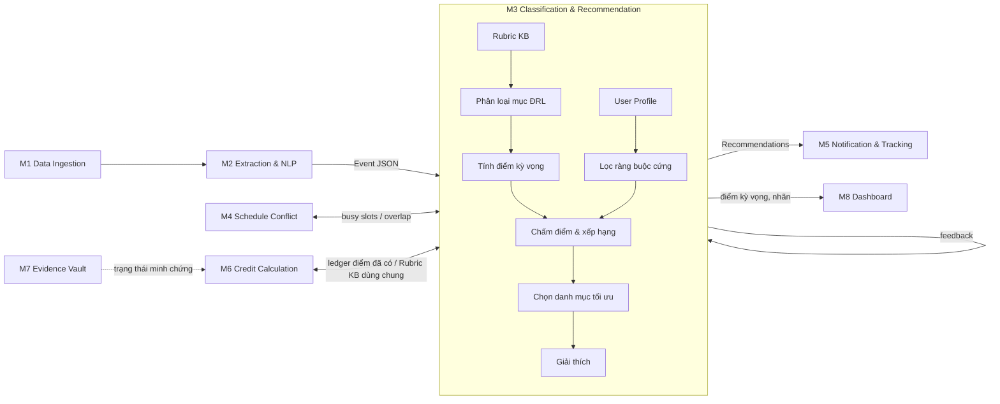
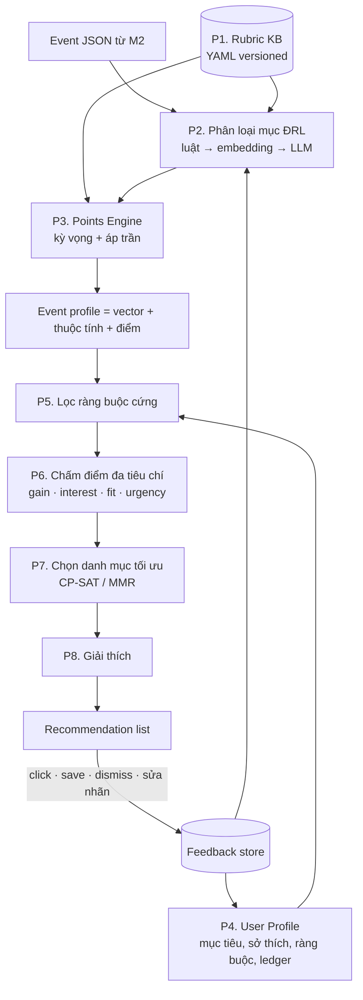

 - 

# Module 3 — Classification & Recommendation Engine

## Thiết kế chi tiết + phương án PoC

> **Đề tài:** Trợ lý ảo hỗ trợ tổng hợp, đề xuất và lưu trữ hoạt động kiếm điểm rèn luyện (ĐRL) cho sinh viên
> **Môn học:** Computational Thinking — **Phạm vi tài liệu:** Module 3 (phân loại & gắn nhãn mục ĐRL, tính điểm kỳ vọng, đề xuất hoạt động)
> **Nguyên tắc thiết kế:** *ưu tiên model có sẵn (pre-trained / API), luật + thuật toán tường minh, không train từ đầu*

---

## 0. Tóm tắt điều hành (TL;DR)

| Câu hỏi                                          | Quyết định đề xuất                                                                                                                                                                                                                                                        |
| -------------------------------------------------- | ------------------------------------------------------------------------------------------------------------------------------------------------------------------------------------------------------------------------------------------------------------------------------- |
| Phân loại hoạt động vào mục ĐRL thế nào? | **Cascade 3 tầng**: (0) luật từ khóa + tổ chức → (1) embedding zero-shot theo prototype → (2) LLM few-shot chỉ gọi khi chưa chắc. Gộp bằng log-linear fusion, có ngưỡng "tự động / cần xác nhận / không rõ".                                     |
| Tính điểm thế nào?                            | **Rule engine tất định** đọc từ file khung điểm (YAML) — *LLM không bao giờ được tự "nghĩ ra" số điểm*. Có áp trần theo mục/tiêu chí, trả về khoảng [thấp, cao] + nguồn gốc (công bố / suy ra từ luật).                              |
| Đề xuất thế nào?                              | **Lọc ràng buộc cứng → chấm điểm đa tiêu chí (gain, interest, fit, urgency) → chọn *tập* hoạt động tối ưu** bằng CP-SAT / MMR. Content-based + goal-based nên **chạy được ngay cả khi chưa có dữ liệu người dùng (cold start)**. |
| Model nào?                                        | Embedding:**BAAI/bge-m3** (hoặc multilingual-e5-base nếu máy yếu). LLM nhỏ qua API (Claude Haiku / GPT-4o-mini / Gemini Flash) hoặc Qwen2.5-7B chạy local. **Không cần fine-tune** ở PoC.                                                                 |
| Rủi ro lớn nhất?                                | Không nằm ở model mà ở**(a) khung điểm của trường có được mã hóa đúng không, (b) chất lượng dữ liệu từ Module 1–2**.                                                                                                                            |
| PoC?                                               | 10 ngày, Python + Streamlit, ~150 sự kiện, 5 persona, 5 thí nghiệm đánh giá (mục 15).                                                                                                                                                                                  |

---

## 1. Bối cảnh, phạm vi, giả định

### 1.1 Vị trí của Module 3 trong hệ thống



### 1.2 Ranh giới trách nhiệm (cần cả nhóm thống nhất)

| Việc                                                                                                                                      | Ai làm      | Ghi chú                                                                 |
| ------------------------------------------------------------------------------------------------------------------------------------------ | ------------ | ------------------------------------------------------------------------ |
| Trích**thông tin tường minh** trong bài đăng (tên, thời gian, địa điểm, hạn đăng ký, *điểm công bố nếu có*) | **M2** | M3 không trích lại.                                                   |
| Suy ra**thông tin ngầm**: thuộc mục ĐRL nào, cấp tổ chức (lớp/khoa/trường…), vai trò khả dĩ                          | **M3** | Dùng khi M2 để trống.                                                |
| Điểm**kỳ vọng** (dự báo trước khi tham gia, để xếp hạng)                                                                 | **M3** | Có thể sai số, có khoảng tin cậy.                                  |
| Điểm**thực nhận** (đã tham gia + có minh chứng + được xác nhận)                                                         | **M6** | Ledger chính thức.                                                     |
| Phát hiện trùng lịch                                                                                                                   | **M4** | PoC tự cài hàm`overlap()` đơn giản, bản thật gọi API của M4. |

> ⚠️ **Trùng lặp M3 ↔ M6:** cả hai đều "tính điểm". Đề xuất tách **`rubric_kb` + `points_engine` thành thư viện dùng chung**: M3 gọi ở chế độ *dự báo*, M6 gọi ở chế độ *ghi sổ*. Tránh hai nơi hiểu khác nhau về cùng một khung điểm.

### 1.3 Phân rã theo Computational Thinking (để đưa vào báo cáo môn học)

| Trụ cột CT                  | Áp dụng trong Module 3                                                                                                                                                                                                                                         |
| ----------------------------- | ---------------------------------------------------------------------------------------------------------------------------------------------------------------------------------------------------------------------------------------------------------------- |
| **Decomposition**       | Chia thành 8 bài toán con P1–P8 (mục 3).                                                                                                                                                                                                                    |
| **Pattern recognition** | (i) Hoạt động cùng loại lặp lại*từ khóa, đơn vị tổ chức, định dạng* → luật & prototype; (ii) người dùng lặp lại *sở thích, khung giờ, khoảng cách ngại đi* → hồ sơ người dùng.                                          |
| **Abstraction**         | Bài đăng →*event profile* (vector + thuộc tính); khung điểm → *cấu hình YAML*; sinh viên → *user profile* (mục tiêu điểm, sở thích, lịch). Bỏ qua chi tiết không ảnh hưởng quyết định (màu poster, lời văn quảng cáo…). |
| **Algorithm design**    | Cascade phân loại, rule engine tính điểm, hàm chấm điểm đa tiêu chí, tối ưu tập chọn (ILP/greedy).                                                                                                                                               |

### 1.4 Giả định & điều cần xác nhận ngay

1. **Khung điểm ĐRL.** Tài liệu dùng khung 5 tiêu chí tổng 100 điểm theo *Thông tư 16/2015/TT-BGDĐT* (hệ đại học chính quy) làm **mặc định**: C1 học tập (≤20), C2 nội quy/quy chế (≤25), C3 hoạt động chính trị–xã hội–văn hóa–thể thao (≤20), C4 quan hệ cộng đồng (≤25), C5 cán bộ lớp/đoàn thể/thành tích (≤10). **Trường của bạn có thể có khung chi tiết hơn hoặc phiên bản mới — hãy đối chiếu với sổ tay/quy định hiện hành của trường** và thay các số trong `rubric.yaml`. *Các mức điểm cụ thể (2, 3, 5 …) trong tài liệu này chỉ là số mẫu để chạy demo.*
2. Nguồn dữ liệu ban đầu: bài đăng công khai (fanpage Đoàn–Hội, khoa, CTSV) → M1/M2 đưa ra *Event JSON* (mục 2).
3. Quy mô: vài trăm sự kiện/học kỳ/trường → **không cần hạ tầng nặng**, vector search brute-force bằng numpy là đủ.
4. Người dùng cuối là sinh viên một trường; ngôn ngữ chính là tiếng Việt (có lẫn tiếng Anh, có thể không dấu).

---

## 2. Đặc tả giao diện (I/O contracts)

### 2.1 Input từ M2 — `Event`

```json
{
  "event_id": "evt_2026_00123",
  "title": "Ngày hội hiến máu tình nguyện 'Giọt hồng yêu thương'",
  "description": "…(văn bản gốc đã làm sạch)…",
  "organizer": {"name": "Hội Sinh viên trường", "official": true},
  "start": "2026-11-20T08:00:00+07:00",
  "end": "2026-11-20T11:30:00+07:00",
  "registration_deadline": "2026-11-18T23:59:00+07:00",
  "location": {"text": "Sảnh A, cơ sở Thủ Đức", "online": false},
  "capacity": 200, "seats_left": 35, "fee": 0,
  "explicit_points": null,
  "explicit_level": null,
  "tags_raw": ["hiến máu", "tình nguyện"],
  "source_url": "https://…", "ingested_at": "2026-11-10T09:00:00+07:00"
}
```

### 2.2 Input — `UserProfile`

```json
{
  "user_id": "u_001",
  "target": {"total": 85, "mode": "balanced"},
  "ledger": {"criteria": {"C1": 12, "C3": 8, "C4": 15}, "items": {"C4.tinh_nguyen": 10}},
  "interests_text": "thích âm nhạc, lập trình, hoạt động ngoài trời",
  "interest_tags": ["am nhac", "lap trinh", "ngoai troi"],
  "constraints": {"max_travel_min": 45, "budget": 0, "pref_hours": [8, 21], "formats": ["offline", "online"]},
  "calendar_ref": "ics://…  (lấy từ M4)",
  "exam_weeks": [["2026-12-15", "2026-12-28"]]
}
```

### 2.3 Output — `Recommendation`

```json
{
  "event_id": "evt_2026_00123",
  "label": {"item_id": "C4.tinh_nguyen", "criterion": "C4",
            "confidence": 0.91, "status": "auto",
            "top2": [["C4.tinh_nguyen", 0.91], ["C3.vh_vn_tdtt", 0.07]]},
  "points": {"expected": 5, "low": 5, "high": 5, "effective": 2,
             "source": "rule", "capped_by": "item"},
  "score": {"total": 0.54, "gain": 0.11, "interest": 0.71, "fit": 0.88, "urgency": 0.67},
  "explanation": ["Tiêu chí C4 còn cách mục tiêu 85 điểm của bạn khoảng 6 điểm", "Không trùng lịch", "Hạn đăng ký còn 2 ngày"],
  "warnings": ["Điểm chỉ ước tính từ khung điểm trường; sự kiện không công bố điểm"]
}
```

---

## 3. Kiến trúc & phân rã bài toán con



| #  | Bài toán con               | Đầu vào → Đầu ra                            | Kỹ thuật chính                         | Cần train?                          |
| -- | ---------------------------- | ------------------------------------------------- | ----------------------------------------- | ------------------------------------ |
| P1 | Rubric Knowledge Base        | văn bản quy định → cấu hình có cấu trúc | YAML + version, kiểm tra schema          | Không                               |
| P2 | Phân loại & gắn nhãn     | Event → (mục ĐRL, độ tin cậy)               | Rule + embedding zero-shot + LLM few-shot | Không                               |
| P3 | Tính điểm kỳ vọng       | (mục, cấp, vai trò) → điểm, khoảng, nguồn | Rule engine tra bảng + áp trần         | Không                               |
| P4 | Mô hình hóa người dùng | form + lịch + hành vi → profile                | Embedding + Rocchio update                | Không                               |
| P5 | Lọc ràng buộc cứng       | tập sự kiện → ứng viên hợp lệ             | Constraint filtering                      | Không                               |
| P6 | Chấm điểm                 | (user, event) → score ∈ [0,1]                   | Tổng có trọng số, minh bạch          | Không (tinh chỉnh nhẹ tùy chọn) |
| P7 | Chọn danh mục              | ứng viên → tập K sự kiện                    | ILP (CP-SAT) / MMR                        | Không                               |
| P8 | Giải thích                 | score + điều kiện → câu giải thích         | Template (+ LLM diễn đạt, tùy chọn)  | Không                               |

---

## 4. P1 — Rubric Knowledge Base (khung điểm dạng cấu hình)

**Vấn đề:** Mọi thứ phía sau (nhãn, điểm, trần, khoảng thiếu) đều dựa vào khung điểm. Nếu để khung điểm "nằm trong đầu LLM" thì không kiểm chứng và không cập nhật được.

**Giải pháp:** mã hóa thành file cấu hình có version, tách khỏi code.

### 4.1 Mô hình dữ liệu

- `criteria`: 5 tiêu chí + điểm tối đa.
- `levels`: thang cấp tổ chức: `lop < khoa < truong < thanh_pho < quoc_gia`.
- `items`: các **mục** cụ thể của trường (mức phân loại cấp 2). Mỗi mục có: `criterion`, `name`, `anchors` (câu ví dụ cho tầng embedding), `cap_per_semester`, và bảng điểm `points[role][level]`.
- `role`: `participant` (tham gia), `organizer` (ban tổ chức/tình nguyện viên), mở rộng được: `speaker`, `winner`…

### 4.2 Quy trình nạp khung điểm (làm *một lần*, cả nhóm cùng rà soát)

1. Lấy văn bản quy định ĐRL hiện hành của trường (PDF/Word).
2. Mỗi dòng "cộng điểm" → 1 `item`; ghi rõ số điều/khoản nguồn (`source_ref`) để truy vết.
3. Điền `anchors`: 3–8 tên hoạt động *thật* của trường cho mỗi mục (lấy từ lịch sử sự kiện).
4. Kiểm tra schema (pydantic) + test "tổng trần các mục không vượt trần tiêu chí".
5. Người có thẩm quyền (cố vấn/CTSV) xác nhận → gắn `version`.

### 4.3 File mẫu (`rubric.yaml`) — **số liệu chỉ là mẫu để demo**

```yaml
# GIÁ TRỊ MẪU để demo: thay bằng khung điểm thật của trường bạn.
version: "demo-TT16-2015"
school: "<điền tên trường>"
criteria:
  C1: {name: "Ý thức tham gia học tập", max: 20}
  C2: {name: "Ý thức chấp hành nội quy, quy chế, quy định", max: 25}
  C3: {name: "Hoạt động chính trị, xã hội, văn hóa, văn nghệ, thể thao, phòng chống tệ nạn", max: 20}
  C4: {name: "Ý thức công dân trong quan hệ cộng đồng", max: 25}
  C5: {name: "Công tác cán bộ lớp, đoàn thể; thành tích đặc biệt", max: 10}
levels: [lop, khoa, truong, thanh_pho, quoc_gia]
items:
  C1.hoc_thuat:
    criterion: C1
    name: "Hội thảo, seminar, cuộc thi học thuật, NCKH"
    anchors: ["Hội thảo khoa học dành cho sinh viên", "Cuộc thi Olympic tin học", "Seminar chia sẻ kinh nghiệm nghiên cứu khoa học"]
    cap_per_semester: 6
    points:
      participant: {lop: 1, khoa: 2, truong: 3, thanh_pho: 4, quoc_gia: 5}
      organizer:   {lop: 2, khoa: 3, truong: 4, thanh_pho: 5, quoc_gia: 6}
  C2.cong_dan:
    criterion: C2
    name: "Sinh hoạt công dân, học tập nội quy, quy chế"
    anchors: ["Tuần sinh hoạt công dân sinh viên", "Buổi học tập quy chế đào tạo và nội quy nhà trường"]
    cap_per_semester: 5
    points:
      participant: {truong: 5}
      organizer:   {truong: 5}
  C3.vh_vn_tdtt:
    criterion: C3
    name: "Văn hóa, văn nghệ, thể thao, phòng chống tệ nạn"
    anchors: ["Hội thao sinh viên", "Đêm nhạc văn nghệ chào tân sinh viên", "Giải chạy bộ gây quỹ", "Tuyên truyền phòng chống ma túy"]
    cap_per_semester: 10
    points:
      participant: {lop: 2, khoa: 3, truong: 4, thanh_pho: 5, quoc_gia: 6}
      organizer:   {lop: 3, khoa: 4, truong: 6, thanh_pho: 7, quoc_gia: 8}
  C4.tinh_nguyen:
    criterion: C4
    name: "Tình nguyện, hiến máu, từ thiện, hoạt động cộng đồng"
    anchors: ["Chiến dịch Mùa hè xanh", "Ngày hội hiến máu tình nguyện", "Quyên góp sách cũ cho trẻ em vùng cao", "Dọn vệ sinh bãi biển"]
    cap_per_semester: 12
    points:
      participant: {lop: 2, khoa: 3, truong: 5, thanh_pho: 6, quoc_gia: 8}
      organizer:   {lop: 3, khoa: 5, truong: 7, thanh_pho: 8, quoc_gia: 10}
  C5.cb_lop_clb:
    criterion: C5
    name: "Cán bộ lớp, Đoàn - Hội, CLB, thành tích đặc biệt"
    anchors: ["Đại hội chi Đoàn", "Tập huấn cán bộ lớp", "Sinh hoạt Ban chủ nhiệm câu lạc bộ"]
    cap_per_semester: 5
    points:
      participant: {lop: 1, khoa: 2, truong: 3}
      organizer:   {lop: 2, khoa: 3, truong: 4}
```

**Ưu điểm:** minh bạch, sửa không cần code, dùng chung M3/M6, tái sử dụng cho trường khác.
**Nhược điểm:** tốn công nhập ban đầu; nếu trường đổi quy định phải cập nhật thủ công (giải pháp: version + test hồi quy).

---

## 5. P2 — Phân loại & gắn nhãn mục ĐRL

### 5.1 Không gian nhãn (phân cấp)

```
Cấp 1: C1 | C2 | C3 | C4 | C5 | NONE (không tính ĐRL)         ← 5 tiêu chí + loại trừ
Cấp 2: các item của từng tiêu chí (vd C4.tinh_nguyen)           ← mục theo khung của trường
```

- Phân loại **cấp 2 trực tiếp** (mỗi item là một nhãn), cấp 1 suy ra từ item. Nếu chưa chắc ở cấp 2 nhưng chắc ở cấp 1 → báo "thuộc C4, chưa rõ mục".
- Cho phép **nhãn phụ** (`alt_item`): một số hoạt động thuộc 2 mục (vd. "Giải chạy gây quỹ từ thiện": C3 hay C4?). Điểm vẫn tính theo **nhãn chính**, nhãn phụ chỉ để hiển thị & xin xác nhận.
- Nhãn `NONE` bắt buộc có (tiệc, giao lưu thuần giải trí, quảng cáo thương mại) — nếu không, bộ phân loại *buộc* mọi thứ vào một mục và sinh ra đề xuất ảo.
- Phân phối nhãn **lệch** (nhiều khả năng C3, C4 chiếm đa số — *giả thuyết, cần đếm trên dữ liệu thật*) → đánh giá bằng macro-F1, không chỉ accuracy.

### 5.2 Tầng 0 — Luật (rules) & tiên nghiệm theo đơn vị tổ chức

- Chuẩn hóa văn bản: lowercase + **bỏ dấu** (Facebook hay gõ không dấu) trước khi khớp regex.
- Từ khóa đặc trưng theo mục (xem `RULES` trong code mục 15.4): "hiến máu", "mùa hè xanh" → C4; "hội thao", "văn nghệ" → C3; "seminar", "olympic" → C1; "sinh hoạt công dân" → C2; "đại hội chi đoàn", "tập huấn cán bộ lớp" → C5.
- **Prior theo đơn vị**: Phòng CTSV → nghiêng C2; Đoàn trường/Hội SV → nghiêng C3/C4; Khoa/bộ môn → nghiêng C1; CLB học thuật → C1/C5.
- Đầu ra: phân phối xác suất thô; **nếu không có tín hiệu thì trả `None`** (không bỏ phiếu bừa).

|            |                                                                                                                             |
| ---------- | --------------------------------------------------------------------------------------------------------------------------- |
| ✅ Ưu     | Rất nhanh, rẻ, giải thích được, độ chính xác cao với các ca "điển hình"                                     |
| ❌ Nhược | Dễ sót biến thể diễn đạt; từ khóa gây nhầm ("tình nguyện viên cho hội thảo" → C4 hay C1?); phải bảo trì |

### 5.3 Tầng 1 — Embedding zero-shot theo prototype (không train)

1. Với mỗi item: tạo tập **anchor** = `name` + các câu `anchors` trong rubric → embed một lần, lưu cache.
2. Với event: ghép `"{title}. {mô tả rút gọn}. Đơn vị: {organizer}"` → embed.
3. Điểm tương đồng mỗi item = trung bình **top-2** cosine với các anchor của item (ổn định hơn max).
4. Chuyển thành xác suất: `softmax(sim / τ)` với **τ ≈ 0.05** (tham số hiệu chỉnh trên tập dev; cosine giữa embedding thường dồn trong khoảng hẹp nên cần τ nhỏ).
5. Khi có phản hồi: **kNN trên sự kiện đã gắn nhãn** (thêm vào tập anchor) → hệ thống "học" mà không train.

|            |                                                                                                                                                                |
| ---------- | -------------------------------------------------------------------------------------------------------------------------------------------------------------- |
| ✅ Ưu     | Bao phủ biến thể diễn đạt, hiểu ngữ nghĩa đa ngôn ngữ, thêm nhãn mới chỉ cần thêm anchor                                                     |
| ❌ Nhược | Nhạy với chất lượng anchor; không phân biệt tốt các mục sát nghĩa; không hiểu ngữ cảnh phủ định/điều kiện; xác suất cần hiệu chỉnh |

### 5.4 Tầng 2 — LLM few-shot (chỉ khi chưa chắc)

- **Điều kiện gọi:** sau khi fusion tầng 0+1, nếu `p_top1 < hi` **hoặc** `p_top1 − p_top2 < margin` → gọi LLM. (Giả thuyết: ~20–40% sự kiện cần tầng 2 — đo lại ở thí nghiệm E1.)
- **Prompt:** mô tả ngắn từng mục (rút từ rubric) + 4–6 ví dụ gắn nhãn (few-shot) + bài đăng. *Temperature = 0*, bắt buộc **JSON schema**.
- **Chống bịa (guardrail):** (a) bắt buộc trường `evidence` = trích nguyên văn ≤ 25 từ từ bài đăng, code kiểm tra là *chuỗi con* của bài đăng; (b) `item_id` phải thuộc danh sách hợp lệ; (c) LLM **không được xuất số điểm** — điểm do P3 tính; (d) sai schema → thử lại 1 lần → bỏ tầng.
- LLM chỉ nhìn **văn bản sự kiện công khai**, không nhận dữ liệu cá nhân của sinh viên.

|            |                                                                                                                                   |
| ---------- | --------------------------------------------------------------------------------------------------------------------------------- |
| ✅ Ưu     | Hiểu ngữ cảnh, xử lý ca mơ hồ/nhiều ý, cho lý do; thêm mục mới chỉ cần sửa prompt                                 |
| ❌ Nhược | Tốn tiền & độ trễ (kiểm soát bằng cascade); có thể bịa/không ổn định → cần guardrail; phụ thuộc nhà cung cấp |

Prompt mẫu: xem Phụ lục A.

### 5.5 Fusion, hiệu chỉnh & quyết định

- **Log-linear pooling:** `score_k = Σ_i w_i · log(p_i,k + ε)` rồi softmax. Trọng số `w` (3 số) chọn bằng **grid search trên tập dev** (không phải "training" theo nghĩa nặng).
- **Hiệu chỉnh:** dùng *temperature scaling* hoặc *isotonic regression* trên tập dev để `confidence` phản ánh đúng xác suất đúng (kiểm bằng đường reliability + ECE).
- **Ngưỡng quyết định** (khởi điểm; chỉnh theo dev):

| Điều kiện            | Trạng thái | Hành vi UI                                                                          |
| ----------------------- | ------------ | ------------------------------------------------------------------------------------ |
| `conf ≥ 0.75`        | `auto`     | Hiển thị nhãn bình thường                                                      |
| `0.45 ≤ conf < 0.75` | `review`   | Hiển thị top-2, nhãn "cần xác nhận"; điểm gain bị chiết khấu theo`conf` |
| `conf < 0.45`         | `unknown`  | **Không đưa vào đề xuất điểm**; hỏi người dùng/quản trị viên   |

- **Human-in-the-loop:** người dùng/admin sửa nhãn 1 chạm → lưu vào feedback → thành anchor mới cho tầng 1 (mục 12).

### 5.6 Lựa chọn model (ưu tiên không train)

| Vai trò                                       | Lựa chọn khuyến nghị                                                | Phương án thay thế                                                                                                                                                                    | Ghi chú                                                                                                                          |
| ---------------------------------------------- | ----------------------------------------------------------------------- | ----------------------------------------------------------------------------------------------------------------------------------------------------------------------------------------- | --------------------------------------------------------------------------------------------------------------------------------- |
| **Embedding**                            | `BAAI/bge-m3` (đa ngôn ngữ, văn bản dài, miễn phí)            | `intfloat/multilingual-e5-base/-small` (nhẹ hơn; nhớ thêm tiền tố `query:`/`passage:`), embedding API (OpenAI/Gemini/Cohere), các bi-encoder tiếng Việt trên Hugging Face | Kiểm tra tên/phiên bản trên model hub trước khi dùng — danh sách thay đổi nhanh. Máy yếu → bản`small`/`base`. |
| **LLM tầng 2**                          | LLM nhỏ-rẻ qua API (Claude Haiku, GPT-4o-mini, Gemini Flash…)        | `Qwen2.5-7B-Instruct` chạy local (llama.cpp/Ollama, lượng tử hóa 4-bit)                                                                                                            | Chọn theo ngân sách/quyền riêng tư; so sánh 2 model ở E1.                                                                 |
| **Reranker** (tùy chọn)                | `bge-reranker-v2-m3` để xếp lại top-3 nhãn                       | —                                                                                                                                                                                        | Chỉ thêm nếu E1 cho thấy nhầm giữa các mục sát nghĩa.                                                                   |
| **Few-shot fine-tune** (giai đoạn sau) | `SetFit` (8–16 mẫu/nhãn) hoặc Logistic Regression trên embedding | `PhoBERT` fine-tune đầy đủ                                                                                                                                                          | Chỉ khi đã có ≥ 500–1000 sự kiện gắn nhãn.**Không làm ở PoC.**                                                 |
| Không khuyến nghị                           | NLI zero-shot đa ngôn ngữ                                            | —                                                                                                                                                                                        | Thường yếu với tiếng Việt và nhãn đặc thù ĐRL.                                                                        |

### 5.7 Đánh giá ưu/nhược & hiệu quả kỳ vọng của P2

| Phương án                   | Độ chính xác (giả thuyết)         | Chi phí/độ trễ | Giải thích được | Nhận xét                        |
| ------------------------------ | --------------------------------------- | ------------------ | -------------------- | --------------------------------- |
| Chỉ luật                     | Cao ở ca điển hình, độ phủ thấp | ~0                 | ★★★               | Tốt làm tầng 0                 |
| Chỉ embedding                 | Trung bình–khá                       | thấp              | ★★                 | Cần anchor tốt                  |
| Chỉ LLM                       | Khá–cao nhưng không ổn định      | cao                | ★★                 | Đắt, khó kiểm chứng          |
| **Cascade (đề xuất)** | **Cao nhất trong ngân sách**   | thấp–vừa        | ★★★               | Cân bằng chất lượng/chi phí |

> **Mục tiêu nghiệm thu (acceptance target — *không phải kết quả đã đo*):** top-1 accuracy cấp 1 (5 tiêu chí) ≥ 85%, top-2 ≥ 95%; cấp 2 (mục) top-1 ≥ 70%; ECE ≤ 0.10; tỷ lệ `unknown` ≤ 15%. Các ngưỡng này sẽ được kiểm chứng ở thí nghiệm E1 (mục 14). Tôi không có số đo thực tế trên dữ liệu của nhóm; đừng trích các con số này như kết quả.

---

## 6. P3 — Tính điểm kỳ vọng (Points Engine)

### 6.1 Nguyên tắc

1. **Tất định:** cùng đầu vào → cùng điểm; có unit test. LLM *không* tham gia tính điểm.
2. **Ưu tiên nguồn công bố:** nếu sự kiện/ban tổ chức nêu rõ "được cộng X điểm rèn luyện" (do M2 trích) → dùng X, đánh dấu `source = explicit`.
3. **Nếu không:** tra bảng khung điểm theo `(item, role, level)` → `source = rule`.
4. **Thiếu thông tin** (không biết cấp hoặc vai trò) → trả **khoảng** `[low, high]` và điểm kỳ vọng = trung bình, `source = rule_fallback`; khi xếp hạng dùng giá trị **thận trọng** (xem 6.4).
5. **Áp trần:** điểm hiệu dụng không vượt phần còn lại của trần *mục* và trần *tiêu chí* (lấy từ ledger của M6).

### 6.2 Công thức

```
P_expected(e)  = explicit_points                                  nếu có
               = table[item][role][level]                         nếu tra được
               = mean(table[item][role].values())                 nếu thiếu cấp (low = min, high = max)

rem_item(e)    = cap_item_per_semester − used_item
rem_crit(e)    = max_criterion − used_criterion
P_effective(e) = max(0, min(P_expected, rem_item, rem_crit))
```

Tổng học kỳ: `Σ_c min(Σ điểm các hoạt động thuộc c, max_c)` rồi `min(tổng, 100)`.

### 6.3 Khoảng thiếu điểm theo mục tiêu (goal gap)

```
target_c = max_c × T / 100            (T = tổng điểm mục tiêu, vd 85; hoặc người dùng tự đặt theo tiêu chí)
gap_c    = max(0, target_c − current_c) / max_c        ∈ [0, 1]
```

`gap_c` càng lớn → hoạt động thuộc tiêu chí đó càng "đáng" (dùng ở P6). Đây là điểm khác biệt giúp **đề xuất có giá trị ngay cả khi chưa có dữ liệu hành vi**.

### 6.4 Xử lý bất định (rất quan trọng với dữ liệu thực)

| Tình huống                             | Xử lý                                                                                                                |
| ---------------------------------------- | ---------------------------------------------------------------------------------------------------------------------- |
| Sự kiện không nói rõ có tính ĐRL | Gắn cờ`points_unverified`, giảm trọng số gain (hệ số tin cậy tổ chức `official`: 1.0 → 0.7)             |
| Không rõ cấp (lớp/khoa/trường…)   | Suy ra từ đơn vị tổ chức (Đoàn trường →`truong`; khoa → `khoa`); không suy được → dải [min, max] |
| Nhãn`review` (conf thấp)             | `gain` nhân `conf` ⇒ rủi ro nhãn sai được trừ vào điểm kỳ vọng                                        |
| Khung điểm đổi giữa kỳ             | `rubric.version` ghi vào mỗi kết quả; tính lại khi đổi version                                               |
| Cộng điểm thực tế khác dự báo    | M6 là nguồn chân lý; M3 chỉ dự báo — UI luôn ghi "**ước tính**"                                      |

### 6.5 Ví dụ tính tay (khớp với code PoC)

Sinh viên có mục tiêu `T = 85`; ledger: C4 = 15/25, mục `C4.tinh_nguyen` đã dùng 10 / trần 12.
Sự kiện "Hiến máu cấp trường" (vai trò tham gia): bảng mẫu cho 5 điểm, `conf = 0.9`, đơn vị chính thức.

```
P_expected  = 5
rem_item    = 12 − 10 = 2     rem_crit = 25 − 15 = 10
P_effective = min(5, 2, 10) = 2      → capped_by = "item"
gap_C4      = (25×0.85 − 15) / 25 = 0.25
gain        = min(1, 2/10) × (0.5 + 0.5×0.25) × 0.9 × 1.0 = 0.2 × 0.625 × 0.9 = 0.1125
```

→ Hệ thống nói được: *"Sự kiện này chỉ còn cộng tối đa 2 điểm vì bạn gần chạm trần mục Tình nguyện"* — loại thông tin mà một danh sách sự kiện thông thường không cho.

|            |                                                                                                                                                                              |
| ---------- | ---------------------------------------------------------------------------------------------------------------------------------------------------------------------------- |
| ✅ Ưu     | Minh bạch, kiểm thử được, không "ảo giác điểm", dễ giải thích                                                                                                  |
| ❌ Nhược | Chỉ đúng khi khung điểm được nhập đúng; trường có ngoại lệ/phê duyệt thủ công thì sai lệch; phụ thuộc M2 trích đúng "điểm công bố" và "cấp" |

---

## 7. P4 — Mô hình hóa người dùng (nhu cầu, sở thích, lịch trình)

### 7.1 Các thành phần hồ sơ

| Thành phần                | Nguồn                                                                   | Biểu diễn                                                        | Ghi chú                                          |
| --------------------------- | ------------------------------------------------------------------------ | ------------------------------------------------------------------ | ------------------------------------------------- |
| **Mục tiêu điểm** | Onboarding (chọn xếp loại mong muốn hoặc nhập số) + ledger từ M6 | `T`, `gap_c`                                                   | Dùng cho`gain`                                 |
| **Sở thích**        | Chọn tag (âm nhạc, lập trình, thể thao…) + 1–2 câu tự do       | `interest_vec` (embedding chuẩn hóa) + `tags`                | Tạo bằng cùng model embedding với sự kiện   |
| **Ràng buộc**       | Form                                                                     | `max_travel_min`, `budget`, `pref_hours`, `online/offline` | Là*hard* hoặc *soft* tùy thuộc tiêu chí |
| **Lịch trình**      | M4 / file ICS                                                            | danh sách khoảng bận`(start, end)` + tuần thi                | Dùng cho lọc trùng lịch &`fit`              |
| **Hành vi ngầm**    | Feedback (click, lưu, đăng ký, bỏ qua)                              | cập nhật`interest_vec`                                         | Mục 12                                           |

### 7.2 Tạo & cập nhật vector sở thích (không train)

```
interest_vec = normalize( mean(embed(tag_i)) + embed(free_text) )              # khởi tạo

# cập nhật theo từng tín hiệu (Rocchio dạng online)
tích cực (lưu/đăng ký): u ← normalize( u + η⁺ · (e − u) )     η⁺ ≈ 0.10
tiêu cực (bỏ qua):      u ← normalize( u − η⁻ · e )            η⁻ ≈ 0.03    (nhỏ hơn — "bỏ qua" là tín hiệu nhiễu)
```

Giữ thêm bản `u_declared` (sở thích khai báo) và cho trộn `u = 0.7·u_declared + 0.3·u_learned` để tránh "bong bóng lọc" và để người dùng đặt lại được.

### 7.3 Cold start

| Mức dữ liệu                 | Hệ thống dựa vào                                                            | Chất lượng kỳ vọng                         |
| ------------------------------ | ------------------------------------------------------------------------------- | ----------------------------------------------- |
| Chưa có gì                  | `gain` (khoảng thiếu điểm) + `urgency` + độ phổ biến toàn trường | Đủ dùng, thiên về "lấy điểm hiệu quả" |
| Có form onboarding            | +`interest` từ tag/free text + `fit` từ ràng buộc                       | Cá nhân hóa cơ bản                         |
| Có ≥ vài chục tương tác | + Rocchio, hiệu chỉnh trọng số theo cá nhân                               | Cá nhân hóa tốt hơn (cần kiểm chứng)    |

**Quyền riêng tư:** lưu hồ sơ **cục bộ** (extension storage / DB của chính người dùng); không gửi lịch cá nhân, MSSV, free text tới LLM bên ngoài; embedding của free text tính cục bộ. LLM tầng 2 chỉ nhận văn bản sự kiện công khai.

---

## 8. P5 — Lọc ràng buộc cứng

Loại bỏ sớm những sự kiện *không thể hoặc không nên* đề xuất; ghi **lý do loại** để giải thích ("vì sao không thấy sự kiện X?").

| Ràng buộc                                                | Nguồn dữ liệu                   | Hành vi                                                                        |
| ---------------------------------------------------------- | ---------------------------------- | ------------------------------------------------------------------------------- |
| Hết hạn đăng ký / đã diễn ra                       | `registration_deadline`, `now` | Loại                                                                           |
| Hết chỗ                                                  | `seats_left`                     | Loại (hoặc đưa vào "dự phòng")                                           |
| **Không còn điểm** (chạm trần mục/tiêu chí) | P3`P_effective = 0`              | Loại — tránh đề xuất hoạt động "vô ích" về điểm                   |
| **Trùng lịch** (có đệm 30 phút)                | Lịch bận từ M4                  | Loại                                                                           |
| Quá xa so với`max_travel_min` (offline)                | `travel_min`                     | Loại                                                                           |
| Vượt ngân sách                                         | `fee`                            | Loại                                                                           |
| Không đủ điều kiện tham gia (khoa/khóa/năm)        | M2 trích điều kiện             | Loại (nếu trích được)                                                     |
| Nhãn`unknown`                                           | P2                                 | Không đưa vào danh sách điểm; có thể hiện ở mục "Chưa phân loại" |

Độ phức tạp `O(N·B)` với `N` sự kiện, `B` số khoảng bận → không đáng kể ở quy mô vài trăm sự kiện.

---

## 9. P6 — Chấm điểm đề xuất (đa tiêu chí, minh bạch)

### 9.1 Công thức tổng

```
S(u, e) = w_gain·gain + w_interest·interest + w_fit·fit + w_urgency·urgency        (mọi thành phần ∈ [0,1])
```

| Thành phần       | Định nghĩa                                                                                                | Ý nghĩa                                                                                                                     |
| ------------------ | ------------------------------------------------------------------------------------------------------------ | ----------------------------------------------------------------------------------------------------------------------------- |
| **gain**     | `min(1, P_eff / P_ref) × (0.5 + 0.5·gap_c) × conf × official_factor`, `P_ref = 10`                   | Giá trị điểm*thực nhận thêm* cho mục tiêu của người dùng                                                       |
| **interest** | `0.6 × percentile_rank(cos(u_vec, e_vec) trong tập ứng viên) + 0.4 × Jaccard(tags)`                   | Mức hợp sở thích. Dùng*percentile rank* vì cosine của embedding dồn trong khoảng hẹp → khó so sánh trực tiếp |
| **fit**      | `1 − phạt(giờ ngoài khung ưa thích: 0.3; khoảng cách: ≤0.4; rơi vào tuần thi: 0.4)`, kẹp ≥ 0 | Mức tiện lợi/ít gây áp lực                                                                                             |
| **urgency**  | `exp(−days_to_deadline / 5)` (+0.2 nếu chỗ ≤ 10)                                                       | Cơ hội sắp mất;*không* để thống trị                                                                                |

### 9.2 Trọng số theo chế độ (khởi điểm — là giả thuyết, cần hiệu chỉnh)

| Chế độ                  | gain | interest | fit  | urgency | Khi nào                                    |
| -------------------------- | ---- | -------- | ---- | ------- | ------------------------------------------- |
| `balanced` (mặc định) | 0.35 | 0.30     | 0.25 | 0.10    | Dùng thường ngày                        |
| `need_points`            | 0.55 | 0.10     | 0.20 | 0.15    | Cuối kỳ, đang thiếu điểm              |
| `interest_first`         | 0.20 | 0.50     | 0.20 | 0.10    | Đã đủ điểm, muốn tham gia vì thích |

### 9.3 Hiệu chỉnh trọng số *không cần dữ liệu lớn*

1. **Pairwise survey:** cho 10–20 sinh viên so sánh cặp sự kiện ("bạn chọn cái nào?") → mô hình **Bradley–Terry** (logistic regression 4 tham số) → trọng số `w`.
2. **Phân tích độ nhạy:** dao động mỗi `w` ±20% → đo mức thay đổi top-5 (Kendall τ / overlap@5). Nếu top-5 ổn định → không cần tinh chỉnh thêm.
3. Khi có log thật: thay bằng **LinUCB / Thompson sampling** (contextual bandit) hoặc LightGBM-Ranker (giai đoạn sau, mục 16).

### 9.4 Vì sao không dùng Collaborative Filtering / mô hình học sâu ngay?

- **Không có ma trận tương tác người–sự kiện** (cold start tuyệt đối); sự kiện ĐRL lại *ngắn hạn* (diễn ra 1 lần rồi hết) → item cold-start liên tục.
- Mục tiêu *"lấp khoảng thiếu điểm"* là tín hiệu **có cấu trúc, rõ ràng** hơn nhiều so với sở thích ẩn.
- Content-based + goal-based cho kết quả **giải thích được** — quan trọng với đồ án và với niềm tin người dùng.

|            |                                                                                                                                                                     |
| ---------- | ------------------------------------------------------------------------------------------------------------------------------------------------------------------- |
| ✅ Ưu     | Chạy ngay, giải thích được, tùy biến theo chế độ, kiểm thử độc lập từng thành phần                                                               |
| ❌ Nhược | Trọng số do con người đặt (cần hiệu chỉnh); tuyến tính nên không bắt được tương tác phức tạp; embedding có thiên lệch ngôn ngữ/chủ đề |

---

## 10. P7 — Chọn *danh mục* hoạt động tối ưu (set-level)

**Vấn đề:** xếp hạng từng sự kiện riêng lẻ rồi lấy top-5 thường cho ra danh sách *tệ khi xét tổng thể*: 3 sự kiện cùng tối thứ Bảy, hoặc 5 sự kiện cùng tiêu chí đã gần chạm trần.

### 10.1 Mô hình hóa (ILP, giải bằng OR-Tools CP-SAT)

```
Biến:     x_e ∈ {0,1}   (chọn sự kiện e)
          g_c ≥ 0       (điểm thực nhận thêm ở tiêu chí c, đơn vị 0.1 điểm)

Ràng buộc:
  x_i + x_j ≤ 1                      với mọi cặp (i, j) trùng lịch (kèm đệm)
  Σ x_e ≤ K                          (K = số hoạt động tối đa muốn nhận, vd 5)
  g_c ≤ Σ_{e∈c} P_eff(e)·conf(e)·x_e          (điểm kỳ vọng thực nhận)
  g_c ≤ remaining_c                           (trần còn lại ⇒ hàm lõm, tránh "dồn" vào một tiêu chí)
  (tùy chọn) Σ giờ_e·x_e ≤ ngân sách giờ/tuần

Mục tiêu: maximize  Σ_e (w_interest·interest_e + w_fit·fit_e + w_urgency·urgency_e)·x_e
                  + Σ_c [w_gain·(0.5 + 0.5·gap_c)/P_ref] · g_c
```

- Quy mô nhỏ (≤ 100–200 ứng viên) → giải trong **dưới 1 giây**.
- Bài toán thuộc họ *weighted interval scheduling + knapsack có trần* → NP-khó tổng quát, nhưng với quy mô này không thành vấn đề.

### 10.2 Phương án nhẹ hơn: greedy + MMR (không cần solver)

```
MMR(e) = λ · S(u, e) − (1 − λ) · max_{s ∈ đã chọn} cos(e_vec, s_vec)         λ ≈ 0.7
```

Chọn lần lượt; sau mỗi lần chọn loại các sự kiện trùng lịch và cập nhật trần còn lại. Nhanh, dễ cài, **nhưng không đảm bảo tối ưu**.

### 10.3 Khi nào dùng cái nào

| Nhu cầu                                                                                        | Dùng            |
| ----------------------------------------------------------------------------------------------- | ---------------- |
| Hiển thị danh sách "Dành cho bạn" (top-N, có thể bấm bất kỳ)                          | **MMR**    |
| Nút "Lập kế hoạch tuần/tháng giúp tôi" (tập hoạt động*cùng thực hiện được*) | **CP-SAT** |

|            |                                                                                                                                                                 |
| ---------- | --------------------------------------------------------------------------------------------------------------------------------------------------------------- |
| ✅ Ưu     | Cho kế hoạch*khả thi* (không trùng lịch, không dư điểm vô ích), đa dạng, tối ưu điểm theo mục tiêu                                        |
| ❌ Nhược | Thêm phụ thuộc (ortools); mô hình hóa gần đúng (điểm kỳ vọng); người dùng có thể không muốn "một kế hoạch cứng" → luôn cho chọn lại |

---

## 11. P8 — Giải thích đề xuất

Mỗi đề xuất kèm **tối đa 3 lý do**, sinh từ *chính các thành phần điểm* (grounded), không từ trí tưởng tượng của LLM:

| Điều kiện               | Mẫu câu                                                                                                          |
| -------------------------- | ------------------------------------------------------------------------------------------------------------------ |
| `gain` cao               | "Cộng ~{P_eff} điểm vào {criterion_name}; bạn còn cách mục tiêu ~{gap_points} điểm ở tiêu chí này." |
| `capped_by` ≠ null      | "Lưu ý: chỉ còn tối đa {P_eff} điểm vì mục này sắp chạm trần học kỳ."                              |
| `interest` cao           | "Hợp với sở thích '{tag_trùng}' của bạn."                                                                   |
| `fit` cao                | "Không trùng lịch, cách {travel_min} phút, nằm trong khung giờ bạn thường rảnh."                        |
| `urgency` cao            | "Hạn đăng ký còn {days} ngày / còn {seats_left} chỗ."                                                      |
| `status = review`        | "Hệ thống chưa chắc mục điểm (gợi ý: {top1} hoặc {top2}) — bạn xác nhận giúp?"                      |
| `source = rule_fallback` | "Điểm ước tính {low}–{high}; sự kiện không nêu rõ."                                                     |

Tùy chọn: dùng LLM *chỉ để diễn đạt lại cho tự nhiên*, với prompt cấm thêm/đổi con số; kiểm tra tự động rằng mọi số trong câu ra đều nằm trong dữ liệu đầu vào.
Thêm chế độ **"Vì sao không?"** dùng lý do loại ở P5 (trùng lịch, hết hạn, chạm trần…).

---

## 12. Vòng phản hồi & cải thiện không cần train nặng

| Tín hiệu                                                                               | Thu thập ở đâu | Dùng để                                                                 |
| ---------------------------------------------------------------------------------------- | ------------------ | -------------------------------------------------------------------------- |
| Click / xem chi tiết                                                                    | UI                 | Tín hiệu yếu → cập nhật`interest_vec` (η nhỏ)                    |
| Lưu / đăng ký                                                                        | UI                 | Tín hiệu mạnh → cập nhật`interest_vec`; thêm ví dụ tích cực   |
| "Không quan tâm" (+ lý do:*không hợp / quá xa / không rảnh / đã có điểm*) | UI                 | Cập nhật`interest_vec` (η⁻) **hoặc** ràng buộc, tùy lý do |
| **Sửa nhãn** (người dùng/admin)                                               | UI                 | Thêm vào tập anchor/kNN tầng 1 →*học không cần train*            |
| Điểm thực nhận từ M6 so với điểm dự báo                                        | M6                 | Phát hiện sai lệch bảng điểm (sai số hệ thống) → rà lại rubric |

**Lộ trình nâng cấp theo lượng dữ liệu:**

| Dữ liệu có               | Nâng cấp                                                                                        |
| --------------------------- | ------------------------------------------------------------------------------------------------- |
| < 100 sự kiện gắn nhãn  | Rule + embedding + LLM, tinh chỉnh ngưỡng bằng tay                                            |
| 100–500                    | Thêm kNN trên sự kiện đã gắn nhãn; grid search trọng số fusion; hiệu chỉnh xác suất |
| ≥ 500–1000                | Fine-tune nhẹ:**SetFit** hoặc Logistic Regression trên embedding (vài phút trên CPU)  |
| ≥ vài nghìn tương tác | LinUCB / LightGBM-Ranker cho P6                                                                   |

---

## 13. Đánh giá tổng thể: ưu điểm, nhược điểm, hiệu quả thực tế

### 13.1 Ưu điểm của thiết kế

1. **Không phải train** ở giai đoạn đầu; tất cả thành phần thay thế độc lập được (model embedding, LLM, solver).
2. **Tách "hiểu" và "tính":** LLM/embedding chỉ làm việc *mơ hồ* (phân loại); việc cần *chính xác* (điểm, trần, lịch) do code tất định đảm nhiệm.
3. **Minh bạch & kiểm thử được** từng tầng → phù hợp đồ án môn học (có thể báo cáo ablation).
4. **Chi phí thấp:** LLM chỉ gọi ở ca khó; ước lượng cỡ độ lớn: vài trăm nghìn token mỗi học kỳ cho vài trăm sự kiện (giả định ~1k token/lần gọi, ~30% sự kiện) — *cần đo lại bằng log thực tế*.
5. **Cold-start ổn:** giá trị cốt lõi ("còn thiếu bao nhiêu điểm, hoạt động nào lấp được, có kịp lịch không") không cần dữ liệu hành vi.

### 13.2 Nhược điểm & giới hạn

1. **Phụ thuộc chất lượng đầu vào M1–M2:** trích sai ngày/giờ, thiếu hạn đăng ký, poster dạng ảnh không OCR được → M3 đề xuất sai dù thuật toán đúng. ("Garbage in, garbage out".)
2. **Phụ thuộc việc mã hóa đúng khung điểm của trường** (và việc trường cập nhật quy định).
3. **Nhãn mơ hồ vốn có:** có hoạt động hợp lý thuộc 2 mục; ngay cả người cũng bất đồng → độ chính xác cấp 2 sẽ không bao giờ ~100%.
4. **Điểm là dự báo:** trường quyết định cuối cùng; sai lệch có thể làm sinh viên kỳ vọng sai → UI phải ghi rõ "ước tính".
5. **Trọng số do người đặt** — cần user study để hiệu chỉnh; nếu bỏ qua bước này, chất lượng cá nhân hóa chỉ ở mức "hợp lý".
6. **Tiếng Việt không dấu/viết tắt/teencode** làm giảm chất lượng embedding & luật → cần bước chuẩn hóa.

### 13.3 Đánh giá hiệu quả thực tế (trung thực)

| Hạng mục                          | Kỳ vọng hợp lý                                                    | Độ chắc chắn               | Điều gì quyết định                    |
| ----------------------------------- | --------------------------------------------------------------------- | ------------------------------ | ------------------------------------------- |
| Phân loại cấp 1 (5 tiêu chí)   | Tốt, đa số ca điển hình đúng                                  | Trung bình–cao               | Chất lượng anchor + dữ liệu M2         |
| Phân loại cấp 2 (mục chi tiết) | Khá; ca sát nghĩa cần xác nhận người                          | Trung bình                    | Độ chi tiết rubric của trường         |
| Tính điểm kỳ vọng              | Chính xác*nếu* rubric đúng & sự kiện công bố/có cấp rõ  | Cao (có điều kiện)         | Rubric + M2                                 |
| Lọc trùng lịch / hết hạn       | Gần như tuyệt đối (tất định)                                  | Cao                            | Lịch từ M4 đầy đủ                     |
| Cá nhân hóa theo sở thích      | Cải thiện*vừa phải* so với sắp xếp theo thời gian/điểm    | Thấp–trung bình (chưa đo) | Dữ liệu hành vi, chất lượng embedding |
| Giá trị "lập kế hoạch tuần"   | **Khác biệt rõ nhất** so với danh sách sự kiện thường | Trung bình–cao               | Ràng buộc đúng + UI                     |

> Giá trị thực sự của module nằm ở **kết hợp (điểm còn thiếu × lịch rảnh × cấp độ chắc chắn)** hơn là ở "độ thông minh" của model. Đừng kỳ vọng embedding/LLM tự tạo ra khác biệt lớn nếu dữ liệu đầu vào nghèo.

### 13.4 Ma trận rủi ro

| Rủi ro                                          | Tác động | Khả năng            | Giảm thiểu                                                                                  |
| ------------------------------------------------ | ----------- | --------------------- | --------------------------------------------------------------------------------------------- |
| Rubric nhập sai/lỗi thời                      | Cao         | TB                    | Version + SME xác nhận + test hồi quy; hiển thị "ước tính"                            |
| LLM bịa nhãn/điểm                            | Cao         | Thấp (có guardrail) | Evidence-substring check, schema, LLM không xuất điểm                                     |
| M2 trích sai thời gian                         | Cao         | TB                    | Kiểm tra hợp lý (end > start, năm hợp lệ); cho người dùng sửa                       |
| Đề xuất lệch (chỉ thấy cùng một loại)   | TB          | TB                    | MMR, phần "khám phá" 1–2 mục; quản lý η⁻ nhỏ                                        |
| Lộ dữ liệu cá nhân                          | Cao         | Thấp                 | Lưu cục bộ; LLM chỉ nhận văn bản sự kiện công khai                                  |
| Người dùng "săn điểm" thay vì rèn luyện | Đạo đức | TB                    | Cân bằng`interest`; đề xuất đa dạng tiêu chí; không đề xuất hành vi gian lận |
| Chi phí/độ trễ API                           | Thấp–TB   | Thấp                 | Cascade, cache embedding & kết quả theo`event_id`                                         |

---

## 14. Kế hoạch đánh giá

### 14.1 Dữ liệu đánh giá

| Tập                              | Nội dung                                                                                                            | Số lượng gợi ý | Cách làm                                                                                                                                       |
| --------------------------------- | -------------------------------------------------------------------------------------------------------------------- | ------------------- | ------------------------------------------------------------------------------------------------------------------------------------------------ |
| **Golden set sự kiện**    | Bài đăng/thông báo thật (công khai) + nhãn mục ĐRL + cấp + vai trò                                       | 150–200            | 2 người gắn nhãn độc lập, đo**Cohen's κ**; bất đồng thì thảo luận. Chia dev 40% / test 60% (dev chỉ dùng chỉnh ngưỡng) |
| **Ca khó (challenge)**     | Không dấu, viết tắt, nhiều ý, poster chỉ có chữ ngắn, sự kiện thương mại, sự kiện không tính ĐRL | 30–40              | Tự sưu tầm + LLM sinh biến thể rồi*người rà lại*                                                                                     |
| **Persona**                 | Hồ sơ giả lập: mục tiêu, ledger, sở thích, lịch bận, ràng buộc                                           | 5–8                | Phủ các tình huống: thiếu C4, đã đủ C3, lịch kín, ở xa, đang tuần thi…                                                            |
| **Phán đoán liên quan** | Với mỗi persona, nhãn 0/1/2 (không / được / rất hợp) cho ~30 ứng viên                                     | 150–240 cặp       | 2 người chấm độc lập                                                                                                                       |

> Lưu ý đạo đức/dữ liệu: dùng nội dung công khai, ẩn thông tin cá nhân; không đưa dữ liệu sinh viên thật vào repo công khai.

### 14.2 Thí nghiệm

| Mã           | Câu hỏi                                | Phương pháp                                                                                                                                                           | Chỉ số                                                                                              | Ngưỡng nghiệm thu (mục tiêu)                                |
| ------------- | ---------------------------------------- | ------------------------------------------------------------------------------------------------------------------------------------------------------------------------ | ----------------------------------------------------------------------------------------------------- | ---------------------------------------------------------------- |
| **E1**  | Cascade có hơn từng tầng riêng lẻ? | Chạy 4 cấu hình:*chỉ luật / chỉ embedding / chỉ LLM / cascade* trên test set                                                                                   | Top-1, Top-2, macro-F1 (cấp 1 & 2),**ECE**, tỷ lệ gọi LLM, chi phí token, độ trễ        | Cấp 1 top-1 ≥ 85%; cấp 2 ≥ 70%; ECE ≤ 0.10; gọi LLM ≤ 40% |
| **E2**  | Engine điểm có đúng?                | ≥ 30 test case tính tay từ rubric (kể cả áp trần, thiếu cấp, điểm công bố)                                                                                  | Tỷ lệ pass unit test                                                                                | 100%                                                             |
| **E3**  | Đề xuất có tốt hơn baseline?       | 4 baseline/cấu hình:**B0** theo thời gian; **B1** theo điểm giảm dần; **B2** chỉ interest; **B3** đầy đủ (gain+interest+fit+urgency) | nDCG@5, Precision@5,**vi phạm ràng buộc (phải = 0)**, độ đa dạng (ILD), phủ tiêu chí | B3 > B0, B1 ở nDCG@5; vi phạm = 0                              |
| **E3b** | Từng thành phần có ích?             | Ablation: bỏ lần lượt gain / interest / fit / urgency                                                                                                                | Δ nDCG@5                                                                                             | Mỗi thành phần có đóng góp (hoặc loại bỏ nếu không)  |
| **E4**  | Greedy/MMR vs CP-SAT                     | Cùng persona & tập ứng viên                                                                                                                                          | Tổng điểm kỳ vọng, khả thi, thời gian chạy                                                    | CP-SAT ≥ greedy, < 1s                                           |
| **E5**  | Người dùng có thấy hữu ích?       | 8–15 sinh viên làm 3 tác vụ (tìm hoạt động phù hợp; lập kế hoạch tuần; sửa nhãn); so sánh với cách tự tìm                                          | Thời gian hoàn thành, tỷ lệ chấp nhận đề xuất,**SUS**, phỏng vấn ngắn              | SUS ≥ 68; chấp nhận ≥ 40%*(giả thuyết)*                  |

### 14.3 Cách báo cáo (để thuyết phục)

- Luôn kèm **baseline** và **khoảng tin cậy** (bootstrap) với tập nhỏ; không kết luận từ chênh lệch vài điểm phần trăm.
- Tách **lỗi do M2** khỏi **lỗi do M3** (dùng dữ liệu đã được người rà soát để cô lập M3).
- Phân tích lỗi: ma trận nhầm lẫn (confusion matrix) 5×5 + top-10 ca sai điển hình.

---

## 15. PoC — Phương án xây dựng demo prototype để kiểm thử Module 3

### 15.1 Mục tiêu & phạm vi

**Mục tiêu PoC:** chứng minh (1) phân loại + tính điểm đủ đúng; (2) đề xuất có *khả thi* (không trùng lịch, đúng trần) và *hợp lý*; (3) giải thích được; (4) đo được bằng E1–E5.

| Trong phạm vi                                         | Ngoài phạm vi (dùng dữ liệu giả/mock)                                      |
| ------------------------------------------------------ | -------------------------------------------------------------------------------- |
| P1–P8 đầy đủ ở mức tối thiểu                  | Crawl dữ liệu (M1), OCR poster, trích xuất NER (M2) — dùng JSON dựng sẵn |
| UI Streamlit/Gradio một trang                         | Đồng bộ lịch thật (M4) — dùng ICS/JSON mẫu                               |
| Rubric YAML cho 5 mục mẫu → mở rộng theo trường | Ledger chính thức & minh chứng (M6, M7) — dùng ledger giả                  |
| Đánh giá E1–E4 bằng script, E5 mini               | Extension trình duyệt, đăng nhập, lưu trữ lâu dài                       |

### 15.2 Công nghệ

| Lớp          | Công cụ                                                                                     | Lý do                                                    |
| ------------- | --------------------------------------------------------------------------------------------- | --------------------------------------------------------- |
| Ngôn ngữ    | Python 3.11                                                                                   | Hệ sinh thái ML sẵn                                    |
| Embedding     | `sentence-transformers` + `BAAI/bge-m3` (hoặc `multilingual-e5-base` nếu laptop yếu) | Không train; CPU chạy được với vài trăm văn bản |
| Vector search | `numpy` brute-force (hoặc FAISS nếu muốn)                                                | Quy mô nhỏ                                              |
| LLM           | API (Claude Haiku / GPT-4o-mini / Gemini Flash)**hoặc** Ollama + Qwen2.5-7B            | Chọn theo ngân sách; viết lớp bọc để đổi dễ    |
| Schema        | `pydantic`                                                                                  | Kiểm tra Event/Profile/Output                            |
| Cấu hình    | `PyYAML`                                                                                    | Rubric KB                                                 |
| Tối ưu      | `ortools` (CP-SAT)                                                                          | Lập kế hoạch tuần                                     |
| UI            | `streamlit`                                                                                 | Dựng demo nhanh                                          |
| Đánh giá   | `scikit-learn`, `pandas`, `matplotlib`                                                  | Confusion matrix, reliability plot, nDCG                  |
| Quản lý     | `git`, `pytest`                                                                           | Unit test engine điểm                                   |

### 15.3 Cấu trúc repo đề xuất

```
m3-poc/
├─ data/
│  ├─ rubric.yaml            # khung điểm (mục 4)
│  ├─ events.json            # 150 sự kiện (thật + tổng hợp)
│  ├─ events_gold.csv        # nhãn vàng: item, level, role
│  ├─ personas.json          # 5–8 persona + lịch bận
│  └─ relevance.csv          # nhãn liên quan persona × event
├─ m3/
│  ├─ points.py              # P1 + P3
│  ├─ classifier.py          # P2 (luật + embedding + LLM + fusion)
│  ├─ recommender.py         # P5 + P6 + MMR
│  ├─ planner.py             # P7 (CP-SAT)
│  └─ explain.py             # P8 (template)
├─ eval/
│  ├─ run_e1_classification.py
│  ├─ run_e2_points_tests.py # pytest
│  ├─ run_e3_recsys.py       # nDCG, ablation
│  └─ run_e4_planner.py
├─ app.py                    # Streamlit
└─ README.md
```

### 15.4 Mã nguồn khung (đã chạy thử phần thuần Python)

> Ghi chú: các đoạn dưới đây đã được chạy thử với dữ liệu giả (không gồm phần tải model embedding và gọi LLM — cần mạng/API key của nhóm). Đây là **khung xuất phát**, không phải sản phẩm hoàn chỉnh; trọng số/ngưỡng là giá trị khởi điểm.
>
> Hai lưu ý khi ghép vào repo: (1) code được chạy thử ở dạng thư mục phẳng — khi đặt vào gói `m3/` dùng import dạng `from m3.points import …`; (2) khung code **chưa có nhãn `NONE`** (sự kiện không tính ĐRL): hãy thêm một mục ảo `NONE` vào `rubric.yaml` với anchors như "tiệc liên hoan", "quảng cáo khóa học", "khuyến mãi" để tầng 0–1 có thể trả về nhãn này, và xử lý `item_id == "NONE"` ở `make_llm`.

#### `m3/points.py` — Rubric loader + Points Engine

```python
"""points.py - Rubric KB + Points Engine (deterministic, không dùng LLM)."""
from dataclasses import dataclass
import yaml

def load_rubric(path="rubric.yaml"):
    with open(path, encoding="utf-8") as f:
        return yaml.safe_load(f)

@dataclass
class Points:
    item_id: str
    expected: float      # điểm kỳ vọng (trước khi áp trần)
    low: float
    high: float
    source: str          # explicit | rule | rule_fallback
    effective: float = 0.0      # sau khi áp trần theo ledger
    capped_by: str | None = None

def estimate_points(rubric, item_id, level, role="participant", explicit=None):
    item = rubric["items"][item_id]
    if explicit is not None:                       # sự kiện tự công bố điểm -> ưu tiên
        return Points(item_id, explicit, explicit, explicit, "explicit")
    table = item["points"].get(role) or item["points"]["participant"]
    if level in table:
        v = float(table[level])
        return Points(item_id, v, v, v, "rule")
    vals = [float(x) for x in table.values()]      # thiếu cấp -> dải [min, max], lấy trung bình
    return Points(item_id, sum(vals) / len(vals), min(vals), max(vals), "rule_fallback")

def apply_caps(rubric, pts: Points, ledger):
    """ledger = {"items": {item_id: điểm đã tích lũy}, "criteria": {C: điểm đã tích lũy}}"""
    item = rubric["items"][pts.item_id]
    crit = item["criterion"]
    rem_item = item.get("cap_per_semester", 1e9) - ledger["items"].get(pts.item_id, 0)
    rem_crit = rubric["criteria"][crit]["max"] - ledger["criteria"].get(crit, 0)
    eff = max(0.0, min(pts.expected, rem_item, rem_crit))
    pts.effective = eff
    pts.capped_by = None if eff >= pts.expected else ("item" if rem_item <= rem_crit else "criterion")
    return pts

def remaining(rubric, ledger):
    return {c: max(0, v["max"] - ledger["criteria"].get(c, 0)) for c, v in rubric["criteria"].items()}
```

#### `m3/classifier.py` — Cascade phân loại

```python
"""classifier.py - Cascade: luật -> embedding -> LLM (chỉ gọi khi cần) -> fusion -> quyết định."""
import json, math, re, unicodedata
import numpy as np

def norm(s: str) -> str:
    """lower + bỏ dấu: khớp được cả bài đăng Facebook gõ không dấu."""
    s = unicodedata.normalize("NFD", s.lower().replace("đ", "d"))
    return "".join(ch for ch in s if unicodedata.category(ch) != "Mn")

RULES = {   # item_id -> các regex (đã bỏ dấu)
    "C4.tinh_nguyen": [r"tinh nguyen", r"hien mau", r"mua he xanh", r"tu thien", r"quyen gop", r"thien nguyen"],
    "C3.vh_vn_tdtt": [r"van nghe", r"hoi thao", r"giai (bong|chay|co)", r"the thao", r"ma tuy", r"tuyen truyen", r"festival"],
    "C1.hoc_thuat": [r"hoi thao khoa hoc", r"seminar", r"olympic", r"nghien cuu khoa hoc|nckh", r"workshop hoc thuat"],
    "C2.cong_dan": [r"sinh hoat cong dan", r"noi quy", r"quy che"],
    "C5.cb_lop_clb": [r"dai hoi (chi )?doan", r"can bo lop", r"ban chu nhiem", r"tap huan can bo"],
}
ORGANIZER_PRIOR = {"phong ctsv": "C2.cong_dan", "doan truong": "C3.vh_vn_tdtt", "hoi sinh vien": "C4.tinh_nguyen"}

def rule_probs(text, organizer="", items=None):
    t, org = norm(text), norm(organizer)
    sc = {k: sum(bool(re.search(p, t)) for p in ps) for k, ps in RULES.items()}
    for k, v in ORGANIZER_PRIOR.items():
        if k in org: sc[v] = sc.get(v, 0) + 0.5
    if sum(sc.values()) == 0: return None            # không có tín hiệu -> bỏ qua tầng này
    z = {k: math.exp(1.5 * v) for k, v in sc.items()}
    s = sum(z.values()); return {k: v / s for k, v in z.items()}

class EmbeddingClassifier:
    """Zero-shot theo prototype: so event với câu mô tả/ví dụ của từng mục. Không train."""
    def __init__(self, rubric, model_name="BAAI/bge-m3", tau=0.05):
        from sentence_transformers import SentenceTransformer
        self.m, self.tau = SentenceTransformer(model_name), tau
        self.V = {k: self.m.encode([it["name"]] + it["anchors"], normalize_embeddings=True)
                  for k, it in rubric["items"].items()}
    def predict(self, text):
        e = self.m.encode([text], normalize_embeddings=True)[0]
        s = {k: float(np.sort(V @ e)[-2:].mean()) for k, V in self.V.items()}   # top-2 anchor
        z = {k: math.exp(v / self.tau) for k, v in s.items()}
        tot = sum(z.values()); return {k: v / tot for k, v in z.items()}

def fuse(dists, weights, eps=1e-6):
    """Log-linear pooling của nhiều phân phối (bỏ qua tầng None)."""
    pairs = [(d, w) for d, w in zip(dists, weights) if d]
    keys = pairs[0][0].keys()
    z = {k: math.exp(sum(w * math.log(d.get(k, 0) + eps) for d, w in pairs)) for k in keys}
    tot = sum(z.values()); return {k: v / tot for k, v in z.items()}

def classify(text, organizer, emb, llm=None, hi=0.75, lo=0.45, margin=0.15, w=(0.6, 1.0, 1.5)):
    p0, p1 = rule_probs(text, organizer), emb.predict(text)
    p = fuse([p0, p1], w[:2])
    top = sorted(p.items(), key=lambda kv: -kv[1])
    used_llm = False
    if llm and (top[0][1] < hi or top[0][1] - top[1][1] < margin):   # tầng 2 chỉ khi "chưa chắc"
        p2 = llm(text)                                                # -> {item_id: prob} đã validate
        p = fuse([p0, p1, p2], w); used_llm = True
        top = sorted(p.items(), key=lambda kv: -kv[1])
    conf = top[0][1]
    status = "auto" if conf >= hi else "review" if conf >= lo else "unknown"
    return dict(item=top[0][0], conf=conf, top2=top[:2], status=status, used_llm=used_llm)

LLM_PROMPT = """Bạn phân loại hoạt động sinh viên vào đúng MỘT mục điểm rèn luyện.
Danh sách mục: {rubric_brief}
Chỉ dựa vào nội dung bài đăng. Trả về JSON duy nhất:
{{"item_id": "...", "alt_item_id": "... hoặc null", "event_level": "lop|khoa|truong|thanh_pho|quoc_gia|unknown",
 "evidence": "trích NGUYÊN VĂN <= 25 từ từ bài đăng", "confidence": 0.0-1.0}}
Nếu không thuộc mục nào: item_id = "NONE". Không bịa điểm số."""

def validate_llm(out: dict, text: str, valid_items):
    ok = out.get("item_id") in set(valid_items) | {"NONE"} and norm(out.get("evidence", "")) in norm(text)
    return ok   # evidence phải là chuỗi con của bài đăng -> chặn bịa
```

Cách gọi LLM (tầng 2) — viết lớp bọc để thay nhà cung cấp:

```python
import json, anthropic
client = anthropic.Anthropic()                 # đọc ANTHROPIC_API_KEY từ môi trường
MODEL = "claude-haiku-5-5"                      # hoặc model nhỏ-rẻ khác của nhà cung cấp bạn chọn

def make_llm(rubric):
    brief = "; ".join(f'{k}: {v["name"]}' for k, v in rubric["items"].items())
    def llm(text):
        r = client.messages.create(model=MODEL, max_tokens=300, temperature=0,
            system=LLM_PROMPT.format(rubric_brief=brief),
            messages=[{"role": "user", "content": text}])
        out = json.loads(r.content[0].text)
        if not validate_llm(out, text, rubric["items"]):   # guardrail: evidence phải có trong bài đăng
            return None                                    # fuse() sẽ bỏ qua tầng này
        keys = list(rubric["items"]); conf = float(out.get("confidence", .6))
        rest = (1 - conf) / max(1, len(keys) - 1)
        return {k: (conf if k == out["item_id"] else rest) for k in keys}
    return llm
```

#### `m3/recommender.py` — Lọc cứng + chấm điểm + MMR

```python
"""recommender.py - Hard filter + scoring + MMR (content-based, không cần train)."""
from dataclasses import dataclass, field
from datetime import datetime, timedelta
import math
import numpy as np

@dataclass
class Event:
    id: str; title: str
    start: datetime; end: datetime
    deadline: datetime                  # hạn đăng ký
    item_id: str; criterion: str
    pts_effective: float                # điểm sau khi áp trần (từ points.apply_caps)
    cls_conf: float                     # độ tin cậy phân loại 0..1
    vec: np.ndarray                     # embedding đã chuẩn hóa
    tags: set = field(default_factory=set)
    online: bool = False
    travel_min: int = 0
    fee: int = 0
    seats_left: int | None = None
    official: bool = True

@dataclass
class User:
    vec: np.ndarray                     # interest vector (chuẩn hóa)
    tags: set
    busy: list                          # [(start, end)] từ Module 4 / ICS
    gap: dict                           # {criterion: 0..1} = thiếu / max
    max_travel_min: int = 45
    budget: int = 0
    pref_hours: tuple = (8, 21)         # khung giờ thích hợp
    exam_weeks: list = field(default_factory=list)   # [(start, end)]

MODES = {  # trọng số khởi điểm (giả thuyết, hiệu chỉnh bằng user test)
    "balanced": dict(gain=.35, interest=.30, fit=.25, urgency=.10),
    "need_points": dict(gain=.55, interest=.10, fit=.20, urgency=.15),
    "interest_first": dict(gain=.20, interest=.50, fit=.20, urgency=.10),
}
P_REF = 10.0

def overlap(a0, a1, b0, b1, buf=30):
    d = timedelta(minutes=buf)
    return a0 < b1 + d and b0 < a1 + d

def hard_filter(events, user, now):
    ok, dropped = [], {}
    for e in events:
        if e.deadline < now:                                      reason = "hết hạn đăng ký"
        elif e.seats_left is not None and e.seats_left <= 0:      reason = "hết chỗ"
        elif e.pts_effective <= 0:                                reason = "không còn điểm (đã chạm trần)"
        elif any(overlap(e.start, e.end, s, t) for s, t in user.busy): reason = "trùng lịch"
        elif not e.online and e.travel_min > user.max_travel_min: reason = "quá xa"
        elif e.fee > user.budget:                                 reason = "vượt ngân sách"
        else: ok.append(e); continue
        dropped[e.id] = reason
    return ok, dropped

def _pct_rank(x, arr):
    return float(np.mean(np.asarray(arr) <= x)) if len(arr) else 0.0

def score_all(cands, user, now, mode="balanced"):
    w = MODES[mode]
    cos = [float(user.vec @ e.vec) for e in cands]
    out = {}
    for e, c in zip(cands, cos):
        union = len(e.tags | user.tags) or 1
        interest = 0.6 * _pct_rank(c, cos) + 0.4 * len(e.tags & user.tags) / union
        gain = min(1.0, e.pts_effective / P_REF) * (0.5 + 0.5 * user.gap.get(e.criterion, 0)) \
               * e.cls_conf * (1.0 if e.official else 0.7)
        fit = 1.0
        if not (user.pref_hours[0] <= e.start.hour < user.pref_hours[1]): fit -= 0.3
        if not e.online: fit -= 0.4 * min(1.0, e.travel_min / max(1, user.max_travel_min))
        if any(overlap(e.start, e.end, s, t, 0) for s, t in user.exam_weeks): fit -= 0.4
        days = max(0.0, (e.deadline - now).total_seconds() / 86400)
        urgency = math.exp(-days / 5)
        if e.seats_left is not None and e.seats_left <= 10: urgency = min(1.0, urgency + 0.2)
        comps = dict(gain=gain, interest=interest, fit=max(0.0, fit), urgency=urgency)
        out[e.id] = dict(total=sum(w[k] * v for k, v in comps.items()), **comps)
    return out

def mmr_topn(cands, scores, n=5, lam=0.7):
    chosen, pool = [], list(cands)
    while pool and len(chosen) < n:
        def val(e):
            red = max((float(e.vec @ s.vec) for s in chosen), default=0.0)
            return lam * scores[e.id]["total"] - (1 - lam) * red
        best = max(pool, key=val); chosen.append(best); pool.remove(best)
    return chosen
```

#### `m3/planner.py` — Lập kế hoạch tối ưu (CP-SAT)

```python
"""planner.py - Chọn *tập* hoạt động tối ưu bằng CP-SAT (không chồng lịch, có trần điểm)."""
from ortools.sat.python import cp_model
from m3.recommender import MODES, P_REF, overlap

def plan(cands, scores, remaining, gap, mode="balanced", K=5, buf=30, scale=1000):
    w = MODES[mode]
    m = cp_model.CpModel()
    x = {e.id: m.NewBoolVar(e.id) for e in cands}
    for i, a in enumerate(cands):                       # ràng buộc không chồng lịch
        for b in cands[i + 1:]:
            if overlap(a.start, a.end, b.start, b.end, buf):
                m.Add(x[a.id] + x[b.id] <= 1)
    m.Add(sum(x.values()) <= K)
    obj = []
    for e in cands:                                     # phần không phải điểm: interest/fit/urgency
        u = scores[e.id]
        rest = w["interest"] * u["interest"] + w["fit"] * u["fit"] + w["urgency"] * u["urgency"]
        obj.append(int(scale * rest) * x[e.id])
    for c, rem in remaining.items():                    # phần điểm: concave theo trần của tiêu chí
        es = [e for e in cands if e.criterion == c]
        if not es: continue
        g = m.NewIntVar(0, int(rem * 10), f"g_{c}")     # đơn vị 0.1 điểm
        m.Add(g <= sum(int(e.pts_effective * e.cls_conf * 10) * x[e.id] for e in es))
        per_unit = w["gain"] * (0.5 + 0.5 * gap.get(c, 0)) / P_REF * 0.1
        obj.append(int(round(scale * per_unit)) * g)
    m.Maximize(sum(obj))
    s = cp_model.CpSolver(); s.parameters.max_time_in_seconds = 5
    st = s.Solve(m)
    if st not in (cp_model.OPTIMAL, cp_model.FEASIBLE): return []
    return [e for e in cands if s.Value(x[e.id])]
```

#### `app.py` — Khung UI Streamlit (chưa chạy thử)

```python
import json, streamlit as st
from datetime import datetime
from m3.points import load_rubric, estimate_points, apply_caps, remaining
from m3.classifier import EmbeddingClassifier, classify
# from m3.recommender import ...   from m3.planner import plan

st.set_page_config(page_title="M3 PoC — ĐRL", layout="wide")
rubric = load_rubric("data/rubric.yaml")

@st.cache_resource
def get_emb():
    return EmbeddingClassifier(rubric)          # tải model 1 lần

tab1, tab2, tab3 = st.tabs(["① Phân loại & tính điểm", "② Đề xuất", "③ Lập kế hoạch tuần"])

with tab1:
    text = st.text_area("Dán bài đăng sự kiện", height=180)
    org = st.text_input("Đơn vị tổ chức", "")
    level = st.selectbox("Cấp (nếu biết)", ["", "lop", "khoa", "truong", "thanh_pho", "quoc_gia"])
    if st.button("Phân tích") and text:
        res = classify(text, org, get_emb())                       # thêm llm=make_llm(rubric) khi có API key
        st.json(res)
        pts = apply_caps(rubric, estimate_points(rubric, res["item"], level or None),
                         {"items": {}, "criteria": {}})            # ledger giả; nối M6 sau
        st.metric("Điểm kỳ vọng", f"{pts.expected:g}", help=f"nguồn: {pts.source}; khoảng {pts.low:g}–{pts.high:g}")
        if res["status"] != "auto":
            st.warning("Chưa chắc chắn — hãy chọn nhãn đúng để hệ thống học:")
            # st.selectbox(...) -> lưu vào feedback.jsonl -> thêm anchor cho EmbeddingClassifier

# tab2: chọn persona + chế độ (balanced/need_points/interest_first) -> hard_filter -> score_all -> mmr_topn
#       hiển thị bảng: tên, nhãn, điểm hiệu dụng, 4 thành phần điểm, câu giải thích; expander "Vì sao không?"
# tab3: nút "Lập kế hoạch" -> plan(...) -> hiển thị lịch tuần + tổng điểm theo tiêu chí (biểu đồ cột so với mục tiêu)
```

### 15.5 Dữ liệu cho PoC

1. **~60–80 sự kiện thật** (bài đăng công khai của Đoàn–Hội/khoa/CTSV), chép tay vào `events.json` theo schema mục 2.1.
2. **~70–90 sự kiện tổng hợp** do LLM sinh để phủ *các mục ít gặp, ca không dấu, ca nhiều ý, ca `NONE`*, kèm cả phiên bản "nhiễu" (thiếu hạn đăng ký, thiếu cấp…). **Bắt buộc người rà lại** — LLM sinh dữ liệu dễ quá "sạch".
3. Gắn nhãn vàng (mục, cấp, vai trò) bởi 2 người → `events_gold.csv`.
4. 5–8 persona; ví dụ:
   - *Minh* — năm 2, thiếu C4, lịch kín thứ Ba/Năm, thích âm nhạc, ngại đi xa.
   - *Lan* — năm 3, thiếu C1, sắp thi, chỉ nhận hoạt động online.
   - *Hùng* — năm 1, ledger trống, chưa biết mình thích gì (kiểm tra cold start).
   - *Vy* — đã chạm trần C3, kiểm tra việc *không* đề xuất hoạt động vô ích.

### 15.6 Kịch bản demo (5–7 phút)

| Bước | Hành động                                                                                                                           | Thông điệp                             |
| ------ | -------------------------------------------------------------------------------------------------------------------------------------- | ----------------------------------------- |
| 1      | Dán một bài đăng thô → hiện**mục ĐRL + độ tin cậy + bằng chứng (evidence) + điểm kỳ vọng + nguồn điểm**    | Phân loại & tính điểm minh bạch     |
| 2      | Dán bài đăng mơ hồ → trạng thái`review` (top-2) → sửa nhãn 1 chạm → dán lại bài tương tự, hệ thống đã "học" | Human-in-the-loop, học không cần train |
| 3      | Chọn persona*Minh*, chế độ `balanced` → danh sách top-5 kèm giải thích                                                    | Cá nhân hóa + giải thích             |
| 4      | Đổi`need_points` → danh sách thay đổi; mở "Vì sao không thấy sự kiện X?" → "trùng lịch môn Thứ Ba"                  | Hiểu vì sao có/không có đề xuất   |
| 5      | Persona*Vy* (chạm trần C3) → hoạt động C3 không xuất hiện, kèm lý do                                                      | Biết "trần điểm"                      |
| 6      | Nút**Lập kế hoạch tuần** → lịch không chồng chéo + biểu đồ điểm từng tiêu chí so với mục tiêu               | Giá trị tổng hợp của module          |

### 15.7 Kế hoạch 10 ngày

| Ngày | Công việc                                                                                   | Sản phẩm bàn giao (DoD)                            |
| ----- | --------------------------------------------------------------------------------------------- | ----------------------------------------------------- |
| 1     | Chốt rubric của trường →`rubric.yaml`; thống nhất schema Event/Profile với M2/M4/M6 | YAML qua schema check; tài liệu I/O ký duyệt      |
| 2–3  | Thu thập & gắn nhãn dữ liệu (events, gold, persona)                                      | `events.json` ≥ 150; κ giữa 2 người gắn nhãn |
| 4     | Tầng 0 (luật) + tầng 1 (embedding) + fusion + ngưỡng                                     | Chạy E1 cho cấu hình*luật / embedding*          |
| 5     | Tầng 2 (LLM) + guardrail + cascade + hiệu chỉnh                                            | E1 đầy đủ 4 cấu hình; reliability plot          |
| 6     | Points Engine + unit test (≥ 30 case)                                                        | E2 pass 100%                                          |
| 7     | Hard filter + scoring + MMR + giải thích                                                    | Chạy được trên 5 persona                         |
| 8     | CP-SAT planner + so sánh greedy                                                              | E4                                                    |
| 9     | Streamlit UI + E3 (nDCG, ablation)                                                            | Demo chạy end-to-end                                 |
| 10    | E5 mini (5–8 bạn), tổng hợp báo cáo, tập demo                                          | Báo cáo kết quả + slide + video demo              |

### 15.8 Tiêu chí thành công của PoC

- [ ] Engine điểm pass 100% test case; mọi kết quả có `source` và `capped_by`.
- [ ] Phân loại: đạt hoặc **giải thích được** vì sao chưa đạt ngưỡng ở mục 14.2 (phân tích lỗi).
- [ ] Đề xuất: **0 vi phạm ràng buộc cứng** (không trùng lịch, không quá hạn, không chạm trần) trên mọi persona.
- [ ] B3 vượt B0/B1 ở nDCG@5 *hoặc* có phân tích rõ vì sao không.
- [ ] Demo end-to-end chạy ổn định theo kịch bản 15.6.

### 15.9 Hạn chế cần nói thẳng trong báo cáo PoC

- Tập dữ liệu nhỏ, một trường, một học kỳ → kết quả **không suy rộng** được.
- Một phần dữ liệu tổng hợp → có thể lạc quan hơn thực tế.
- Persona giả lập ≠ người dùng thật; E5 chỉ là thăm dò định tính.
- Chưa kiểm tra độ bền khi M2 trích sai.

---

## 16. Lộ trình sau PoC

1. **Tích hợp thật** với M2 (Event JSON), M4 (lịch/ trùng lịch), M6 (ledger, dùng chung `rubric_kb`/`points_engine`).
2. **Tăng chất lượng phân loại:** thu thập nhãn từ người dùng → kNN → SetFit/Logistic Regression trên embedding (mục 12).
3. **Học trọng số từ hành vi:** LinUCB / LightGBM-Ranker khi đủ log.
4. **Đa trường / đa khung điểm:** rubric theo `school_id`; công cụ nhập rubric có giao diện.
5. **Giám sát chất lượng:** theo dõi tỷ lệ `review/unknown`, sai lệch điểm dự báo vs thực nhận, drift chủ đề sự kiện.
6. **Tuân thủ & riêng tư:** chính sách dữ liệu, lưu cục bộ, xin đồng ý rõ ràng khi nối lịch.

---

## Phụ lục A — Prompt mẫu cho tầng 2 (LLM)

**System:**

```
Bạn phân loại hoạt động sinh viên vào đúng MỘT mục điểm rèn luyện.
Danh sách mục: {rubric_brief}
Chỉ dựa vào nội dung bài đăng. Trả về JSON duy nhất, không thêm chữ nào khác:
{"item_id": "...", "alt_item_id": "... hoặc null",
 "event_level": "lop|khoa|truong|thanh_pho|quoc_gia|unknown",
 "evidence": "trích NGUYÊN VĂN <= 25 từ từ bài đăng",
 "confidence": 0.0-1.0}
Nếu hoạt động không thuộc mục nào (giải trí thuần túy, thương mại): item_id = "NONE".
Không bịa số điểm. Nếu không đủ thông tin, hạ confidence thay vì đoán.
```

**Few-shot (4–6 ví dụ; mỗi ví dụ = bài đăng + JSON đúng).** Nên chọn ví dụ *khó*: (i) nhiều ý (giải chạy gây quỹ từ thiện); (ii) tình nguyện viên cho hội thảo; (iii) bài không dấu; (iv) sự kiện thương mại → `NONE`; (v) hoạt động CLB nội bộ → C5.

## Phụ lục B — Checklist kiểm thử nhanh trước khi demo

- [ ] Rubric: tổng trần các mục ≤ trần tiêu chí; mọi item có `anchors` ≥ 3.
- [ ] Cùng một sự kiện chạy 2 lần → kết quả giống nhau (tầng LLM `temperature=0`, có cache theo `event_id`).
- [ ] Sự kiện không dấu và có dấu cho cùng nhãn.
- [ ] Sự kiện `NONE` không xuất hiện trong đề xuất điểm.
- [ ] Persona chạm trần không nhận sự kiện của tiêu chí đó.
- [ ] Mọi con số trong câu giải thích có trong dữ liệu đầu vào.
- [ ] Không gửi dữ liệu cá nhân tới dịch vụ ngoài.

## Phụ lục C — Thuật ngữ

| Thuật ngữ        | Nghĩa                                                                                         |
| ------------------ | ---------------------------------------------------------------------------------------------- |
| Zero-shot          | Dùng model có sẵn để phân loại mà không train thêm cho nhãn đó                    |
| Anchor / Prototype | Câu mẫu đại diện cho một nhãn, dùng để so khớp embedding                            |
| Cascade            | Chuỗi tầng xử lý rẻ → đắt, chỉ chuyển tầng khi chưa chắc                          |
| Log-linear pooling | Gộp nhiều phân phối xác suất bằng tổng có trọng số của log-xác suất              |
| ECE                | Expected Calibration Error — sai số giữa độ tin cậy và độ đúng thực tế            |
| Rocchio            | Cập nhật vector sở thích bằng cách kéo về mẫu tích cực, đẩy khỏi mẫu tiêu cực |
| MMR                | Maximal Marginal Relevance — cân bằng độ liên quan và đa dạng                         |
| CP-SAT             | Bộ giải ràng buộc/ILP của Google OR-Tools                                                 |
| nDCG@k             | Chỉ số chất lượng xếp hạng, ưu tiên mục liên quan ở vị trí cao                   |
| SetFit             | Fine-tune few-shot cho sentence-transformer                                                    |
| Cold start         | Chưa có dữ liệu hành vi của người dùng/sự kiện                                      |
