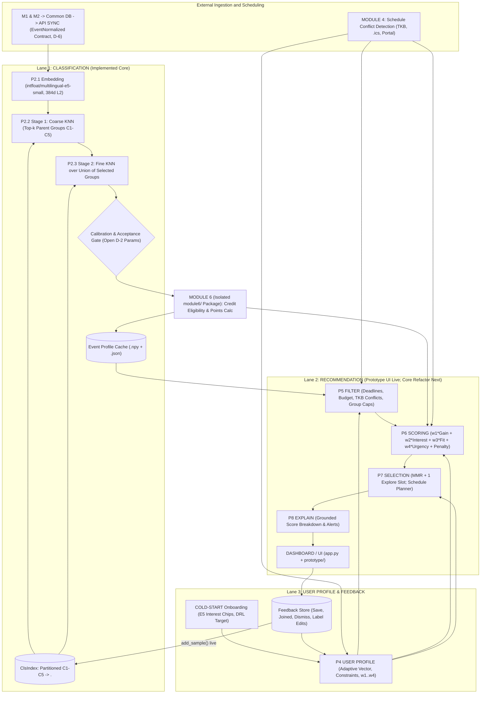

# No-Le-DRL — Module 3 (Classification & Recommendation Engine)

> [!NOTE]
> **Current Project State (`module-3` branch)**: Core **Classification (`P2`)**, **Event Profile Cache**, an isolated replaceable **Module 6 (`module6/`)** credit engine, canonical **Data Contracts (`src/schemas.py`)**, offline **Data Preparation Scripts (`scripts/`)**, and an **Interactive Web Prototype (`app.py` + `prototype/`)** are implemented and verified (**42/42 tests passing**), with live **`intfloat/multilingual-e5-small`** (`384d` L2-normalized) support inside `.venv`. Production **Recommendation & Scheduling modules (`P4`–`P8` in `src/recommender.py`)**, full-dataset **validation experiments (`D-2` hyperparameter tuning)**, and **external sibling module integrations (`M1/M2`, `M4`, `M5`, `M7`)** are next on the roadmap.

---

## 1. Project Overview

**No-Le-DRL** (`module-3` branch) implements **Module 3** of a Student Training Score (*Điểm Rèn Luyện* — **ĐRL**) activity classification and personalized recommendation engine for **University of Science, VNU-HCM (HCMUS)** (*Trường Đại học Khoa học Tự nhiên, ĐHQG-HCM*).

The scoring specification follows **Decision No. `1028/QĐ-KHTN-CTSV`** (04/09/2020, encoded in [`data/raw/rubric.yaml`](data/raw/rubric.yaml) from [`res/drl2025.md`](res/drl2025.md) / [`res/drl2025.pdf`](res/drl2025.pdf)), used as the MVP baseline for this Computational Thinking project.

### Key Architectural Decisions Locked (`docs/module3_decision_log.md`)
- **`D-1` & `D-2` (Two-Stage Hierarchical KNN Classifier)**:
  - **`P2.1`**: Encode normalized event text with **`intfloat/multilingual-e5-small`** (`query:` / `passage:` prefixes, `384d`, L2-normalized).
  - **`P2.2` (Stage 1 — Coarse Parent Groups)**: KNN over parent groups (`C1`–`C5`) selects the `Top-k` candidate parent groups (without choosing a final item).
  - **`P2.3` (Stage 2 — Fine-Grained Multi-Group Union)**: Retrieves the fine-grained dataset for **every** selected Stage 1 parent group and runs the second KNN over their **union** to predict a canonical `<major>.<minor>` rubric item ID alongside its parent group.
  - Strictly preserves distinct `stage1_scores` and `stage2_scores`, never blindly multiplies `stage1 * stage2`, and never labels raw KNN scores as calibrated probabilities until calibration is fitted and validated.
  - All numerical tuning parameters (`stage1_top_k`, `stage1_min_score_threshold`, `stage1_neighbors`, `stage2_neighbors`, `stage2_aggregation_strategy`, `calibration_method`, `acceptance_threshold`, `rejection_policy`) remain open in `HierarchicalKNNConfig` until validated on the full dataset.
- **`D-3` & `D-4` (Classification vs. Credit Eligibility Boundary)**:
  - Module 3 (`src/classifier.py`) **only classifies rubric items**.
  - **Module 6** owns all DRL credit eligibility checks, point calculations, group caps (`30/20/25/25/30`), penalties (`P`), floor (`0`), total cap (`100`), and shortfalls. It is isolated in a dedicated replaceable package [`module6/`](module6/README.md) behind `CreditCalculatorProtocol`.
- **`D-5` (Multi-Criteria Scoring Weights)**: Uses **4 weights `w1..w4`** with additive unweighted `Penalty`: `Score = w1·Gain + w2·Interest + w3·Fit + w4·Urgency + Penalty`.
- **`D-6` (Upstream Normalization Boundary)**: Upstream **M1 & M2** own crawling, normalization, and missing-field handling; Module 3 consumes the normalized `EventNormalized` contract.
- **`T-1`–`T-5` (Taxonomy Decisions)**:
  - Full 51-item rubric taxonomy supported data-driven (`events_full.csv` is currently a demo seed while awaiting the full labeled dataset).
  - Group `P` (`6.4` mandatory civic week) and `NONE` / `UNKNOWN` filtering are handled upstream by **Module 1**.
  - Canonical item IDs use `<major>.<minor>` format (e.g., `1.6`, `1.7`, `3.5`).

---

## 2. Architecture Overview

The system architecture is documented in [`module3_engine_flowchart.drawio.svg`](module3_engine_flowchart.drawio.svg) and consists of three internal Module 3 lanes connected to five external modules:



---

## 3. Project Structure

```text
No-Le-DRL/
├── README.md                                     # Project documentation (this file)
├── .gitignore                                    # Ignores venvs, caches, .npy binaries, logs, IDE junk
├── pyproject.toml                                # Python packaging & optional extras ([ml], [opt], [api], [dev])
├── requirements.txt                              # Quick-install core requirements
├── app.py                                        # Interactive prototype web server & REST API (stdlib HTTP)
├── module3_engine_flowchart.drawio.svg           # System architecture flowchart
├── configs/
│   ├── __init__.py
│   └── model_config.py                           # E5 model constants, repo paths, open D-2 HierarchicalKNNConfig
├── src/
│   ├── __init__.py
│   ├── schemas.py                                # Typed contracts (EventNormalized, ClassificationResult, ScoringWeights, ...)
│   ├── contract_validator.py                     # Boundary & D-2/T-4/rubric.yaml integrity validators
│   ├── vector_ops.py                             # L2 norm, cosine similarity, standard NumPy .npy v1.0 I/O
│   ├── embedder.py                               # E5Embedder (e5-small offline-first) + HashingDemoEmbedder + factory
│   ├── cls_index.py                              # Data-driven partitioned HierarchicalClsIndex (.npy + .json)
│   ├── classifier.py                             # TwoStageHierarchicalKNNClassifier (P2.1 -> P2.2 -> P2.3 union)
│   ├── event_cache.py                            # EventProfileCache (384d vectors + P2 labels + Module 6 points)
│   └── recommender.py                            # Placeholder for Phase 4-6 production recommender modules
├── module6/                                      # Isolated, replaceable Module 6 credit engine (D-3 / D-4)
│   ├── README.md                                 # Swap-out contract instructions
│   ├── __init__.py
│   ├── interface.py                              # CreditCalculatorProtocol, UserLedger, LedgerEvaluation
│   ├── attribute_extractor.py                    # Refactored level/role/duration/explicit_points extractors
│   └── credit_engine.py                          # Deterministic RubricCreditEngine backed by data/raw/rubric.yaml
├── prototype/                                    # Interactive 4-tab UI prototype
│   ├── index.html                                # Dashboard, P7 Planner, Live P2 Inspector, Profile & Feedback
│   ├── styles.css                                # Flat teal/slate responsive design system
│   └── app.js                                    # Frontend controller connected to app.py REST endpoints
├── scripts/
│   ├── __init__.py
│   ├── prepare_test_fixtures.py                  # Offline adapter: data/events.json (108 events) -> EventNormalized
│   └── prepare_cls_dataset.py                    # Data-driven hierarchical C1-C5 dataset builder (leakage-checked)
├── tests/
│   ├── test_config_and_env.py                    # Stage 0 packaging & open D-2 slot tests
│   ├── test_schemas.py                           # Stage 1 canonical IDs & contract invariant tests
│   ├── test_data_validation.py                   # 108-event fixture, zero-leakage split & 51-item rubric tests
│   ├── test_classifier.py                        # Stage 2B two-stage union KNN, persistence & cache tests
│   ├── test_module6_credit_engine.py             # Stage 2A rubric arithmetic, caps, penalties & exclusivity tests
│   └── test_prototype_api.py                     # Embedder factory & interactive prototype API tests
├── docs/
│   ├── module3_decision_log.md                   # Approved architectural & taxonomy decisions (D-1..D-6, T-1..T-5)
│   ├── module3_audit_validation.md               # Audit validation & risk registry
│   └── module3_implementation_roadmap.md         # Phased implementation roadmap & QA plan
├── data/
│   ├── events.json                               # 108 real HCMUS event snapshots (Facebook/Email)
│   ├── raw/
│   │   ├── rubric.yaml                           # Machine-readable HCMUS DRL rubric (51 items, v3.1-mvp)
│   │   └── events_dataset.csv                    # Raw flat demo CSV (152 rows)
│   └── processed/                                # Generated caches & demo hierarchical datasets
└── res/
    ├── drl2025.md / drl2025.pdf                  # Source HCMUS QĐ 1028/QĐ-KHTN-CTSV regulation
    ├── events_full.csv                           # Extended demo CSV (153 rows with Organizer & Vai_Tro)
    └── keyword_rules.py / keyword_rules.yaml     # Legacy v1 Tier-0 draft rule engine (kept for reference)
```

---

## 4. Implementation Status

| Component / Flowchart Node | Location | Status | Notes |
| :--- | :--- | :--- | :--- |
| **Contracts & Validation (`D-6`, `T-4`)** | [`src/schemas.py`](src/schemas.py), [`src/contract_validator.py`](src/contract_validator.py) | **Implemented** | Enforces `<major>.<minor>` IDs, `D-2` invariants, `D-5` 4 weights, and 51-item `rubric.yaml` validation. |
| **`P2.1` Embedding (`e5-small`, 384d L2)** | [`src/embedder.py`](src/embedder.py), [`src/vector_ops.py`](src/vector_ops.py) | **Implemented** | Uses `intfloat/multilingual-e5-small` (loads cached local HF snapshot offline-first in ~4s; ~18–20ms/query on CPU). |
| **`DATA · LOCAL — ClsIndex`** | [`src/cls_index.py`](src/cls_index.py), [`scripts/prepare_cls_dataset.py`](scripts/prepare_cls_dataset.py) | **Implemented (Demo Data)** | Data-driven `C1–C5` partitioned index (`145` clean demo samples, zero eval leakage); ready for full dataset drop-in. |
| **`P2.2`, `P2.3`, Calibration Gate** | [`src/classifier.py`](src/classifier.py) | **Implemented (Tuning Pending)** | Two-stage hierarchical union KNN verified; open `D-2` hyperparameters & calibrator await full-dataset validation. |
| **`DATA · CACHE — Event Profile Cache`** | [`src/event_cache.py`](src/event_cache.py) | **Implemented** | Standard `.npy` float32 + `.json` persistence with P2 labels and Module 6 expected points. |
| **`MODULE 6` — Credit Calc & Evaluation** | [`module6/`](module6/README.md) | **Implemented (Replaceable)** | Isolated behind `CreditCalculatorProtocol`; supports caps `30/20/25/25/30`, floor `0`, max `100`, penalties, roles, duration, `exclusive_with`. |
| **`DASHBOARD / UI` Prototype** | [`app.py`](app.py), [`prototype/`](prototype/) | **Prototype Live** | 4 interactive tabs wired to real `P2`, `e5-small`, `module6/`, and 108 HCMUS events (incl. live `label_correction` → `ClsIndex`). |
| **`P4`–`P8` Production Engine (`src/`)** | [`src/recommender.py`](src/recommender.py) | **Next (Stage 3)** | Currently simulated inside `app.py`; planned to be extracted into `src/user_profile.py`, `src/filter.py`, `src/scoring.py`, `src/selector.py`, `src/planner.py` (CP-SAT), `src/explainer.py`. |
| **External Modules (`M1/M2`, `M4`, `M5`, `M7`)** | *(External repos / teams)* | **Not in Repo** | Isolated via `EventNormalized` contract (`D-6`) and adapter protocols. |

---

## 5. Installation & Setup

### 1. Create a Virtual Environment & Install Dependencies

```bash
python3 -m venv .venv
source .venv/bin/activate
pip install --upgrade pip

# Core + dev tests (PyYAML, numpy, pytest)
pip install -e ".[dev]"

# Full ML stack to run real `intfloat/multilingual-e5-small` (P2.1)
pip install -e ".[ml,dev]"
```

*(Optional extras available in `pyproject.toml`: `[opt]` for OR-Tools CP-SAT, `[api]` for FastAPI/Uvicorn, or `[all]` for everything.)*

### 2. Prepare Offline Demo Datasets & Fixtures

```bash
# Convert data/events.json (108 events) -> EventNormalized offline fixtures
.venv/bin/python -m scripts.prepare_test_fixtures

# Build partitioned C1-C5 hierarchical demo dataset (0 label conflicts, 0 eval leakage)
.venv/bin/python -m scripts.prepare_cls_dataset
```

When the full labeled dataset arrives later, rebuild without code changes:

```bash
.venv/bin/python -m scripts.prepare_cls_dataset \
  --input path/to/full_dataset.csv \
  --stage full \
  --output data/processed/cls_index/hierarchical_dataset_full.json
```

---

## 6. Running the Interactive Prototype & Tests

### Launch the Prototype Web UI (with `intfloat/multilingual-e5-small`)

```bash
.venv/bin/python app.py --host 127.0.0.1 --port 8765 --require-e5
```

Open **http://127.0.0.1:8765** in your browser to explore:
1. **Recommendations Dashboard (`Gợi ý ĐRL`)**: Live `C1–C5` DRL cap tracking, `w1..w4` weight sliders, `P5` filter toggles, `P7` MMR + Exploration Slot, `P8` explanations, `"Why not?"` drop diagnostics, and live `Save / Joined / Dismiss / Edit Label` actions.
2. **Schedule Planner (`Lập kế hoạch P7`)**: Conflict-free, cap-respecting plan against a mock weekly timetable (`Module 4`).
3. **Live P2 Classifier Inspector (`Thử phân loại P2`)**: Step-by-step trace of `P2.1 e5-small` → `P2.2 Stage 1` → `P2.3 Stage 2 Union` → `Module 6` with tunable `D-2` experimental parameters.
4. **Profile & Feedback Store (`Hồ sơ & Feedback`)**: Cold-start E5 interest chips and real-time feedback/label-correction log.

*(Without `[ml]` installed, run `python3 app.py` to launch using the deterministic zero-dependency `HashingDemoEmbedder` fallback.)*

### Run the Test Suite

```bash
# Using standard library unittest
.venv/bin/python -m unittest discover -s tests -v

# Or using pytest
.venv/bin/pytest
```

---

## 7. Roadmap & Next Steps

See [`docs/module3_implementation_roadmap.md`](docs/module3_implementation_roadmap.md) for the detailed plan:
1. **Stage 3 (`P4`–`P8`)**: Extract production user profiling, hard filtering, `w1..w4` scoring, MMR + OR-Tools CP-SAT schedule planner, grounded explainer, and an isolated `module4/` timetable adapter.
2. **Stage 4 (Validation on Full Dataset)**: Run `eval/run_p2_validation.py` once the full labeled dataset is ready to empirically lock `D-2` parameters (`Top-k`, thresholds, Stage 2 aggregation, calibration, and inter-stage error analysis) and update [`module3_engine_flowchart.drawio.svg`](module3_engine_flowchart.drawio.svg).
3. **Stage 5 (Integrations)**: Connect persistent `Feedback Store`, `API SYNC` (`Common DB`), `Module 4`, `Module 5`, `Module 7`, and swap `module6/` with the final Module 6 implementation.
