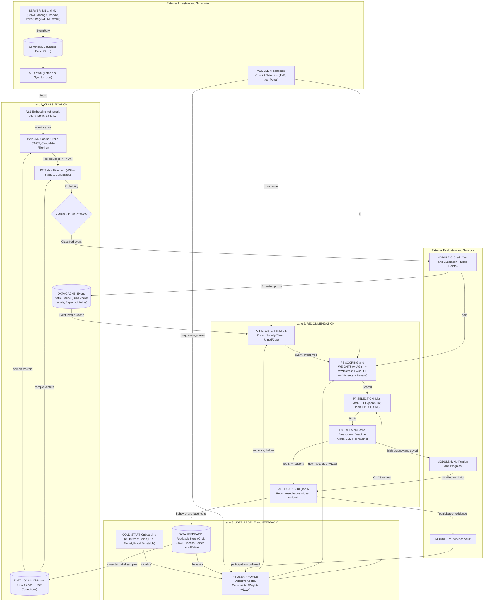

# No-Le-DRL — Module 3 (Classification & Recommendation Engine)

> [!IMPORTANT]
> **Current Project State**: This repository (branch `module-3`) is currently in an **early scaffolding, specification, and seed-data stage**. None of the core Module 3 components defined in [`module3_engine_flowchart.drawio.svg`](file:///Users/Apple/Documents/Computational%20Thinking/No-Le-DRL/module3_engine_flowchart.drawio.svg) are fully implemented: [`src/classifier.py`](file:///Users/Apple/Documents/Computational%20Thinking/No-Le-DRL/src/classifier.py), [`src/recommender.py`](file:///Users/Apple/Documents/Computational%20Thinking/No-Le-DRL/src/recommender.py), and all four files in `data/processed/` are empty (`0` bytes). The only executable Python implementation currently in the repository is [`res/keyword_rules.py`](file:///Users/Apple/Documents/Computational%20Thinking/No-Le-DRL/res/keyword_rules.py) (backed by [`res/keyword_rules.yaml`](file:///Users/Apple/Documents/Computational%20Thinking/No-Le-DRL/res/keyword_rules.yaml)), a standalone draft Tier-0 rule-based classifier and attribute extractor that is **not depicted in the flowchart** and **not integrated into `src/`**.

---

## 1. Project Overview

**No-Le-DRL** (`module-3` branch) is the workspace for **Module 3** of a Student Training Score (*Điểm Rèn Luyện* — **ĐRL**) activity classification and personalized recommendation system tailored to **University of Science, VNU-HCM (HCMUS)** (*Trường Đại học Khoa học Tự nhiên, ĐHQG-HCM*).

The scoring framework is structured around **Decision No. `1028/QĐ-KHTN-CTSV`** (dated `04/9/2020`, documented in [`res/drl2025.md`](file:///Users/Apple/Documents/Computational%20Thinking/No-Le-DRL/res/drl2025.md) and [`res/drl2025.pdf`](file:///Users/Apple/Documents/Computational%20Thinking/No-Le-DRL/res/drl2025.pdf)). According to [`data/raw/rubric.yaml`](file:///Users/Apple/Documents/Computational%20Thinking/No-Le-DRL/data/raw/rubric.yaml), that 2020 regulation is marked `validity.state: expired` and is used specifically as the MVP baseline for this Computational Thinking project.

As of the current working tree:
- **Design & Data Assets Present**: An architectural flowchart ([`module3_engine_flowchart.drawio.svg`](file:///Users/Apple/Documents/Computational%20Thinking/No-Le-DRL/module3_engine_flowchart.drawio.svg)), a comprehensive machine-readable ĐRL rubric ([`data/raw/rubric.yaml`](file:///Users/Apple/Documents/Computational%20Thinking/No-Le-DRL/data/raw/rubric.yaml)), labeled HCMUS activity seed datasets ([`data/raw/events_dataset.csv`](file:///Users/Apple/Documents/Computational%20Thinking/No-Le-DRL/data/raw/events_dataset.csv), [`res/events_full.csv`](file:///Users/Apple/Documents/Computational%20Thinking/No-Le-DRL/res/events_full.csv)), a static snapshot of 108 pre-extracted events ([`data/events.json`](file:///Users/Apple/Documents/Computational%20Thinking/No-Le-DRL/data/events.json)), and embedding configuration constants ([`configs/model_config.py`](file:///Users/Apple/Documents/Computational%20Thinking/No-Le-DRL/configs/model_config.py)).
- **Standalone Prototype Code Present**: A draft Tier-0 keyword scoring and attribute extraction engine ([`res/keyword_rules.py`](file:///Users/Apple/Documents/Computational%20Thinking/No-Le-DRL/res/keyword_rules.py) + [`res/keyword_rules.yaml`](file:///Users/Apple/Documents/Computational%20Thinking/No-Le-DRL/res/keyword_rules.yaml)).
- **Core Module 3 Code Missing**: The intended embedding/kNN classifier (`P2`), user profile & feedback loop (`P4`, `COLD-START`, `Feedback Store`), multi-criteria recommendation & schedule optimization pipeline (`P5`–`P8`), UI (`DASHBOARD / UI`), and external module integrations (`M1 & M2`, `API SYNC`, `Module 4`, `Module 5`, `Module 6` engine, `Module 7`) are **not yet implemented** in code on this branch.

---

## 2. Module 3 Architecture

The intended architecture defined in [`module3_engine_flowchart.drawio.svg`](file:///Users/Apple/Documents/Computational%20Thinking/No-Le-DRL/module3_engine_flowchart.drawio.svg) (diagram ID `module3-engine-flowchart`) consists of **three internal Module 3 lanes** interacting with **five external modules** and **three local data stores**.

### Intended Architecture (per `module3_engine_flowchart.drawio.svg`)



### Component Breakdown by Lane

1. **Classification (`CLASSIFICATION`)**:
   - **`DATA · LOCAL — ClsIndex (Mẫu KNN)`**: Holds reference sample vectors (`vector mẫu`) from raw CSV seed records and user label corrections (`Mẫu user sửa nhãn`), supplying reference vectors to both `P2.2` and `P2.3`.
   - **`P2.1 Embedding`**: Encodes incoming events using `e5-small` (`query:` prefix) into L2-normalized 384-dimensional vectors (`event vector`).
   - **`P2.2 kNN Mục lớn`**: Performs coarse kNN classification across high-level groups `C1–C5` and filters candidate groups above ~40% probability (`Top nhóm (P > ~40%)`).
   - **`P2.3 kNN Mục nhỏ`**: Performs fine-grained kNN sub-item classification restricted to the candidate groups from `P2.2`.
   - **`Pmax ≥ 0.70` Decision Gate**: Accepts automated classification if maximum probability is at least `0.70` (`<0.70: chờ duyệt` / pending approval); routes classified events to `Module 6`.
   - **`DATA · CACHE — Event Profile Cache`**: Caches 384d E5 vectors, coarse/fine labels, and expected ĐRL points (`điểm dự kiến` from `Module 6`), feeding `P5`.
2. **Recommendation (`RECOMMENDATION`)**:
   - **`P5 · FILTER`**: Enforces hard constraints using `Event Profile Cache`, `P4` (`đối tượng, ẩn`), and `Module 4` (`busy, travel`): registration deadline/capacity, cohort/faculty/class eligibility, prior participation, and group point caps.
   - **`P6 · SCORING & WEIGHTS`**: Multi-criteria scoring formula `Score = w₁·Gain + w₂·Interest + w₃·Fit + w₄·Urgency + Penalty`, using `Gain` (`Module 6`), `Interest` (E5 cosine similarity with `user_vec`), `Fit` (`Module 4`), `Urgency`, and `Penalty`, weighted via `P4`.
   - **`P7 · SELECTION`**: Splits into list selection (`MMR + 1 slot khám phá` — Maximal Marginal Relevance plus 1 exploration slot) and conflict-free schedule planning (`LP / CP-SAT`) aligned with `C1–C5` targets from `P4`.
   - **`P8 · EXPLAIN`**: Generates score-component breakdowns from templates, deadline warnings, and LLM-rephrased explanations (`Top-N + lý do`); sends saved high-urgency items to `Module 5`.
   - **`DASHBOARD / UI`**: Renders Top-N suggestions, explanations, and reminders (`Module 5`); emits user interaction events (`Click, Lưu, Bỏ qua, Sửa nhãn, Đã tham gia`) to `Feedback Store` and evidence uploads to `Module 7`.
3. **User Profile & Feedback (`USER PROFILE & FEEDBACK`)**:
   - **`COLD-START — Onboarding`**: Captures E5 interest chips, ĐRL target, cohort/faculty, and Portal timetable to initialize `P4`.
   - **`P4 · USER PROFILE`**: Maintains the adaptive interest vector (`preset + saved/participated − dismissed`), profile constraints/overrides, and adaptive weights `w₁..w₄` (`Preset + Shortfall (M6) + Schedule (M4)`).
   - **`DATA · FEEDBACK — Feedback Store`**: Stores user behavioral signals and label corrections; closes the reinforcement/learning loop to `P4` (`hành vi`) and `ClsIndex` (`mẫu sửa nhãn`).
4. **External Modules (Outside Module 3 Core)**:
   - **`SERVER (M1 & M2)` + `Common DB` + `API SYNC`**: Crawls events (Fanpage, Moodle, Portal), extracts entities (Regex/LLM), writes `EventRaw` to `Common DB`, and syncs locally to `P2.1`.
   - **`MODULE 4` (Schedule Conflict Detection)**: Reads TKB, `.ics`, and Portal schedules; outputs `busy`, `travel`, `fit`, and `exam_weeks`.
   - **`MODULE 6` (Credit Calc & Evaluation)**: Computes expected rubric points (`điểm dự kiến`, `gain`) and shortfall context referenced by `P4`.
   - **`MODULE 5` (Notification & Progress)**: Tracks ĐRL goal progress and triggers deadline/saved-event reminders on the UI.
   - **`MODULE 7` (Evidence Vault)**: Stores participation proof and confirms event completion back to `P4`.

---

## 3. Project Structure

Every file currently present in the `module-3` working tree is listed below with its verified role and size:

```text
No-Le-DRL/
├── .gitignore                              # Ignores __pycache__, .venv/venv, .env, huggingface_cache/, models/, checkpoints/, outputs/, logs/
├── README.md                               # This documentation file
├── module3_engine_flowchart.drawio.svg     # Primary Module 3 architecture & execution flowchart (untracked in Git)
├── configs/
│   └── model_config.py                     # 5 lines: MODEL_ID="intfloat/multilingual-e5-small", MODEL_DEVICE="cpu", EMBEDDING_DIMENSION=384
├── data/
│   ├── events.json                         # 4,405 lines (108 event records: 104 facebook, 4 email; 102 gemini_batch, 6 heuristic)
│   ├── processed/
│   │   ├── event_embeddings.npy            # 0 bytes (empty placeholder)
│   │   ├── event_metadata.json             # 0 bytes (empty placeholder)
│   │   ├── rubric_embeddings.npy           # 0 bytes (empty placeholder)
│   │   └── rubric_prototypes.json          # 0 bytes (empty placeholder)
│   └── raw/
│       ├── events_dataset.csv              # 153 lines (header + 152 rows: Ten_Hoat_Dong, Ma_Muc; 26 unique Ma_Muc codes)
│       └── rubric.yaml                     # 1,335 lines: HCMUS ĐRL rubric specification (version khtn-qd1028-2020-v3.1-mvp)
├── docs/
│   ├── module3_audit_validation.md         # Deep audit validation, empirical metrics, technical risks, and open decisions
│   └── module3_implementation_roadmap.md   # Dependency-driven phased implementation roadmap and QA strategy
├── res/
│   ├── drl2025.md                          # 425 lines: Markdown text of QĐ 1028/QĐ-KHTN-CTSV (04/9/2020)
│   ├── drl2025.pdf                         # Source PDF of QĐ 1028/QĐ-KHTN-CTSV (343 KB)
│   ├── events_full.csv                     # 154 lines (header + 153 rows: extended columns incl. Organizer, Vai_Tro, Diem_Toi_Da)
│   ├── keyword_rules.py                    # 155 lines: Standalone Tier-0 keyword classifier & heuristic attribute extractor
│   └── keyword_rules.yaml                  # 608 lines: Draft keyword ruleset (version kw-v1, rubric_version khtn-qd1028-2020-v3-mvp)
└── src/
    ├── classifier.py                       # 0 bytes (empty placeholder)
    └── recommender.py                      # 0 bytes (empty placeholder)
```

*(Note: `git status` also shows `Module3_Classification_Recommendation_Design.md` as unstaged-deleted in the working tree. That `1,140`-line file in `HEAD` documents the earlier **v1 3-tier cascade design** from which `res/keyword_rules.py` and `data/processed/rubric_prototypes.json` originated, before the newer v2 `module3_engine_flowchart.drawio.svg` architecture.)*

---

## 4. Implementation Status

Status classifications follow strict evidence-based criteria:
- **Implemented**: Fully implemented and supported by actual source code.
- **Partially Implemented**: Some supporting artifacts, data, or partial code exist, but core execution logic is incomplete.
- **Not Implemented**: No corresponding implementation exists in the codebase.
- **Unclear / Needs Verification**: Cannot be confirmed from this Git repository (e.g., external repositories outside `origin/main`, `origin/module-2`, and `module-3`).

### Flowchart Component Assessment

| Flowchart Area / Node | Corresponding File(s) & Symbol(s) | Existing Implementation Summary | Status | Missing Functionality / Discrepancies |
| :--- | :--- | :--- | :--- | :--- |
| **DATA · LOCAL — `ClsIndex (Mẫu KNN)`** | [`data/raw/events_dataset.csv`](file:///Users/Apple/Documents/Computational%20Thinking/No-Le-DRL/data/raw/events_dataset.csv), [`res/events_full.csv`](file:///Users/Apple/Documents/Computational%20Thinking/No-Le-DRL/res/events_full.csv), [`data/processed/rubric_embeddings.npy`](file:///Users/Apple/Documents/Computational%20Thinking/No-Le-DRL/data/processed/rubric_embeddings.npy), [`data/processed/rubric_prototypes.json`](file:///Users/Apple/Documents/Computational%20Thinking/No-Le-DRL/data/processed/rubric_prototypes.json) | Seed labeled datasets exist (`152` rows in `events_dataset.csv`, `153` rows in `events_full.csv`, across `26` unique `Ma_Muc` codes). Processed embedding/prototype artifacts are `0`-byte empty files. | **Partially Implemented** | No vector index builder, stored sample vectors, or user-correction loop; `10` of `21` `event_matchable` codes have `0` rows while `15` non-`event_matchable` codes are included; `events_dataset.csv` has `5` identical normalized titles with conflicting labels (`1.6`/`1.7`, `3.5`/`3.14`, `4.3`/`4.4`) and `8` overlapping titles with `data/events.json`. |
| **`P2.1` — Embedding (`e5-small`, `query:`, 384d L2)** | [`configs/model_config.py`](file:///Users/Apple/Documents/Computational%20Thinking/No-Le-DRL/configs/model_config.py) (`MODEL_ID`, `MODEL_DEVICE`, `EMBEDDING_DIMENSION`), [`src/classifier.py`](file:///Users/Apple/Documents/Computational%20Thinking/No-Le-DRL/src/classifier.py) | Only 3 static constants exist (`"intfloat/multilingual-e5-small"`, `"cpu"`, `384`). [`src/classifier.py`](file:///Users/Apple/Documents/Computational%20Thinking/No-Le-DRL/src/classifier.py) is `0` bytes. | **Not Implemented** | No model loader, no text formatting with `query:` prefix, no embedding inference, and no L2 normalization. |
| **`P2.2` — kNN Mục lớn (`C1–C5`, `P > ~40%`)** | [`src/classifier.py`](file:///Users/Apple/Documents/Computational%20Thinking/No-Le-DRL/src/classifier.py) | File is empty (`0` bytes). | **Not Implemented** | No coarse kNN group classifier, probability calibration, or `~40%` candidate group filter. |
| **`P2.3` — kNN Mục nhỏ** | [`src/classifier.py`](file:///Users/Apple/Documents/Computational%20Thinking/No-Le-DRL/src/classifier.py) | File is empty (`0` bytes). | **Not Implemented** | No Stage-2 fine-grained kNN classifier constrained to Stage-1 candidate groups. |
| **Decision Gate: `Pmax ≥ 0.70` (`<0.70: chờ duyệt`)** | [`src/classifier.py`](file:///Users/Apple/Documents/Computational%20Thinking/No-Le-DRL/src/classifier.py) | File is empty (`0` bytes). (Note: [`res/keyword_rules.py`](file:///Users/Apple/Documents/Computational%20Thinking/No-Le-DRL/res/keyword_rules.py) has an unrelated rule-score margin `status="review"` flag.) | **Not Implemented** | No probability threshold gate (`0.70`), no pending-review queue/workflow. |
| **DATA · CACHE — `Event Profile Cache`** | [`data/processed/event_embeddings.npy`](file:///Users/Apple/Documents/Computational%20Thinking/No-Le-DRL/data/processed/event_embeddings.npy), [`data/processed/event_metadata.json`](file:///Users/Apple/Documents/Computational%20Thinking/No-Le-DRL/data/processed/event_metadata.json) | Both files exist only as `0`-byte placeholders. | **Not Implemented** | No cached E5 vectors, assigned labels, or expected ĐRL points. |
| **`P5 · FILTER` — Hard Constraint Filtering** | [`src/recommender.py`](file:///Users/Apple/Documents/Computational%20Thinking/No-Le-DRL/src/recommender.py) | File is empty (`0` bytes). | **Not Implemented** | No filtering for expired deadlines/capacity, cohort/faculty/class mismatch, prior participation, or group caps. |
| **`P6 · SCORING & WEIGHTS` — Multi-Criteria Scoring** | [`src/recommender.py`](file:///Users/Apple/Documents/Computational%20Thinking/No-Le-DRL/src/recommender.py) | File is empty (`0` bytes). | **Not Implemented** | No implementation of `w₁·Gain + w₂·Interest + w₃·Fit + w₄·Urgency + Penalty`. |
| **`P7 · SELECTION` — List Selection (`MMR + 1 slot khám phá`)** | [`src/recommender.py`](file:///Users/Apple/Documents/Computational%20Thinking/No-Le-DRL/src/recommender.py) | File is empty (`0` bytes). | **Not Implemented** | No Maximal Marginal Relevance re-ranking or exploration slot logic. |
| **`P7 · SELECTION` — Schedule Planning (`LP / CP-SAT`)** | [`src/recommender.py`](file:///Users/Apple/Documents/Computational%20Thinking/No-Le-DRL/src/recommender.py) | File is empty (`0` bytes). | **Not Implemented** | No LP/CP-SAT optimization solver for conflict-free scheduling to meet ĐRL targets. |
| **`P8 · EXPLAIN` — Explanations & Alerts** | *(No corresponding file)* | None found. | **Not Implemented** | No score-breakdown templates, near-deadline warning generator, or LLM rephrasing. |
| **`DASHBOARD / UI` — User Interface** | *(No corresponding file)* | None found. | **Not Implemented** | No UI or API endpoints to present Top-N items or capture `Click/Lưu/Bỏ qua/Sửa nhãn/Đã tham gia`. |
| **`COLD-START` — Onboarding** | *(No corresponding file)* | None found. | **Not Implemented** | No onboarding flow for E5 interest chips, ĐRL target, cohort/faculty, or Portal timetable import. |
| **`P4 · USER PROFILE` — Adaptive User Profile** | *(No corresponding file)* | None found. | **Not Implemented** | No user embedding updates, profile constraints/overrides, or adaptive `w₁..w₄` weight computation. |
| **DATA · FEEDBACK — `Feedback Store`** | *(No corresponding file)* | None found. | **Not Implemented** | No persistence for user interactions (`click`, `save`, `dismiss`, `joined`) or user label corrections. |
| **`MODULE 6` — Credit Calc & Evaluation** | [`data/raw/rubric.yaml`](file:///Users/Apple/Documents/Computational%20Thinking/No-Le-DRL/data/raw/rubric.yaml), [`res/drl2025.md`](file:///Users/Apple/Documents/Computational%20Thinking/No-Le-DRL/res/drl2025.md), [`res/drl2025.pdf`](file:///Users/Apple/Documents/Computational%20Thinking/No-Le-DRL/res/drl2025.pdf), [`res/keyword_rules.py`](file:///Users/Apple/Documents/Computational%20Thinking/No-Le-DRL/res/keyword_rules.py) (`level`, `role`, `duration`, `explicit_points`) | Complete machine-readable rubric (`51` items, `0` internal schema errors, group caps `30/20/25/25/30`, floor `0`, total max `100`, baseline `50` pts, `level_buckets`, `exclusive_with`) plus draft regex/keyword fallback extractors in `res/keyword_rules.py`. | **Partially Implemented** | No Python evaluator exists to compute actual/expected points (`Gain`), enforce group caps/exclusivity/penalties, or calculate user shortfalls; `KeywordRules.duration()` emits keys incompatible with `rubric.yaml`'s `24h_to_lt_1w` bucket. |
| **`SERVER (M1 & M2)` & `Common DB`** | [`data/events.json`](file:///Users/Apple/Documents/Computational%20Thinking/No-Le-DRL/data/events.json) | Static snapshot of `108` extracted events (`104` `facebook`, `4` `email`; `102` `gemini_batch`, `6` `heuristic`; all `is_event: true`). | **Not Implemented** *(in this Git repo)* / **Unclear / Needs Verification** *(external repos)* | Verified `origin/main` and `origin/module-2` contain only `README.md`; no crawlers, extractors, or Common DB code exist in this Git repo. |
| **`API SYNC` — Fetch from Common DB** | *(No corresponding file)* | None found. | **Not Implemented** | No sync client or API consumer exists in this Git repo. |
| **`MODULE 4` — Schedule Conflict Detection** | *(No corresponding file)* | None found. | **Not Implemented** *(in this Git repo)* / **Unclear / Needs Verification** *(external repos)* | Verified `origin/main` and `origin/module-2` contain only `README.md`; no TKB/`.ics`/Portal parser or `busy`/`travel`/`fit`/`exam_weeks` interface exists in this Git repo. |
| **`MODULE 5` — Notification & Progress** | *(No corresponding file)* | None found. | **Not Implemented** *(in this Git repo)* / **Unclear / Needs Verification** *(external repos)* | Verified `origin/main` and `origin/module-2` contain only `README.md`; no reminder scheduler or goal-progress tracker exists in this Git repo. |
| **`MODULE 7` — Evidence Vault** | *(No corresponding file)* | None found. | **Not Implemented** *(in this Git repo)* / **Unclear / Needs Verification** *(external repos)* | Verified `origin/main` and `origin/module-2` contain only `README.md`; no evidence storage or verification interface exists in this Git repo (also blocked by open question `Q9` in `rubric.yaml`). |

### Implemented Component Outside the Flowchart: Tier-0 Rule Engine

The repository's **only substantive executable Python code** resides in [`res/keyword_rules.py`](file:///Users/Apple/Documents/Computational%20Thinking/No-Le-DRL/res/keyword_rules.py) (155 lines) and [`res/keyword_rules.yaml`](file:///Users/Apple/Documents/Computational%20Thinking/No-Le-DRL/res/keyword_rules.yaml) (608 lines, explicitly marked `status: "draft — cần kiểm thử trên bài đăng thật"`). It implements a deterministic Tier-0 keyword classifier and attribute extractor **not shown in `module3_engine_flowchart.drawio.svg`** and **not imported by `src/`**:

- **Text Normalization** ([`res/keyword_rules.py#L5-L22`](file:///Users/Apple/Documents/Computational%20Thinking/No-Le-DRL/res/keyword_rules.py#L5-L22)): `norm()` (lowercase, `đ -> d`, NFD diacritic stripping, non-alphanumeric cleanup), `light()` (NFC lowercase retaining diacritics for homograph matching), `has_diacritics()`, and `_pad()` (boundary-padded phrase matching).
- **Rule Scoring Engine** (`KeywordRules.score` in [`res/keyword_rules.py#L64-L121`](file:///Users/Apple/Documents/Computational%20Thinking/No-Le-DRL/res/keyword_rules.py#L64-L121)):
  - Scores **22 labels** (20 positive event labels + `P.sinh_hoat_cong_dan` + `NONE`) using tiered weights (`decisive=6.0`, `strong=3.0`, `medium=1.5`, `weak=0.5`), `title_multiplier=1.5`, `combos`, and `negative_penalty=3.0`.
  - Disambiguates Vietnamese unaccented homographs (`homographs`: `hội thảo` vs `hội thao` via diacritics or `context_any`).
  - Applies **9 cross-label adjustment rules** (`adjust_rules`: `A1`–`A9`) and **8 regex-based organizer priors** (`organizer_priors`, scaled by `organizer_prior_scale=1.0`).
  - Clamps label scores to `[0.0, 12.0]`, fires when top score `>= 2.0` (`min_score_to_fire`), computes softmax probabilities (`softmax_beta=1.5`), and flags `status` as `"none"`, `"review"` (when `top1 - top2 < 2.0` across 8 `confusable_pairs` or close runners-up), `"decisive"`, or `"clear"`.
- **Fallback Attribute Extractors** ([`res/keyword_rules.py#L124-L155`](file:///Users/Apple/Documents/Computational%20Thinking/No-Le-DRL/res/keyword_rules.py#L124-L155)):
  - `level(text, organizer="")`: Detects organization scope (`quoc_te` down to `lop`).
  - `role(text)`: Detects `organizer`, `collaborator`, `volunteer`, plus recruitment cues.
  - `duration(text)`: Extracts `gio`/`ngay`/`tuan`/`thang` duration buckets (`lt_24h`, `ambiguous_lt_24h_or_mid`, `ge_1w`, or `ge_1w?` prior). *(Note: `"ambiguous_lt_24h_or_mid"` and `"ge_1w?"` do not match `rubric.yaml`'s `24h_to_lt_1w` key directly without a mapping layer.)*
  - `explicit_points(text)`: Regex extraction of explicitly stated ĐRL point bonuses or negations.
- **Empirical Baseline Validation**: When executed against existing repository data (via JSON-loaded YAML in Python `3.9.6`), `KeywordRules.score()` ran with zero errors and passed homograph checks (`hội thảo` vs `hội thao`), firing on `77/127` (`61%`) in-scope rows of [`res/events_full.csv`](file:///Users/Apple/Documents/Computational%20Thinking/No-Le-DRL/res/events_full.csv) (`44%` Top-1 overall, `73%` precision when fired) and leaving `41/108` (`38%`) events in [`data/events.json`](file:///Users/Apple/Documents/Computational%20Thinking/No-Le-DRL/data/events.json) unclassified (`status="none"`), with a false-positive `NONE` match on `"Watch Party NVIDIA GTC 2026"` (matching `"party"`).

### Important Discrepancies Between Flowchart and Codebase

1. **Classifier Design Mismatch (`P2` vs. `res/` vs. `src/`)**: The flowchart (`v2`) specifies a two-stage `e5-small` + sample kNN pipeline (`P2.1`–`P2.3`, `Pmax ≥ 0.70`) with user-corrected incremental learning. By contrast, `Module3_Classification_Recommendation_Design.md` in `HEAD` (unstaged-deleted) specifies an earlier **v1 3-tier cascade** (`Tier 0` keyword rules -> `Tier 1` rubric-prototype embeddings -> `Tier 2` LLM). Currently, [`src/classifier.py`](file:///Users/Apple/Documents/Computational%20Thinking/No-Le-DRL/src/classifier.py) is empty (`0` bytes), while [`res/keyword_rules.py`](file:///Users/Apple/Documents/Computational%20Thinking/No-Le-DRL/res/keyword_rules.py) implements the standalone Tier-0 v1 rule engine not shown in the flowchart.
2. **Sample-based kNN (`ClsIndex`) vs. Prototype-based Matching**: The flowchart specifies `ClsIndex (Mẫu KNN)` built from CSV samples + user corrections, whereas empty placeholders [`data/processed/rubric_prototypes.json`](file:///Users/Apple/Documents/Computational%20Thinking/No-Le-DRL/data/processed/rubric_prototypes.json) and [`data/processed/rubric_embeddings.npy`](file:///Users/Apple/Documents/Computational%20Thinking/No-Le-DRL/data/processed/rubric_embeddings.npy) along with `anchors` fields in [`data/raw/rubric.yaml`](file:///Users/Apple/Documents/Computational%20Thinking/No-Le-DRL/data/raw/rubric.yaml) reflect the v1 prototype-matching architecture.
3. **Label Taxonomy & Dataset Quality/Coverage Mismatches**:
   - Flowchart `P2.2` describes classifying coarse groups `C1–C5`. However, [`data/raw/rubric.yaml`](file:///Users/Apple/Documents/Computational%20Thinking/No-Le-DRL/data/raw/rubric.yaml) defines **21 `event_matchable: true` labels**: **0** in `C5`, 20 across `C1`–`C4`, plus **1 mandatory penalty item (`P.sinh_hoat_cong_dan`, ref `6.4`)** and `meta_labels.NONE`.
   - [`data/raw/events_dataset.csv`](file:///Users/Apple/Documents/Computational%20Thinking/No-Le-DRL/data/raw/events_dataset.csv) (152 rows) and [`res/events_full.csv`](file:///Users/Apple/Documents/Computational%20Thinking/No-Le-DRL/res/events_full.csv) (153 rows; contains 1 extra `"1.8"` row for `"Thành viên CLB Google Developer Group on Campus - HCMUS"`) cover `26` `Ma_Muc` codes: **`15` of those codes have `event_matchable: false` in `rubric.yaml`** (`1.1`, `1.2`, `1.3`, `1.4`, `1.7`, `1.8`, `2.1`, `3.7`, `3.14`, `4.1`, `4.4`, `4.7`, `5.1`, `5.3`, `6.1`), while **`10` of the `21` `event_matchable` codes are completely absent** (`1.5`, `3.6`, `3.9`, `3.10`, `3.11`, `3.12`, `3.13`, `4.2`, `4.6`, `6.4`).
   - Dropping `Vai_Tro` in `events_dataset.csv` produced **5 identical normalized titles with conflicting `Ma_Muc` labels** (`1.6`/`1.7`, `3.5`/`3.14`, `4.3`/`4.4`), plus `6` exact normalized title duplicates and **`8` titles overlapping with `data/events.json`** (Jaccard `>= 0.5`).
   - Several CSV labels diverge semantically from [`res/drl2025.md#L319`](file:///Users/Apple/Documents/Computational%20Thinking/No-Le-DRL/res/drl2025.md#L319) and `rubric.yaml` (notably `3.5` is defined as class-level `C3.hoat_dong_cap_lop`, yet `37` rows in `events_dataset.csv` under `3.5` are faculty/school/CTSV events; law and cybersecurity quizzes appear under `3.1` or `3.5` rather than `4.6`).
4. **Event Source & Schema Gaps (`M1 & M2` vs. `data/events.json`)**: The flowchart lists `Fanpage, Moodle, Portal` as M1 sources; [`data/events.json`](file:///Users/Apple/Documents/Computational%20Thinking/No-Le-DRL/data/events.json) contains `104` `facebook` and `4` `email` records (matching `sources_in_scope` in `rubric.yaml`), with zero `Moodle` or `Portal` items. In addition, `data/events.json` lacks `event_id`, `capacity`, `seats_left`, `explicit_points`, and `level`; `reg_end_datetime` is `null` in `47/108` events and `> start_datetime` in `16/108` events; `fee` is messy free text (including `1` extracted phrase rather than a fee); `target_audience` is free-text Vietnamese; and `104/108` events start before `2026-11-23`.
5. **Version & Comment Inconsistencies**:
   - [`res/drl2025.md`](file:///Users/Apple/Documents/Computational%20Thinking/No-Le-DRL/res/drl2025.md) and [`res/drl2025.pdf`](file:///Users/Apple/Documents/Computational%20Thinking/No-Le-DRL/res/drl2025.pdf) are named `drl2025`, yet their content is **QĐ 1028/QĐ-KHTN-CTSV (04/9/2020)**, marked `expired` in `rubric.yaml`.
   - [`res/keyword_rules.yaml`](file:///Users/Apple/Documents/Computational%20Thinking/No-Le-DRL/res/keyword_rules.yaml) header references `rubric_version: "khtn-qd1028-2020-v3-mvp"` and states "21 nhãn sự kiện + NONE + P.sinh_hoat_cong_dan" (which would imply 23 labels), whereas [`data/raw/rubric.yaml`](file:///Users/Apple/Documents/Computational%20Thinking/No-Le-DRL/data/raw/rubric.yaml) is `khtn-qd1028-2020-v3.1-mvp` and `keyword_rules.yaml` defines `22` labels (`20` positive + `P.sinh_hoat_cong_dan` + `NONE`).
6. **Internal Flowchart Weight Notation**: Both `P4` and `P6` nodes in the flowchart specify four weights `w₁..w₄` (with `Penalty` unweighted in `Score = w₁·Gain + w₂·Interest + w₃·Fit + w₄·Urgency + Penalty`), while the connector from `P4` to `P6` is labeled `user_vec, tags, w₁..w₅`.
7. **Missing Build/Test Infrastructure**: No `requirements.txt`, `pyproject.toml`, `setup.py`, CLI runner, or automated test suite exists in the repository.

---

## 5. Execution Flow

### Intended End-to-End Flow (Not Yet Implemented)
1. **Event Sync**: `M1 & M2` ingest raw posts into `Common DB`; `API SYNC` pulls events locally into `P2.1`.
2. **Two-Stage Classification (`P2`)**: `P2.1` encodes each event into an L2-normalized 384d `e5-small` vector; `P2.2` ranks coarse groups (`C1–C5`) via kNN against `ClsIndex` and passes top groups (`P > ~40%`) to `P2.3`; `P2.3` selects the fine-grained rubric item. Events with `Pmax ≥ 0.70` proceed automatically to `Module 6`; events `< 0.70` enter a review state.
3. **Credit Evaluation & Caching**: `Module 6` calculates expected ĐRL points from `rubric.yaml` and caches vectors, labels, and points in `Event Profile Cache`.
4. **Recommendation (`P5`–`P8`)**: Triggered against user state in `P4` (initialized via `COLD-START`) and timetable constraints from `Module 4`: `P5` filters hard constraints -> `P6` computes weighted multi-criteria scores -> `P7` selects Top-N (`MMR + 1` exploration slot) and runs `LP / CP-SAT` schedule optimization -> `P8` generates explanations and deadline alerts -> `DASHBOARD / UI` displays results.
5. **Feedback & Verification Loop**: UI interactions update `Feedback Store` (feeding `P4` user preferences and `ClsIndex` label corrections); high-urgency saved events trigger `Module 5` reminders; participation evidence goes to `Module 7`, which confirms completion back to `P4`.

### Current Executable Behavior
- **No end-to-end pipeline runs today** because [`src/classifier.py`](file:///Users/Apple/Documents/Computational%20Thinking/No-Le-DRL/src/classifier.py) and [`src/recommender.py`](file:///Users/Apple/Documents/Computational%20Thinking/No-Le-DRL/src/recommender.py) are empty.
- Only [`res/keyword_rules.py`](file:///Users/Apple/Documents/Computational%20Thinking/No-Le-DRL/res/keyword_rules.py) can be imported directly in Python as a standalone library (`KeywordRules`) to score event title/body/organizer strings and extract heuristic `level`, `role`, `duration`, and `explicit_points` attributes.

---

## 6. Dependencies and Technologies

### Confirmed Dependencies in Existing Python Code
- **Python**: Python 3 (verified syntax check on Python `3.9.6`). Standard library modules used in [`res/keyword_rules.py`](file:///Users/Apple/Documents/Computational%20Thinking/No-Le-DRL/res/keyword_rules.py): `math`, `re`, `unicodedata`.
- **PyYAML** (`import yaml` in [`res/keyword_rules.py#L3`](file:///Users/Apple/Documents/Computational%20Thinking/No-Le-DRL/res/keyword_rules.py#L3)): Required to load [`res/keyword_rules.yaml`](file:///Users/Apple/Documents/Computational%20Thinking/No-Le-DRL/res/keyword_rules.yaml) (and [`data/raw/rubric.yaml`](file:///Users/Apple/Documents/Computational%20Thinking/No-Le-DRL/data/raw/rubric.yaml)).

### Configured / Planned Technologies (Not Yet Imported in Code)
- **Embedding Model** ([`configs/model_config.py`](file:///Users/Apple/Documents/Computational%20Thinking/No-Le-DRL/configs/model_config.py)): `intfloat/multilingual-e5-small` on `cpu`, dimension `384`.
- **Referenced Stack (Not Selected or Implemented in Code)**:
  - `.gitignore` and `data/processed/*.npy` indicate planned use of NumPy arrays and Hugging Face model caches (`huggingface_cache/`).
  - [`module3_engine_flowchart.drawio.svg`](file:///Users/Apple/Documents/Computational%20Thinking/No-Le-DRL/module3_engine_flowchart.drawio.svg) specifies kNN search, MMR diversity re-ranking, LP / CP-SAT optimization, LLM explanation rephrasing (`P8`), and `.ics`/Portal schedule parsing (`Module 4`), though no specific Python packages (e.g., `sentence-transformers`, `torch`, `numpy`, `ortools`, `scipy`) are declared or imported yet.

---

## 7. Installation and Setup

There is currently **no `requirements.txt`, `pyproject.toml`, or setup script** in the repository.

To create a minimal environment capable of loading [`res/keyword_rules.py`](file:///Users/Apple/Documents/Computational%20Thinking/No-Le-DRL/res/keyword_rules.py):

```bash
python3 -m venv .venv
source .venv/bin/activate
pip install pyyaml
```

*(Note: `PyYAML` is the only third-party package imported by any existing Python file in this repository.)*

---

## 8. Build and Run Instructions

There is currently **no runnable application, CLI, build target, or test suite** for Module 3 because [`src/classifier.py`](file:///Users/Apple/Documents/Computational%20Thinking/No-Le-DRL/src/classifier.py) and [`src/recommender.py`](file:///Users/Apple/Documents/Computational%20Thinking/No-Le-DRL/src/recommender.py) are empty.

### 1. Syntax Verification of Existing Python Files
```bash
python3 -m py_compile configs/model_config.py res/keyword_rules.py
```

### 2. Running the Standalone Tier-0 Rule Engine (`res/keyword_rules.py`)
When invoking from the repository root, explicitly pass `path="res/keyword_rules.yaml"` (the default constructor argument `"keyword_rules.yaml"` assumes the working directory is `res/`):

```python
from res.keyword_rules import KeywordRules

rules = KeywordRules(path="res/keyword_rules.yaml")
result = rules.score(
    title="Workshop kỹ năng mềm dành cho sinh viên",
    body="Hội thảo chia sẻ kinh nghiệm học thuật cấp Khoa",
    organizer="Khoa CNTT",
)
print(result["top"], result["status"], result["probs"])
print("Level:", rules.level("Hội thảo cấp Khoa", "Khoa CNTT"))
print("Role:", rules.role("Tuyển cộng tác viên ban tổ chức"))
```

*(Requires `PyYAML` installed in your active Python environment; validated in Python `3.9.6` using a JSON-converted YAML loader because `PyYAML` is not installed in the system Python environment.)*

---

## 9. Known Limitations and TODOs

See [`docs/module3_audit_validation.md`](file:///Users/Apple/Documents/Computational%20Thinking/No-Le-DRL/docs/module3_audit_validation.md) for the complete risk/decision registry and [`docs/module3_implementation_roadmap.md`](file:///Users/Apple/Documents/Computational%20Thinking/No-Le-DRL/docs/module3_implementation_roadmap.md) for the phased build plan:

1. **Core Module 3 Unimplemented**: Implement `P2` classification in [`src/classifier.py`](file:///Users/Apple/Documents/Computational%20Thinking/No-Le-DRL/src/classifier.py) and `P4`–`P8` user profiling, filtering, scoring, selection/planning, and explanation in [`src/recommender.py`](file:///Users/Apple/Documents/Computational%20Thinking/No-Le-DRL/src/recommender.py).
2. **Architecture Alignment Needed**: Reconcile whether Module 3 should use pure two-stage sample-kNN (`ClsIndex`), rubric-prototype matching (`rubric_prototypes.json` + `anchors`), or a hybrid combining Tier-0 [`res/keyword_rules.py`](file:///Users/Apple/Documents/Computational%20Thinking/No-Le-DRL/res/keyword_rules.py) with `multilingual-e5-small` embeddings, and update either the flowchart or code accordingly.
3. **Seed Dataset Cleanup & Expansion**:
   - Curate training/seed samples for all `21` `event_matchable: true` items (especially the `10` currently missing codes: `1.5`, `3.6`, `3.9`–`3.13`, `4.2`, `4.6`, `6.4`, plus `NONE`), remove `5` role-collision title conflicts and `15` non-`event_matchable` codes from `events_dataset.csv`, and deduplicate the `8` overlapping titles against [`data/events.json`](file:///Users/Apple/Documents/Computational%20Thinking/No-Le-DRL/data/events.json).
   - Reconcile the `1`-row difference (`152` vs `153`) between `data/raw/events_dataset.csv` and `res/events_full.csv`, and resolve the `3.5` regulation-vs-practice labeling discrepancy.
   - Replace draft `anchors` in [`data/raw/rubric.yaml`](file:///Users/Apple/Documents/Computational%20Thinking/No-Le-DRL/data/raw/rubric.yaml) and refine draft rules in [`res/keyword_rules.yaml`](file:///Users/Apple/Documents/Computational%20Thinking/No-Le-DRL/res/keyword_rules.yaml) (including `"party"` false positive and `duration()` bucket mapping).
4. **Event Data Completeness**: Normalize missing/dirty fields in [`data/events.json`](file:///Users/Apple/Documents/Computational%20Thinking/No-Le-DRL/data/events.json) (`47/108` null `reg_end_datetime`, `16/108` `reg_end_datetime > start_datetime`, unparsed string `fee` with `1` non-fee phrase, missing `capacity`/`seats_left`/`event_id`, `104/108` historical dates before `2026-11-23`) in an ingestion layer before `P5`/`P6`.
5. **Regulation Validity & Open Question `Q9`**: Confirm whether the active HCMUS ĐRL regulation differs from the expired 2020 `QĐ 1028/QĐ-KHTN-CTSV` baseline, and resolve open question `Q9` in [`data/raw/rubric.yaml`](file:///Users/Apple/Documents/Computational%20Thinking/No-Le-DRL/data/raw/rubric.yaml#L1324-L1326) (official participation list/API format for Modules 6–7 verification).
6. **External Module Interfaces Missing Across All Repo Branches**: `origin/main` and `origin/module-2` contain only the 1-line `README.md`, confirming no code for `M1 & M2`, `API SYNC`, `Module 4`, `Module 5`, or `Module 7` exists in this Git repository; external repositories remain unverified.
7. **Tooling & Testing**: Add a dependency manifest (`requirements.txt` or `pyproject.toml`), runtime entry points, and unit/integration tests covering classification, rubric credit calculation, filtering, scoring, and schedule planning.
