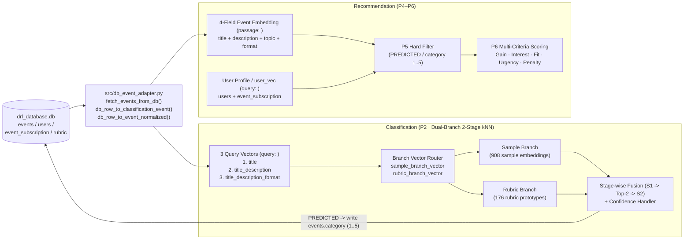

# Kiến trúc Input từ SQLite Database (`drl_database.db`), Phân loại 3-Vector 2 Nhánh & Embedding 4 Trường cho Recommendation

Tài liệu mô tả thiết kế và triển khai lớp đầu vào từ SQLite Database (`drl_database.db` quản lý qua [`database/drl_db_manager.py`](../database/drl_db_manager.py)) cùng kiến trúc embedding tách biệt cho hai chức năng **Classification (P2)** và **Recommendation (P4–P6)**.

---

## 1. Tổng quan luồng dữ liệu (Database-First Architecture)

Hệ thống giữ nguyên 6 bảng lõi của [`SYSTEM_ARCHITECTURE.md`](../SYSTEM_ARCHITECTURE.md) (`events`, `users`, `event_subscription`, `fanpages`, `notifications`, `rubric`) và bổ sung một adapter thống nhất tại [`src/db_event_adapter.py`](../src/db_event_adapter.py) để cấp dữ liệu cho cả Classification và Recommendation, đồng thời vẫn tương thích ngược với chế độ `json` cho bộ test/demo offline.



### Xử lý trường hợp Database đang trống (`0` bản ghi)
Vì `drl_database.db` hiện chưa có dữ liệu scrape thực tế:
- `fetch_events_from_db()` trả về `[]` an toàn qua `DRLDatabaseManager`.
- `validate_loaded_assets()` cho phép `len(events) == 0` khi `source_mode == "database"`.
- `generate_or_load_multi_profile_query_embeddings()` và `generate_or_load_recommendation_embeddings()` trả về ma trận rỗng chuẩn `shape=(0, 384), dtype=float32`.
- `ClassificationPipeline.run_from_database()` và `load_recommendation_candidate_pool_from_db()` → `run_recommendation_demo()` hoàn tất không lỗi với `0` sự kiện.

---

## 2. Ánh xạ cột từ bảng `events` (`drl_database.db`)

| Cột trong `events` | Kiểu DB | Ánh xạ sang Classification (`dict`) | Ánh xạ sang Recommendation (`EventNormalized`) |
| --- | --- | --- | --- |
| `event_id` | `INTEGER PK` | `event_id` + `post_id = "db_{event_id}"` | `event_id = "db_{event_id}"`, `metadata["db_event_id"]` |
| `title` | `TEXT` | `title` (dùng trong cả 3 vector) | `title` (trường 1/4 của rec embedding) |
| `description` | `TEXT` | `description` (dùng trong vector 2 & 3) | `description` (trường 2/4 của rec embedding) |
| `topic` | `TEXT (JSON list)` | `topic` (không đưa vào query classification để tránh nhiễu/rò rỉ nhãn) | `categories` + `metadata["topic"]` (trường 3/4 của rec embedding) |
| `format` | `TEXT (JSON list)` | `format` (dùng trong vector 3 sau khi lọc bỏ `online`/`offline`) | `metadata["format"]` (trường 4/4 của rec embedding, lọc `online`/`offline`) |
| `is_online` | `INTEGER (0/1)` | `is_online`, `online_mode` | `is_online`, `online_mode` (`"online"`/`"offline"`) |
| `is_cancelled` | `INTEGER (0/1)` | Lọc bỏ ở SQL (`is_cancelled = 0`) & `check_event_classifiable` | Lọc bỏ ở SQL (`is_cancelled = 0`) |
| `event_start_datetime` / `event_end_datetime` | `TEXT` | `start_datetime` / `end_datetime` | `start_datetime` / `end_datetime` |
| `reg_start_datetime` / `reg_end_datetime` | `TEXT` | `reg_start_datetime` / `reg_end_datetime` | `reg_start_datetime` / `reg_end_datetime` |
| `location`, `coordinate` | `TEXT` | `location`, `coordinate` | `location`, `metadata["coordinate"]` |
| `fee` | `TEXT` | `fee` | `fee_raw` + `fee_vnd` (parse `"Miễn phí"` → `0`, `"25.000 VNĐ"` → `25000`, `"30k"` → `30000`) |
| `target_audience` | `TEXT (JSON list)` | `target_audience` | `TargetAudienceStructured` (tách `cohorts`, `faculties`, `all_students`) |
| `sources` | `TEXT` | `organizer` | `organizer` (cấp đơn vị tổ chức cho Module 6) |
| `category` | `INTEGER (1..5, NULL)` | `db_category`; được ghi ngược `C1..C5` → `1..5` khi `PREDICTED` | Chuyển `1..5` → `C1..C5` (`status="PREDICTED"`) nếu không truyền bảng kết quả chi tiết |

Ngoài ra, [`build_demo_profile_from_db_user()`](../src/recommendation/pipeline.py) ánh xạ bảng `users` + `event_subscription` + `rubric`:
- `event_subscription.status == "done"` → `participated_event_ids = ["db_{event_id}"]`.
- `users.weights` theo [`SYSTEM_ARCHITECTURE.md`](../SYSTEM_ARCHITECTURE.md) có thứ tự `[gain, fit, interested, urgency]` và được ánh xạ chuẩn sang Module 3 `ScoringWeights(w1_gain, w2_interest, w3_fit, w4_urgency)`.

---

## 3. Classification (P2): Kiến trúc 3 Vector cho kNN 2 Nhánh có thể tùy chọn

Vẫn giữ nguyên cấu trúc **Hierarchical 2-Stage Dual-Branch kNN + Stage-wise Fusion** (`SampleRetriever` + `RubricRetriever`, Stage 1 nhóm lớn → shared Top-2 → Stage 2 tiêu chí), nhưng mỗi sự kiện hợp lệ được sinh **3 query vector** độc lập (`384d`, `float32`, L2-normalized, prefix `query: `):

| Tên Profile | Công thức text (`src/classification/embeddings/event_text_builder.py`) | Mục đích đánh giá |
| --- | --- | --- |
| `title` | `query: {title}` | Cô đọng, ít nhiễu mô tả dài — rất phù hợp thử cho **Nhánh Sample** (vì 908 mẫu tham chiếu chủ yếu là tiêu đề ngắn) |
| `title_description` | `query: {title} {description}` | Giữ nguyên baseline hiện tại (tương thích ngược 100%) |
| `title_description_format` | `query: {title}. Hình thức: {format_tokens}. {description}` | Giàu tín hiệu loại hình hoạt động (`contest`, `seminar`, `workshop`, `volunteer`...; tự lọc bỏ `online`/`offline`) — phù hợp thử cho **Nhánh Rubric** |

### Cách chọn vector cho từng nhánh (để thực nghiệm ma trận $3 \times 3$)

Người đánh giá có thể chọn độc lập vector cho **Nhánh Sample** và **Nhánh Rubric** (thậm chí ghi đè chi tiết tới từng Stage 1 / Stage 2) theo 4 cách:

1. **Qua file cấu hình** [`configs/classification_config.yaml`](../configs/classification_config.yaml):
   ```yaml
   embedding:
     classification_profiles:
       - "title"
       - "title_description"
       - "title_description_format"
     branch_vector_selection:
       sample_branch: "title"                       # hoặc title_description / title_description_format
       rubric_branch: "title_description_format"    # hoặc title / title_description
       # Tùy chọn nâng cao theo từng stage (mặc định null = dùng theo nhánh):
       sample_stage1: null
       sample_stage2: null
       rubric_stage1: null
       rubric_stage2: null
   ```
2. **Qua Python Pipeline API** ([`src/classification/pipeline/classification_pipeline.py`](../src/classification/pipeline/classification_pipeline.py)):
   ```python
   pipeline = ClassificationPipeline(Path("configs/classification_config.yaml"))
   res = pipeline.run_from_database(
       branch_vector_selection={
           "sample_branch": "title",
           "rubric_branch": "title_description_format",
       },
       write_back_db=True,
   )
   ```
3. **Qua HTTP API** ([`app.py`](../app.py)):
   - `POST /api/classify` với `sample_branch_vector`, `rubric_branch_vector` (và tùy chọn `sample_stage1_vector`, `sample_stage2_vector`, `rubric_stage1_vector`, `rubric_stage2_vector`).
   - `POST /api/dual-branch/run-db` với `sample_branch`, `rubric_branch`, `only_unclassified`, `write_back_db`.
4. **Qua Web UI** ([`prototype/index.html`](../prototype/index.html), [`prototype/app.js`](../prototype/app.js)):
   - **Tab 1 (Phân loại sự kiện)**: nhập thêm trường `format`, chọn trực tiếp dropdown **Vector Nhánh Sample** và **Vector Nhánh Rubric** trong hộp *Chọn Vector 2 nhánh & Tham số phân loại*; kết quả hiển thị rõ badge `vector_routing_used` và nội dung text của cả 3 profile.

Mọi bản ghi kết quả phân loại đều đính kèm `classification.vector_routing_used` (`sample_stage1`, `sample_stage2`, `rubric_stage1`, `rubric_stage2`) để truy vết chính xác cấu hình nào đã sinh ra kết quả đánh giá.

---

## 4. Recommendation (P6 · Interest): Embedding 4 Trường (`title + description + topic + format`)

Triển khai module riêng tại [`src/recommendation/rec_embedder.py`](../src/recommendation/rec_embedder.py) tách hẳn khỏi query embedding của Classification:

- **4 trường đầu vào**: `REC_EMBEDDING_FIELDS = ("title", "description", "topic", "format")`.
- **Template chuẩn hóa (E5 asymmetric passage)**:
  ```text
  passage: {title}. Chủ đề: {topic}. Hình thức: {format}. {description}
  ```
- **Chống nhiễu tự động**:
  - Bỏ các nhãn chủ đề quá chung chung (`"Khác"`, `"Other"`, `"Activity"`) trong `topic`.
  - Bỏ các cờ hình thức giao tiếp thuần túy (`"online"`, `"offline"`, `"in-person"`, `"trực tiếp"`, `"trực tuyến"`) trong `format` (vì yếu tố online/offline đã được xử lý tường minh ở `Fit` / Module 4).
- **Tương hợp với E5**:
  - `user_vec` được encode qua `encode_query(...)` (`query: ...`).
  - `event_vec` (4 trường) được encode qua `encode_passages(...)` (`passage: ...`), đồng nhất với 908 `sample_embeddings` (cũng được encode với `passage: `) dùng để hiệu chuẩn `[c_min, c_max]` trong P6 Interest.
- **Cache đĩa**: lưu tại `data/generated/events_rec_embeddings.npy` + `events_rec_metadata.json` kèm SHA-256 fingerprint của tập sự kiện (`compute_events_fingerprint`) để tự động tái sử dụng khi DB chưa thay đổi.

---

## 5. Danh sách file đã tạo / cập nhật

| File | Vai trò |
| --- | --- |
| [`src/db_event_adapter.py`](../src/db_event_adapter.py) | Adapter đọc/ghi SQLite `drl_database.db` (`events`, `users`, `event_subscription`, `rubric`) |
| [`src/classification/embeddings/event_text_builder.py`](../src/classification/embeddings/event_text_builder.py) | Builder cho 3 query vector (`title`, `title_description`, `title_description_format`) |
| [`src/classification/embeddings/event_embedder.py`](../src/classification/embeddings/event_embedder.py) | `MultiProfileQueryEmbeddingSet` & `generate_or_load_multi_profile_query_embeddings()` (cache `.npz`) |
| [`src/classification/data/loaders.py`](../src/classification/data/loaders.py), [`validators.py`](../src/classification/data/validators.py) | Nạp sự kiện từ SQLite DB + cho phép DB trống (`0` dòng) |
| [`src/classification/algorithms/base_algorithm.py`](../src/classification/algorithms/base_algorithm.py), [`hierarchical_two_stage_knn.py`](../src/classification/algorithms/hierarchical_two_stage_knn.py) | Định tuyến vector độc lập cho từng nhánh (và từng stage) + ghi `vector_routing_used` |
| [`src/classification/decision/confidence_handler.py`](../src/classification/decision/confidence_handler.py), [`pipeline/classification_pipeline.py`](../src/classification/pipeline/classification_pipeline.py) | `run_from_database()`, truyền `vector_routing_used`, ghi `events.category` (`1..5`) |
| [`src/recommendation/rec_embedder.py`](../src/recommendation/rec_embedder.py) | Dedicated 4-field Recommendation embedder (`title + description + topic + format`, `passage: `) |
| [`src/recommendation/pipeline.py`](../src/recommendation/pipeline.py), [`scoring.py`](../src/recommendation/scoring.py), [`__init__.py`](../src/recommendation/__init__.py), [`src/recommender.py`](../src/recommender.py) | `load_recommendation_candidate_pool_from_db()`, `build_demo_profile_from_db_user()`, trả `rec_embedding_text` |
| [`configs/classification_config.yaml`](../configs/classification_config.yaml), [`configs/recommendation_config.yaml`](../configs/recommendation_config.yaml) | Cấu hình `input_source`, 3 profiles + `branch_vector_selection`, và `rec_embedding` 4 trường |
| [`app.py`](../app.py), [`prototype/index.html`](../prototype/index.html), [`prototype/app.js`](../prototype/app.js) | Dropdown chọn vector Sample/Rubric ở Tab 1, nguồn DB/JSON & hiển thị 4-field text ở Tab 3, API `/api/dual-branch/run-db` |
| [`tests/test_db_multivector_architecture.py`](../tests/test_db_multivector_architecture.py) | Bộ test kiểm chứng DB trống, adapter, định tuyến 3 vector, cache và embedding 4 trường |
