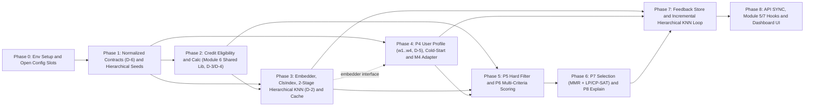

# Module 3 Implementation Roadmap & Quality Assurance Plan

> **Document Conventions**:
> - **Confirmed Requirements**: Derived directly from [`module3_engine_flowchart.drawio.svg`](file:///Users/Apple/Documents/Computational%20Thinking/No-Le-DRL/module3_engine_flowchart.drawio.svg), [`data/raw/rubric.yaml`](file:///Users/Apple/Documents/Computational%20Thinking/No-Le-DRL/data/raw/rubric.yaml), [`docs/module3_decision_log.md`](file:///Users/Apple/Documents/Computational%20Thinking/No-Le-DRL/docs/module3_decision_log.md) (**`D-1`–`D-6` APPROVED**), and verified repository files.
> - **Technical Recommendations**: Concrete engineering choices proposed to satisfy confirmed requirements cleanly and testably.
> - **Open Parameters, Taxonomy & Decisions**: Cross-referenced from [`docs/module3_decision_log.md`](file:///Users/Apple/Documents/Computational%20Thinking/No-Le-DRL/docs/module3_decision_log.md) (`D-2` hyperparameters, label taxonomy `T-1`–`T-5`, and `D-7`–`D-8`); gated phases note them explicitly.
> - **Implementation Status**: This roadmap defines the build and validation plan; the approved two-stage hierarchical KNN architecture and downstream components have **not yet been implemented or experimentally validated**.

---

## 1. Roadmap Strategy & Architectural Dependency Rationale

Implementing components in visual left-to-right flowchart order (`API SYNC -> P2 -> M6 -> Cache -> P5 -> P6 -> P7 -> P8`) would stall immediately because:
1. External modules (`M1 & M2`, `M4`, `M5`, `M7`) do not exist in this Git repository (`origin/main`, `origin/module-2`, `module-3`). Under **`D-6` (APPROVED)**, upstream `M1/M2` own ingestion, normalization, and missing-field handling, so Module 3 must lock its normalized input contract first.
2. Under **`D-2` (APPROVED)**, `P2` requires a **two-stage hierarchical KNN classifier** (`e5-small` + `ClsIndex` partitioned by parent group `C1`–`C5`), which cannot be built or evaluated until unresolved taxonomy questions (`T-1`–`T-5`) are locked and the conflicting flat seed CSVs (`5` title/label collisions, `10` missing matchable codes, `8` overlaps with `data/events.json`) are restructured into clean parent-child datasets.
3. Under **`D-3` and `D-4` (APPROVED)**, **`MODULE 6` (Shared Python Library)** solely owns credit eligibility and point calculation (`Event Profile Cache` points, `P4` shortfall weights, `P5` cap checks, and `P6` `Gain`), making deterministic credit logic a **prerequisite** rather than a downstream step.

### Recommended Dependency Graph & Parallel Execution Tracks

### Implementation Order & Parallelization Matrix

| Phase | Area | Sequential Dependencies | Can Run in Parallel With |
| :--- | :--- | :--- | :--- |
| **Phase 0** | Packaging, Environment & Configurable Param Slots | None (First Milestone; `D-1`–`D-6` approved) | — |
| **Phase 1** | Normalized Input Contracts (`D-6`), Validation & Hierarchical Seeds | Phase 0 (+ `T-1`–`T-5` before final seed export) | — |
| **Phase 2** | Credit Eligibility & Calc (`Module 6` Shared Library, `D-3`/`D-4`) | Phase 1 | Phase 3 (embedder/index/KNN), Phase 4 (schema/profile) |
| **Phase 3** | Embedding, Partitioned `ClsIndex`, 2-Stage Hierarchical KNN (`D-2`) & Cache | Phase 1 (+ `T-1`–`T-5`; needs Phase 2 to populate expected points in cache) | Phase 2, Phase 4 |
| **Phase 4** | Cold-Start, `P4` User Profile (`w1`–`w4`, `D-5`) & `Module 4` Adapter | Phase 1 (+ embedder signature from Phase 3) | Phase 2, Phase 3 |
| **Phase 5** | `P5` Hard Filtering & `P6` Multi-Criteria Scoring (`w1`–`w4`) | Phases 2, 3, 4 | — |
| **Phase 6** | `P7` Selection (`MMR` + `LP / CP-SAT`) & `P8` Explanation | Phase 5 | `P8` templates can develop alongside `P7` solver |
| **Phase 7** | `Feedback Store` & Incremental Learning (`P4` + Partitioned `ClsIndex`) | Phases 3, 4, 6 | — |
| **Phase 8** | External Sync (`API SYNC`, `M5`, `M7`) & `DASHBOARD / UI` | Phases 3–7 | UI shell can start once Phase 1 schemas freeze |

---

## 2. Phased Implementation Plan

### Phase 0 — Environment, Project Setup & Open Parameter Slots

- **Objective & Expected Outcome**: Establish reproducible Python packaging, test runner, and runtime configuration supporting approved decisions `D-1`–`D-6` while keeping deferred `D-2` hyperparameters unset (`None` / experiment-configurable).
- **Components & Flowchart Nodes Involved**: Cross-cutting (`configs/model_config.py`, repo scaffolding).
- **Files to Create or Modify**:
  - Create `pyproject.toml` and/or `requirements.txt` (declaring Python `>=3.9`, `PyYAML`, `numpy`, `pytest`, and optional extras for `sentence-transformers` and `ortools`).
  - Create `src/__init__.py`, `tests/__init__.py`.
  - Extend [`configs/model_config.py`](file:///Users/Apple/Documents/Computational%20Thinking/No-Le-DRL/configs/model_config.py) with path constants, E5 prefixes (`"query: "`, `"passage: "`), and **unset/configurable slots** for deferred `D-2` parameters (`STAGE1_TOP_K = None`, `STAGE1_MIN_SCORE_THRESHOLD = None`, `STAGE2_AGGREGATION_STRATEGY = None`, `CALIBRATION_METHOD = None`, `REJECTION_POLICY = None`)—without hardcoding premature numerical values.
- **Dependencies & Prerequisites**: Approved decisions **`D-1` through `D-6`** in [`docs/module3_decision_log.md`](file:///Users/Apple/Documents/Computational%20Thinking/No-Le-DRL/docs/module3_decision_log.md).
- **Input/Output Contracts**: Standardized configuration dataclass/dict exposing model settings, file paths (`data/raw/rubric.yaml`, `data/events.json`, `data/processed/`), and validation-resolved parameter slots.
- **Recommended Implementation Approach** *(Technical Recommendation)*: Use `pyproject.toml` with optional dependency extras (`[ml]`, `[opt]`, `[dev]`) so fast deterministic unit tests (`Phase 1`–`2`) run cleanly without heavy GPU/transformer installs during CI.
- **Testing Strategy**: Smoke test verifying environment imports (`yaml`, `numpy`, `pytest`), [`configs/model_config.py`](file:///Users/Apple/Documents/Computational%20Thinking/No-Le-DRL/configs/model_config.py) constants (`MODEL_ID == "intfloat/multilingual-e5-small"`, `EMBEDDING_DIMENSION == 384`), and clean package discovery of `src/` and `res/`.
- **Acceptance Criteria**:
  - Clean virtual environment installs from manifest in a single command and `pytest` runs with `0` collection errors.
  - Configuration exposes explicit unset slots for all `5` open `D-2` parameters without hardcoding `Top-k` or acceptance thresholds.
- **Potential Risks & Mitigations**: *Risk*: Unresolved taxonomy (`T-1`–`T-5`) delays final seed generation. *Mitigation*: Separate packaging and contract schemas from taxonomy-dependent seed export.

---

### Phase 1 — Normalized Input Contracts (`D-6`), Data Validation & Hierarchical Seed Hygiene

- **Objective & Expected Outcome**: Define Module 3's normalized input contract per **`D-6` (APPROVED)**, enforce typed I/O contracts across internal boundaries (including distinct Stage 1/Stage 2 classification scores per `D-2`), and prepare clean parent-child partitioned datasets (`C1`–`C5` -> fine-grained items) for `ClsIndex` and evaluation.
- **Components & Flowchart Nodes Involved**: Normalized boundary from `M1 & M2` (`D-6`), `M4`, `M6`, `P4`, `P5`–`P8`, `Feedback Store`, plus `DATA · LOCAL (ClsIndex)`.
- **Files to Create or Modify**:
  - Create `src/schemas.py` (typed dataclasses or `pydantic` models: `EventNormalized` consumed from M1/M2 per `D-6`, `ClassificationResult` preserving distinct `parent_group_id`, `rubric_item_id`, `stage1_scores`, `stage2_scores`, `aggregated_score`, `calibrated_confidence`, and `status`; `CreditEstimate`, `UserProfile`, `ScheduleContext`, `ScoredEvent`, `RecommendationItem`, `FeedbackEvent`).
  - Create `src/contract_validator.py` (validates normalized `EventNormalized` inputs arriving from upstream M1/M2 and validates [`data/raw/rubric.yaml`](file:///Users/Apple/Documents/Computational%20Thinking/No-Le-DRL/data/raw/rubric.yaml) parent-child hierarchy).
  - Create `scripts/prepare_test_fixtures.py` (isolated offline fixture adapter converting legacy raw [`data/events.json`](file:///Users/Apple/Documents/Computational%20Thinking/No-Le-DRL/data/events.json) into `EventNormalized` strictly for offline testing/evaluation—keeping raw scraping/missing-field heuristics out of Module 3 production code per `D-6`).
  - Create `scripts/clean_seed_dataset.py` (reproducible script producing parent-group-partitioned `ClsIndex` seed splits + leakage-free validation/test splits once `T-1`–`T-5` are confirmed).
  - Create `tests/test_schemas.py`, `tests/test_data_validation.py`.
- **Dependencies & Prerequisites**: Phase 0 + **`D-6` (APPROVED)**; final seed export requires resolving open taxonomy questions **`T-1` through `T-5`** in [`docs/module3_decision_log.md`](file:///Users/Apple/Documents/Computational%20Thinking/No-Le-DRL/docs/module3_decision_log.md).
- **Input/Output Contracts**:
  - Upstream Input Contract (`D-6`): `EventNormalized` supplied by M1/M2 (`event_id`, `title`, `description`, `organizer`, `start_datetime`, `end_datetime`, `reg_end_datetime`, `online_mode`, `location`, `fee_vnd`, `target_audience_structured`, `capacity`, `seats_left`, `missing_field_flags`).
  - Fixture Adapter Input (Tests Only): Raw [`data/events.json`](file:///Users/Apple/Documents/Computational%20Thinking/No-Le-DRL/data/events.json) + [`res/events_full.csv`](file:///Users/Apple/Documents/Computational%20Thinking/No-Le-DRL/res/events_full.csv) + [`data/raw/rubric.yaml`](file:///Users/Apple/Documents/Computational%20Thinking/No-Le-DRL/data/raw/rubric.yaml).
  - Output: Validated `RubricSpec` (preserving parent `C1`–`C5` -> child `rubric_item_id` lineage) and non-overlapping hierarchical seed/validation/test splits.
- **Recommended Implementation Approach** *(Technical Recommendation)*:
  - Keep Module 3 core focused strictly on validating the upstream `EventNormalized` contract (`D-6`) and rejecting/flagging malformed inputs cleanly at the boundary.
  - Derive clean hierarchical seeds from [`res/events_full.csv`](file:///Users/Apple/Documents/Computational%20Thinking/No-Le-DRL/res/events_full.csv) (which preserves `Organizer` and `Vai_Tro`) according to resolved taxonomy (`T-1`–`T-5`), partitioning every fine-grained dataset strictly by parent group ID (`C1`–`C5`, and `P` if included per `T-2`).
  - Explicitly deduplicate against [`data/events.json`](file:///Users/Apple/Documents/Computational%20Thinking/No-Le-DRL/data/events.json) (`8` overlapping titles) so validation/test splits have zero data leakage.
- **Testing Strategy**: Data validation test suite checking `rubric.yaml` referential integrity, parent-child mapping completeness, `0` conflicting labels on identical normalized titles in seed splits, `0` title overlap between train seeds and held-out validation/test splits, and `EventNormalized` fixture conversion across all `108` records in `data/events.json`.
- **Acceptance Criteria**:
  - `EventNormalized` contract validator accepts valid upstream payloads and produces explicit field-level errors on contract violations.
  - `100%` of `108` legacy `data/events.json` records convert cleanly through the test-fixture adapter without uncaught exceptions.
  - `0` duplicate/conflicting normalized titles and `0` train/eval leakage across partitioned parent-group seed files (once `T-1`–`T-5` are finalized).
- **Potential Risks & Mitigations**: *Risk*: Historical dates (`104/108` `< 2026-11-23`) cause all fixtures to be filtered out during offline testing. *Mitigation*: Require an explicit `reference_now: datetime` parameter across all time-sensitive functions (`P5`, `P6`).

---

### Phase 2 — Deterministic Rubric & Credit Eligibility Engine (`Module 6` Shared Python Library)

- **Objective & Expected Outcome**: Implement **`D-3` and `D-4` (APPROVED)** by building the deterministic `Module 6` Shared Python Library responsible for **credit eligibility**, point lookups, group caps, penalties, and shortfalls—completely decoupled from `P2` classification confidence.
- **Components & Flowchart Nodes Involved**: `MODULE 6 (Credit Calc & Evaluation)` as a Shared Python Library + optional attribute extraction utilities refactored from [`res/keyword_rules.py`](file:///Users/Apple/Documents/Computational%20Thinking/No-Le-DRL/res/keyword_rules.py).
- **Files to Create or Modify**:
  - Create `src/credit_engine.py` (credit eligibility rules, rubric point lookup, role redirection via `role_items`, `level_buckets` mapping, `exclusive_with` handling, group-cap enforcement `30/20/25/25/30`, `P` unlimited penalties, `[0, 100]` clamp, baseline defaults `C1:15, C2:15, C3:10, C4:10`, `shortfall` & `effective_gain` calculation).
  - Create `src/attribute_extractor.py` (refactoring `level`, `role`, `duration`, `explicit_points` helpers from [`res/keyword_rules.py`](file:///Users/Apple/Documents/Computational%20Thinking/No-Le-DRL/res/keyword_rules.py) with fixed `"24h_to_lt_1w"` duration mapping and path-safe YAML loading for cases where upstream M1/M2 leave optional fields unset).
  - Create `tests/test_credit_engine.py`.
- **Dependencies & Prerequisites**: Phase 1 + **`D-3` & `D-4` (APPROVED)** (`T-5` impacts item `3.5` rubric text if `rubric.yaml` is revised).
- **Input/Output Contracts**:
  - Input: `(rubric_item_id, parent_group_id, EventNormalized, UserLedger, role="participant", explicit_points=None, inferred_level=None, inferred_duration=None)`. *(Classification confidence is NOT used to grant/deny credit eligibility per `D-3`.)*
  - Output: `CreditEstimate(is_credit_eligible, expected_points, min_points, max_points, effective_points, capped_by, source="explicit|rule|rule_fallback", group_id, warning_flags)` and `GroupShortfall(remaining_by_group, gap_by_group, current_total)`.
- **Recommended Implementation Approach** *(Technical Recommendation)*: Build as a pure, stateless deterministic Python library (`D-4`) driven by `data/raw/rubric.yaml`—never invoking LLMs or KNN scores to determine credit eligibility (`D-3`).
- **Testing Strategy**: `>= 30` hand-calculated unit tests verified against [`res/drl2025.md`](file:///Users/Apple/Documents/Computational%20Thinking/No-Le-DRL/res/drl2025.md) and [`data/raw/rubric.yaml`](file:///Users/Apple/Documents/Computational%20Thinking/No-Le-DRL/data/raw/rubric.yaml) covering: eligibility separation (`event_matchable` vs non-eligible / `NONE` / mandatory penalty `6.4`), group caps (`30/20/25/25/30`), total `> 100 -> 100` overflow, unlimited negative penalties + floor `0`, `role_items` (`1.7`, `3.14`, `4.4`, incl. `lop` collaborator `0` pts), `C4.tinh_nguyen` duration buckets (`lt_24h`, `24h_to_lt_1w`, `ge_1w`), `exclusive_with` rules, and baseline toggles.
- **Acceptance Criteria**:
  - `100%` pass rate on all rubric arithmetic, eligibility, cap, penalty, and duration-bucket tests.
  - Zero dependency on `P2` classifier internals (`D-3` separation verified via unit test).
  - Zero `ambiguous_lt_24h_or_mid` unhandled key errors when evaluating `C4.tinh_nguyen`.
- **Potential Risks & Mitigations**: *Risk*: `T-5` resolution alters `3.5` scoring levels. *Mitigation*: Parameterize rules strictly from `rubric.yaml` so updating the YAML requires zero engine code edits.

---

### Phase 3 — Embedding, Partitioned `ClsIndex`, Two-Stage Hierarchical KNN (`P2`) & `Event Profile Cache`

- **Objective & Expected Outcome**: Implement the approved **two-stage hierarchical KNN classifier (`D-1` & `D-2` APPROVED)**, parent-child `ClsIndex`, `e5-small` embedder, `Event Profile Cache`, and the validation experiments required to set open hyperparameters.
- **Components & Flowchart Nodes Involved**: `P2.1 Embedding`, `P2.2 Stage 1 Coarse KNN (C1–C5)`, `P2.3 Stage 2 Multi-Group Union KNN`, Confidence/Rejection Gate (open policy), `DATA · LOCAL (ClsIndex)`, `DATA · CACHE (Event Profile Cache)`.
- **Files to Create or Modify**:
  - Create `src/embedder.py` (wraps `intfloat/multilingual-e5-small`, enforces `query:`/`passage:` prefixes, L2-normalizes 384d vectors, supports deterministic mock/stub embedder for unit tests).
  - Create `src/cls_index.py` (stores and queries the hierarchical index: Stage 1 coarse parent-group dataset (`C1`–`C5`) + per-group fine-grained rubric-item datasets retrievable by `parent_group_id`, preserving exact `parent_group_id <-> rubric_item_id` mapping and supporting union queries across arbitrary subsets of selected parent groups).
  - Implement [`src/classifier.py`](file:///Users/Apple/Documents/Computational%20Thinking/No-Le-DRL/src/classifier.py) following **D-2**:
    1. `P2.1`: Embed normalized event text into a 384d L2-normalized vector.
    2. `P2.2` (**Stage 1 — Coarse Classification**): Run KNN over parent groups (`C1`–`C5`) and select the `Top-k` candidate parent groups (subject to optional minimum candidate-group score threshold, both **OPEN**). Stage 1 selects candidate groups only; it does not determine the final rubric item.
    3. `P2.3` (**Stage 2 — Fine-Grained Multi-Group Classification**): For **every** selected candidate parent group from Stage 1, retrieve its fine-grained rubric-item dataset; run the second KNN over the **union** of all retrieved candidate datasets to identify and rank specific rubric items (`rubric_item_id`) alongside their `parent_group_id`.
    4. Preserve `stage1_scores` and `stage2_scores` as distinct fields; apply only explicitly validated score aggregation, calibration, and rejection/`UNKNOWN`/`NONE` logic (never assuming raw KNN similarities/votes are probabilities and never blindly multiplying `stage1 * stage2`).
  - Create `src/event_cache.py` (reads/writes [`data/processed/event_embeddings.npy`](file:///Users/Apple/Documents/Computational%20Thinking/No-Le-DRL/data/processed/event_embeddings.npy) and [`data/processed/event_metadata.json`](file:///Users/Apple/Documents/Computational%20Thinking/No-Le-DRL/data/processed/event_metadata.json) with vector, `(rubric_item_id, parent_group_id)`, distinct `stage1_scores`/`stage2_scores`, and `Module 6` expected points).
  - Create `eval/run_p2_validation.py` (experimentation suite to resolve open `D-2` parameters on validation data).
  - Create `tests/test_classifier.py`, `tests/test_event_cache.py`.
- **Dependencies & Prerequisites**: Phase 1 + **`D-1`, `D-2`, `D-3` (APPROVED)** + resolution of taxonomy items **`T-1`–`T-4`**; Phase 2 (`Module 6`) required to populate expected points inside `Event Profile Cache` (keeping classification confidence strictly separate from credit eligibility per `D-3`).
- **Input/Output Contracts**:
  - Input: `EventNormalized` (`title`, `description`, `organizer`, etc.) + open configuration (`stage1_top_k`, `stage1_min_score_threshold`, `stage2_aggregation_strategy`, `calibration_model`, `rejection_policy`).
  - Output: `ClassificationResult(rubric_item_id, parent_group_id, selected_candidate_groups, stage1_scores: dict[group_id, float], stage2_scores: dict[item_id, float], aggregated_scores: dict[item_id, float] | None, calibrated_confidence: float | None, status: "accepted|pending_review|rejected|unknown|none", top_k_items, model_version)` and persisted `EventProfile`.
- **Recommended Implementation Approach** *(Technical Recommendation)*:
  - Implement cosine-similarity KNN over L2-normalized E5 vectors in NumPy, parameterized so `Top-k`, distance weighting, minimum candidate-group threshold, aggregation method (e.g., Stage-2-direct vs. additive/rank/learned fusion), calibration (temperature scaling / isotonic regression), and rejection rule are pluggable strategies rather than hardcoded constants.
  - Strictly enforce that Stage 2 searches over the **union** of fine-grained datasets for **all** `Top-k` Stage 1 groups (never truncating to only the Stage 1 top-1 group) and validates every returned `(rubric_item_id, parent_group_id)` against the rubric's parent-child map.
- **Testing & Validation Strategy**:
  - **Structural Unit Tests** (using deterministic synthetic embeddings): Verify L2 norm (`||v||₂ = 1.0 ± 1e-6`), Stage 1 selects `Top-k` parent groups without emitting final items, Stage 2 retrieves datasets for **all** selected Stage 1 groups and searches their **union** (including a test case where the Stage 1 #2 group holds the winning fine-grained item!), parent-child IDs always match, `stage1_scores` and `stage2_scores` remain distinct, and raw KNN scores are flagged `uncalibrated` unless a fitted calibrator is attached.
  - **Required Validation & Experimentation Tasks (To Resolve Open D-2 Parameters)**:
    1. **Top-k Selection Sweep**: Evaluate candidate-group `Recall@k` (`k = 1, 2, 3, ...`) vs. Stage 2 search set size and downstream accuracy on validation data.
    2. **Minimum Candidate-Group Score Threshold Study**: Measure impact of minimum Stage 1 score cutoffs on recall vs. false-group pruning.
    3. **Stage 2 Score Aggregation & Final Ranking Evaluation**: Compare candidate aggregation strategies across multi-group unions against validation ground truth (explicitly confirming no unvalidated `s1 * s2` assumption).
    4. **Inter-Stage Error Propagation Analysis**: Decompose total Stage 2 errors into (a) **Stage 1 miss errors** (true parent group omitted from `Top-k`) vs. (b) **Stage 2 ranking errors** (true parent group was retrieved, but wrong item ranked first).
    5. **Confidence Calibration & Rejection/`UNKNOWN`/`NONE` Policy Validation**: Measure Expected Calibration Error (ECE) / reliability curves and precision-coverage tradeoffs before choosing final acceptance and `NONE`/`UNKNOWN` thresholds.
- **Acceptance Criteria**:
  - Vector dimensionality `== 384` and L2-normalized (`±1e-6`).
  - `100%` of integration/unit tests confirm Stage 2 queries the union of all `Top-k` Stage 1 candidate-group datasets, preserves `(rubric_item_id, parent_group_id)` lineage, and stores distinct `stage1_scores` and `stage2_scores`.
  - Raw similarity scores are never returned as calibrated probabilities when uncalibrated.
  - Validation report generated documenting empirical selection of `Top-k`, min score threshold, Stage 2 aggregation method, error propagation breakdown, calibration metrics, and rejection/`NONE`/`UNKNOWN` policy prior to freezing production config.
- **Potential Risks & Mitigations**: *Risk*: Stage 1 excludes the true parent group (`Top-k` error propagation), or small per-item sample counts (`2`–`5`) bias Stage 2 votes across unbalanced groups (e.g., `C3` has `11` matchable items vs `C2` `2`). *Mitigation*: Explicitly measure error propagation and group-size imbalance during the validation sweep before selecting `Top-k` and aggregation strategy.

---

### Phase 4 — User Profile (`P4`), Cold-Start Onboarding (`COLD-START`) & Schedule Interface (`Module 4` Adapter)

- **Objective & Expected Outcome**: Model student goals, constraints, adaptive E5 interest vectors, adaptive scoring weights **`w1`–`w4` (`D-5` APPROVED)**, and timetable/travel context from `Module 4`.
- **Components & Flowchart Nodes Involved**: `COLD-START Onboarding`, `P4 · USER PROFILE`, `MODULE 4` integration boundary.
- **Files to Create or Modify**:
  - Create `src/user_profile.py` (cold-start initialization from interest chips + ĐRL target + cohort/faculty/class + timetable; adaptive `user_vec` blending `u_declared` and `u_learned`; adaptive weight calculation `w1..w4` combining Preset + M6 Shortfall + M4 Schedule tightness).
  - Create `src/schedule_adapter.py` (`ScheduleProvider` interface + local `.ics`/JSON mock implementation returning `busy` intervals, `exam_weeks`, `travel_minutes(location)`, and `fit` signals).
  - Create `tests/test_user_profile.py`, `tests/test_schedule_adapter.py`.
- **Dependencies & Prerequisites**: Phase 1, Phase 3 (`embedder.encode` interface), Phase 2 (`GroupShortfall` interface) + **`D-5` (APPROVED)**.
- **Input/Output Contracts**:
  - Cold-Start Input: `OnboardingInput(interest_chips, free_text, target_total, target_by_group, cohort, faculty, class_id, pref_hours, max_travel_min, budget, timetable_source, preset_mode)`.
  - `P4` Output: `UserProfile(user_vec_384d, interest_tags, cohort, faculty, class_id, hidden_event_ids, participated_event_ids, target_by_group, overrides, weights_w1_to_w4)` and `ScheduleContext(busy_intervals, exam_weeks)`.
- **Recommended Implementation Approach** *(Technical Recommendation)*:
  - Initialize `u_declared` as the L2-normalized mean of embedded interest chips + optional free text; maintain `u_learned` separately via Rocchio-style updates (`save/joined` positive, `dismiss` small negative) blended as `normalize(0.7 * u_declared + 0.3 * u_learned)` to prevent filter bubbles and allow profile reset.
  - Dynamically adjust `w1` (Gain) upward when M6 `shortfall` is high and `w3` (Fit) upward during M4 `exam_weeks` or dense schedules.
- **Testing Strategy**: Unit tests verifying cold-start with empty history returns a valid normalized `384d` vector (or uniform fallback when no chips chosen), `w1..w4` sum to `1.0` and stay bounded, overrides are respected, and `.ics`/JSON schedule parsing detects exact overlaps and 30-min buffers.
- **Acceptance Criteria**:
  - Cold-start profile generates valid scoring inputs (`user_vec`, `w1..w4`) in `< 100ms` (excluding initial model load).
  - Schedule overlap detection achieves `100%` recall on boundary-overlap test cases.
- **Potential Risks & Mitigations**: *Risk*: `Module 4` real API contract unknown. *Mitigation*: Define minimal abstract `ScheduleProvider` protocol backed by `.ics`/JSON test fixtures.

---

### Phase 5 — Hard Constraint Filtering (`P5`) & Multi-Criteria Scoring (`P6`)

- **Objective & Expected Outcome**: Filter ineligible/impossible events cleanly (preserving explicit exclusion reasons) and compute transparent, multi-criteria utility scores using **`w1`–`w4` (`D-5` APPROVED)** and `Module 6` credit eligibility (`D-3` APPROVED).
- **Components & Flowchart Nodes Involved**: `P5 · FILTER`, `P6 · SCORING & WEIGHTS`.
- **Files to Create or Modify**:
  - Create `src/filter.py` and `src/scoring.py` (or compose inside [`src/recommender.py`](file:///Users/Apple/Documents/Computational%20Thinking/No-Le-DRL/src/recommender.py)).
  - Create `tests/test_filter_scoring.py`.
- **Dependencies & Prerequisites**: Phases 2, 3, 4 + **`D-3`, `D-5`, `D-6` (APPROVED)**.
- **Input/Output Contracts**:
  - `P5` Input: `(EventProfile[], UserProfile, ScheduleContext, CreditEstimate[], reference_now)`.
  - `P5` Output: `(eligible: CandidateEvent[], dropped: dict[event_id, list[DropReason]])`.
  - `P6` Output: `ScoredEvent(event, score_total, components={gain, interest, fit, urgency, penalty}, weights_w1_to_w4)`.
- **Recommended Implementation Approach** *(Technical Recommendation)*:
  - **`P5` Hard Filters**: Check (1) expired `reg_end_datetime` / `start_datetime < reference_now`, (2) `seats_left <= 0` when provided by M1/M2 normalized contract (`D-6`), (3) cohort/faculty/class mismatch, (4) `already_participated` or `hidden` by user, (5) `Module 6` credit eligibility / `effective_points <= 0` (group cap reached or `NONE` / non-eligible per `D-3`, preserving mandatory reminders like `6.4` if surfaced), (6) schedule overlap with `busy` + travel buffer from `M4`, (7) `fee_vnd > user.budget`. Record **all** violated rules per dropped event for P8's "Why not?" diagnostics.
  - **`P6` Multi-Criteria Scoring**: `Score = w1·Gain + w2·Interest + w3·Fit + w4·Urgency + Penalty` (`D-5`). Use percentile-rank normalization for `cos(user_vec, event_vec)` within the candidate pool (preventing compressed E5 cosine ranges from washing out differences); obtain `Gain` strictly from `Module 6` (`D-3`), discounting appropriately only when classification status is uncertain/pending review per validated calibration policy.
- **Testing Strategy**: Deterministic unit tests for every single filter condition (including null/missing flags from normalized M1/M2 contract), `Score` component range checks, `w1..w4` weight sensitivity (`need_points` vs `interest_first`), and `0` exceptions across all normalized fixture events at multiple `reference_now` timestamps.
- **Acceptance Criteria**:
  - `0` hard-constraint violations pass `P5`.
  - Every dropped event carries >= 1 explicit machine-readable `DropReason`.
  - `P6` strictly computes `w1·Gain + w2·Interest + w3·Fit + w4·Urgency + Penalty` with deterministic reproducibility.
- **Potential Risks & Mitigations**: *Risk*: Upstream `M1/M2` normalized payloads occasionally carry `missing_field_flags` (e.g., unknown deadline or capacity). *Mitigation*: Define deterministic missing-field handling policies in `P5`/`P6` honoring upstream flags cleanly.

---

### Phase 6 — Set-Level Selection (`P7`: MMR + LP / CP-SAT) & Explanation Engine (`P8`)

- **Objective & Expected Outcome**: Produce both an explored, diverse **Top-N recommendation list** (`MMR + 1` exploration slot) and a **conflict-free, cap-respecting schedule plan** (`LP / CP-SAT`), paired with grounded natural-language explanations and deadline warnings.
- **Components & Flowchart Nodes Involved**: `P7 · SELECTION` (`Chọn danh sách: MMR + 1 slot khám phá`, `Lập kế hoạch: LP / CP-SAT`), `P8 · EXPLAIN`.
- **Files to Create or Modify**:
  - Create `src/selector.py` (`MMR` diversity ranking + 1 exploration slot from un-seen/adjacent categories).
  - Create `src/planner.py` (`OR-Tools CP-SAT` or `scipy.optimize.milp` schedule optimizer enforcing pairwise time non-overlap + remaining group caps from `Module 6` + `C1–C5` goal targets, with greedy fallback if solver fails or times out).
  - Create `src/explainer.py` (component-score breakdown templates, near-deadline alerts, "Why not?" drop-reason formatter, optional LLM rephraser with numeric grounding verification per `D-7`).
  - Expose cohesive orchestration in [`src/recommender.py`](file:///Users/Apple/Documents/Computational%20Thinking/No-Le-DRL/src/recommender.py).
  - Create `tests/test_selection_planner.py`, `tests/test_explainer.py`.
- **Dependencies & Prerequisites**: Phase 5 + **Decision `D-7`**.
- **Input/Output Contracts**:
  - `P7` Input: `(ScoredEvent[], UserProfile, remaining_group_caps, K)`.
  - `P7` Output: `SelectionOutput(top_n_list, exploration_event_id, planned_schedule, expected_group_gains, solver_status)`.
  - `P8` Output: `RecommendationCard(event, score_breakdown, top_reasons[:3], warnings, deadline_alert, review_prompt_if_uncertain)` + `WhyNotExplanation(dropped_reasons)`.
- **Recommended Implementation Approach** *(Technical Recommendation)*:
  - For **List Selection**: Select `N - 1` items via `MMR(e) = λ·Score(e) - (1-λ)·max_{s∈S} cos(e_vec, s_vec)`, then reserve `1` exploration slot for a high-`Gain`/high-`Fit` candidate outside already-selected clusters/groups.
  - For **Schedule Planning**: Formulate integer variables `x_e ∈ {0,1}` and per-group bounded gain variables `g_c <= rem_c` (avoiding wasteful over-selection past group caps), solve with `cp_model.CpSolver` (`max_time_in_seconds = 1.0`).
  - For **Explanation (`P8`)**: Template-first (`D-7`) returning <= 3 grounded reasons referencing exact numbers (`effective_points`, `shortfall`, `days_to_deadline`, `fit`); if LLM rephrasing is enabled later, run a post-generation regex check verifying no new numbers were hallucinated.
- **Testing Strategy**:
  - Property-based / stress tests on overlapping event clusters verifying `CP-SAT` selects `0` overlapping events, never exceeds remaining group caps, achieves total objective `>=` greedy baseline, and completes in `< 1s` for `<= 200` candidates.
  - Grounding tests confirming every numeric digit in `P8` text appears in `RecommendationCard` inputs.
- **Acceptance Criteria**:
  - `0` schedule overlaps and `0` group-cap overflows in `planned_schedule`.
  - Solver runtime `< 1.0s` for `200` candidates (or clean greedy fallback).
  - Exploration slot present when `len(candidates) >= N`.
  - `100%` of `P8` explanations pass numeric-grounding verification.
- **Potential Risks & Mitigations**: *Risk*: `ortools` installation weight or solver timeout on edge cases. *Mitigation*: Deterministic greedy-with-caps fallback ensures `P7` never crashes even if solver is unavailable.

---

### Phase 7 — Feedback Store & Incremental Learning Loop (`Feedback Store` -> `P4` & Partitioned `ClsIndex`)

- **Objective & Expected Outcome**: Close the flowchart's orange reinforcement/feedback loops: persist user interactions and label corrections, adapt `P4` preferences, and safely feed verified corrections back into the hierarchical `ClsIndex` (both coarse parent group & fine-grained group dataset).
- **Components & Flowchart Nodes Involved**: `DATA · FEEDBACK (Feedback Store)`, feedback edges `UI -> Feedback Store -> P4`, `Feedback Store -> ClsIndex`, and `Module 7 -> P4`.
- **Files to Create or Modify**:
  - Create `src/feedback_store.py` (append-only JSONL / SQLite store for `click`, `save`, `dismiss`, `joined`, and `label_correction`).
  - Update `src/user_profile.py` (apply incremental Rocchio updates & `hidden`/`participated` state from feedback + `Module 7` confirmations).
  - Update `src/cls_index.py` (add validated user label corrections `(rubric_item_id, parent_group_id)` into the corresponding parent-group fine-grained dataset and coarse index with source tag `user_corrected` and undo/rollback capability).
  - Create `tests/test_feedback_loop.py`.
- **Dependencies & Prerequisites**: Phases 3, 4, 6.
- **Input/Output Contracts**:
  - Input: `FeedbackEvent(user_id, event_id, action="click|save|dismiss|joined|label_correction", corrected_item_id=None, corrected_group_id=None, reason=None, timestamp)`.
  - Output: Updated `UserProfile` snapshot and updated hierarchical `ClsIndex` revision (`index_version`).
- **Recommended Implementation Approach** *(Technical Recommendation)*: Validate that every `label_correction` satisfies parent-child taxonomy consistency (`corrected_group_id == parent_of(corrected_item_id)`), isolate user-corrected vectors inside `ClsIndex` with `source="user_corrected"` metadata, and require staging/quarantine before auto-promoting to global kNN neighborhoods to prevent single-user label poisoning.
- **Testing Strategy**: End-to-end loop tests confirming: (1) `save` increases cosine similarity of `user_vec` toward saved event and updates `P6` `Interest` rank on next call; (2) `dismiss` hides/down-weights appropriately; (3) `label_correction` updates both coarse & target parent-group datasets in `ClsIndex` and flips subsequent two-stage `P2` classification on an identical/near-duplicate event; (4) `joined` confirmation updates user ledger and triggers `P5` exclusion.
- **Acceptance Criteria**:
  - Feedback persistence is atomic and survives restart.
  - `100%` of `label_correction` entries preserve valid `(rubric_item_id, parent_group_id)` lineage.
  - Round-trip preference adaptation and two-stage kNN label correction both verify deterministically in automated tests.
- **Potential Risks & Mitigations**: *Risk*: Poisoned or contradictory user corrections degrade `ClsIndex`. *Mitigation*: Track `user_id`/`timestamp` provenance, enforce parent-child validation, cap per-user weight, and support instant rollback via index snapshots.

---

### Phase 8 — External Integrations (`API SYNC`, `Module 5`, `Module 7`) & `DASHBOARD / UI`

- **Objective & Expected Outcome**: Connect Module 3 to upstream/downstream system boundaries (`Common DB` normalized input contract per `D-6`, `Module 5`, `Module 7`) and expose the interactive user dashboard (`Top-N` suggestions, explanations, schedule plan, user actions).
- **Components & Flowchart Nodes Involved**: `API SYNC`, `MODULE 5 (Notification & Progress)`, `MODULE 7 (Evidence Vault)`, `DASHBOARD / UI`.
- **Files to Create or Modify**:
  - Create `src/sync_client.py` (`API SYNC` client fetching normalized `EventNormalized` payloads from `Common DB` per `D-6`, with offline fixture fallback).
  - Create `src/integrations.py` (outbound webhook/queue client for `Module 5` high-urgency reminders and inbound confirmation handler for `Module 7`).
  - Create `src/api.py` (thin FastAPI/HTTP or service layer exposing `/classify`, `/recommend`, `/plan`, `/feedback`, `/profile`).
  - Create `app.py` (minimal interactive UI supporting onboarding, Top-N cards, explanations, schedule planner, and `Click/Save/Dismiss/Edit Label/Joined` actions).
  - Create `tests/test_e2e_api.py`.
- **Dependencies & Prerequisites**: Phases 3–7 + external module specifications + **Decision `D-8`**.
- **Input/Output Contracts**: JSON/REST contracts matching `Phase 1` schemas (`EventNormalized`, `OnboardingInput`, `RecommendationCard`, `FeedbackEvent`, `NotificationPayload`, `EvidenceConfirmation`).
- **Recommended Implementation Approach** *(Technical Recommendation)*: Keep `src/api.py` and `app.py` strictly stateless presentation/transport wrappers around `src/` domain modules so UI changes never touch classification/scoring/rubric logic. Gate real `Module 5`/`Module 7`/`Common DB` calls behind feature flags / stub providers until sibling modules exist.
- **Testing Strategy**: FastAPI `TestClient` / service-facade E2E tests covering full cold-start -> sync -> classify -> credit eval -> recommend -> plan -> feedback -> re-recommend cycle using normalized test fixtures, plus failure-mode tests when external APIs return timeouts/503s.
- **Acceptance Criteria**:
  - Full E2E user journey executes cleanly offline against normalized fixtures (`reference_now` configurable).
  - Every UI action (`Click`, `Save`, `Dismiss`, `Edit Label`, `Joined`) persists to `Feedback Store` and updates subsequent responses.
  - External module outage degrades gracefully without crashing Module 3 recommendations.
- **Potential Risks & Mitigations**: *Risk*: Sibling modules (`M1/M2`, `M4`, `M5`, `M7`) ship incompatible schemas. *Mitigation*: Contract validator (`Phase 1`) + adapter layer (`sync_client.py`, `schedule_adapter.py`, `integrations.py`) isolate translation from core engine.

---

## 3. Testing & Quality Assurance Strategy

### Five-Tier QA Architecture

1. **Unit Tests (`tests/unit/`)**:
   - **Scope**: Individual pure functions and classes: `EventNormalized` contract validation, `credit_engine` eligibility/formulas/caps/penalties/exclusivity (`D-3`/`D-4`), `embedder` L2 norm, `P2` two-stage hierarchical KNN invariants (Stage 1 parent-group `Top-k` selection without premature item choice, Stage 2 retrieval & union search across **all** selected groups, parent-child ID consistency, distinct `stage1_scores`/`stage2_scores`, uncalibrated-score guard), `P4` Rocchio & `w1..w4` normalization (`D-5`), `P5` filter predicates, `P6` scoring formulas, `P7` MMR & CP-SAT constraints, `P8` template formatting & numeric verification.
   - **Execution Target**: Fast, offline (`< 5s` total using mock embeddings where appropriate).
2. **Data Validation Tests (`tests/data/`)**:
   - **Scope**: Run automatically on every data change to `data/raw/rubric.yaml`, `res/events_full.csv`, cleaned hierarchical `ClsIndex` datasets, and normalized fixture exports.
   - **Invariants**: Valid YAML/JSON schemas; `0` broken `role_items`/`exclusive_with`/`applies_to` refs; every fine-grained dataset maps cleanly to a valid Stage 1 parent group; `0` conflicting normalized titles in seed splits; `0` overlap between `ClsIndex` training seeds and held-out validation/test sets.
3. **Component Integration Tests (`tests/integration/`)**:
   - **Scope**: Multi-module pipelines:
     - `EventNormalized -> P2 (Stage 1 -> Multi-Group Union Stage 2) -> Module 6 CreditEngine -> EventProfileCache`
     - `EventProfileCache + P4 + ScheduleAdapter -> P5 -> P6 -> P7 -> P8`
     - `Dashboard Action -> FeedbackStore -> P4 & Hierarchical ClsIndex`
4. **End-to-End & Offline Evaluation Tests (`tests/e2e/`, `eval/`)**:
   - **Scope**: Full pipeline evaluated over normalized `data/events.json` fixtures (with controlled `reference_now`) across `5+` synthetic student personas (e.g., cold-start Year-1 student, point-deficient Year-3 student, exam-week student, `C3`-capped student, tight-budget/commute student).
   - **Classification Validation Suite (`eval/run_p2_validation.py`)**: Required to empirically determine open `D-2` parameters (`Top-k`, Stage 1 min score threshold, Stage 2 score aggregation & ranking strategy, confidence calibration / ECE, and rejection/`UNKNOWN`/`NONE` thresholds) and measure **inter-stage error propagation** (Stage 1 miss rate vs. Stage 2 ranking error rate).
   - **Recommendation Baselines**: Compare `P6`+`P7` against chronological ordering (`B0`) and greedy points-only ordering (`B1`).
5. **Edge Cases & Failure-Mode Matrix**:

| Scenario | Expected System Behavior |
| :--- | :--- |
| True item belongs to Stage 1 #2 parent group (not #1) | Stage 2 retrieves datasets across **all** `Top-k` Stage 1 groups and searches their union, allowing the #2 group's fine-grained item to win if supported. |
| True parent group missed by Stage 1 (`Top-k` / min-threshold pruning) | Logged explicitly as a **Stage 1 miss error** in `eval/` error-propagation metrics for tuning `Top-k` and min score threshold. |
| Uncalibrated KNN similarities / vote proportions | Treated strictly as raw scores (`calibrated_confidence = None`), never labeled as calibrated probabilities until calibration is fitted and validated. |
| Unaccented / teencode Vietnamese post | E5 multilingual embeddings classify cleanly; low-confidence or out-of-distribution inputs route via the validated rejection/`UNKNOWN`/`NONE` policy. |
| Pure commercial / party post (`NONE`) | Handled per resolved `T-3` & rejection policy; `Module 6` marks `is_credit_eligible=False` (`expected_points == 0`), excluded from point recommendations (`P5`). |
| Mandatory event (`P.sinh_hoat_cong_dan`, `6.4`) | Routed per `T-2`; `Module 6` flags as high-priority **mandatory reminder** (avoiding `-10`/`-20` penalty), never labeled as `+points`. |
| Group already at cap (`C3 == 25`) | `CreditEstimate.effective_points == 0`, `capped_by == "group"`; `P5` drops with reason `group_cap_reached`; `P8` explains why in "Why not?". |
| Upstream `EventNormalized` flags missing optional field | `P5`/`P6` honor `missing_field_flags` safely without crashing; `P8` surfaces unverified warning badge. |
| All events filtered out in `P5` | `P7` returns empty list cleanly; `P8` renders top drop reasons (`"Why not?"`) suggesting relaxed constraints. |
| `CP-SAT` infeasible or times out (`> 1s`) | Falls back seamlessly to greedy conflict-free selection (`MMR` + cap check) with `solver_status="fallback"`. |
| `P8` LLM API timeout or hallucinated number | Numeric-grounding validator catches mismatch and reverts silently to deterministic `P8` template. |
| External `API SYNC` / `M4` / `M5` / `M7` offline | Reads cached `Event Profile Cache` / local `.ics` / local `Feedback Store` and marks external status stale. |

### Measurable Acceptance Criteria by Component

| Component | Measurable Acceptance Gate |
| :--- | :--- |
| **Phase 1 — Contracts & Hierarchical Data** | `100%` valid `EventNormalized` contract validation (`D-6`); `100%` `data/events.json` fixture conversion; `0` seed label collisions; `0` train/eval overlap; valid parent-child partitions. |
| **Phase 2 — `Module 6` Shared Credit Engine** | `100%` pass on `>= 30` hand-verified rubric test cases covering credit eligibility (`D-3`), caps, penalties, duration/level variants, and `exclusive_with`. |
| **Phase 3 — `P2` Two-Stage Hierarchical KNN** | Vector norm `1.0 ± 1e-6`; `100%` multi-group union search across all `Top-k` Stage 1 groups; `100%` distinct `stage1_scores`/`stage2_scores` & valid `(rubric_item_id, parent_group_id)`; completed validation study resolving `Top-k`, min threshold, Stage 2 aggregation, error propagation, calibration, and `NONE`/`UNKNOWN` policy. |
| **Phase 4 — `P4` & `M4` Adapter** | Cold-start profile produces valid `384d` vector & `w1..w4` summing to `1.0` (`D-5`) in `< 100ms`; `100%` overlap recall with buffer. |
| **Phase 5 — `P5` & `P6`** | **`0`** hard-constraint violations (deadline, capacity, cap, schedule overlap); `100%` dropped items carry machine-readable `DropReason`; exact `w1..w4` scoring (`D-5`). |
| **Phase 6 — `P7` & `P8`** | **`0`** schedule conflicts & **`0`** cap overflows in planned schedule; solver latency `< 1.0s` (`<= 200` candidates); `100%` `P8` numbers grounded in inputs. |
| **Phase 7 — Feedback Loop** | `save`/`dismiss` measurably shifts `user_vec` and ranking; `label_correction` updates target parent-group dataset in `ClsIndex` and preserves parent-child integrity. |
| **Phase 8 — E2E & UI** | Full cold-start -> classify -> credit eval -> recommend -> plan -> feedback cycle succeeds against normalized fixtures with `0` unhandled exceptions. |
