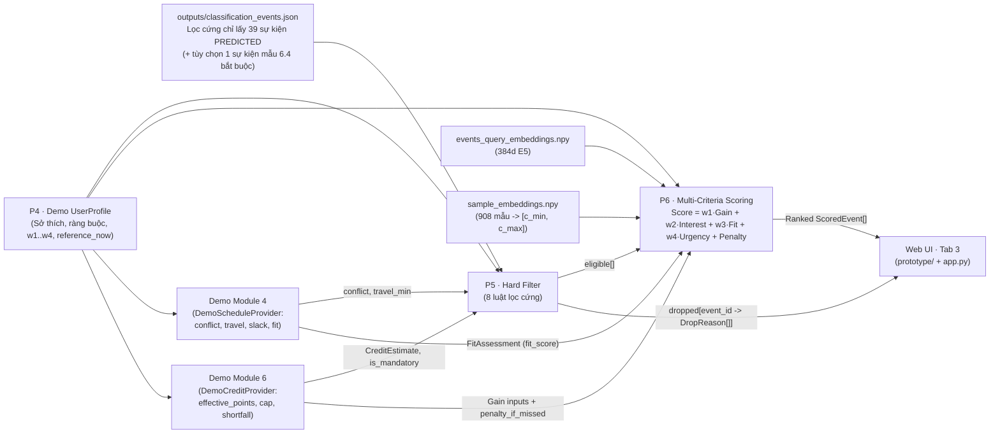

# Phương án Thiết kế (v2.0): Demo P4 · Demo M4/M6 · Lọc Cứng (P5) · Chấm Điểm (P6) · UI Demo & Report

> **Trạng thái:** `v2.0 — ĐÃ CẬP NHẬT THEO GÓP Ý NHÓM (CHỜ DUYỆT TRƯỚC KHI TRIỂN KHAI)`
> **Phạm vi:**
> 1. Thiết kế **Demo Module 4** (lịch trình, di chuyển, `compute_fit`) và **Demo Module 6** (điểm thực nhận, trần nhóm, khoảng thiếu, cờ bắt buộc) tách biệt qua interface chuẩn để test và dễ thay thế bằng module thật sau này.
> 2. Thiết kế **P4 Demo User Profile** gọn nhẹ, **P5 Hard Filter** và **P6 Multi-Criteria Scoring** chỉ tiêu thụ các sự kiện có trạng thái **`PREDICTED`** từ `outputs/classification_events.json` (**39/108 sự kiện**).
> 3. Thiết kế **Giao diện Web UI Demo & Test Recommendation** tích hợp trực tiếp vào `app.py` + `prototype/` sẵn có (không thêm thư viện ngoài).
> 4. Quy định cấu trúc **File Report đầu ra** (`docs/recommendation_p4_p5_p6_report.md`) báo cáo chi tiết những gì đã thực hiện được và lộ trình **Future Work**.
>
> **Tài liệu liên quan:**
> - Sơ đồ luồng: `module3_engine_flowchart.drawio.svg`
> - Đặc tả bàn giao Module 4: `docs/module4_fit_handoff_spec.md`
> - Quyết định kiến trúc: `docs/module3_decision_log.md` (`D-3`, `D-4`, `D-5`, `D-6`)
> - Dữ liệu kiểm thử: `outputs/classification_events.json` (39 `PREDICTED`), `data/processed/test_fixtures_events.json`, `data/generated/events_query_embeddings.npy`, `data/processed/cls_index/sample_embeddings.npy` (908 mẫu)

---

## 1. Tóm tắt các yêu cầu & thay đổi đã cập nhật (v2.0)

| Hạng mục | Phương án thiết kế chốt trong v2.0 |
|---|---|
| **Nguồn sự kiện đầu vào** | **Chỉ lấy các sự kiện `status == "PREDICTED"`** từ `outputs/classification_events.json` (**39 sự kiện**: `1.9` = 23, `3.5` = 8, `1.6` = 7, `4.3` = 1; nhóm `C1` = 30, `C3` = 8, `C4` = 1; `offline` = 33, `online` = 6; phí `0–140.000đ`). Bỏ qua toàn bộ 69 sự kiện `NEEDS_REVIEW`. Kèm nút tùy chọn chèn **1 sự kiện mẫu bắt buộc (`6.4` Tuần SHCD)** để test riêng `Penalty`. |
| **Demo Module 4** | Xây dựng `DemoScheduleProvider` (`src/recommendation/demo_module4.py`) tuân thủ đúng Protocol `ScheduleProvider` và đặc tả `docs/module4_fit_handoff_spec.md`: cung cấp preset TKB mẫu, tùy chỉnh slot bận / tuần thi, `travel_min` theo cơ sở (hoặc override), `nearest_slack_minutes` và `compute_fit` 5 bước liên tục. |
| **Demo Module 6** | Xây dựng `DemoCreditProvider` (`src/recommendation/demo_module6.py`) tuân thủ đúng `CreditCalculatorProtocol` (bọc `RubricCreditEngine` trên `data/raw/rubric.yaml`): nhận nhanh điểm hiện tại `C1..C5` và `target_total`, tính `effective_points`, `capped_by`, `target_gap_by_group`, và nhận diện cờ bắt buộc (`6.4` / `is_mandatory`). |
| **P4 · Demo User Profile** | Hồ sơ gọn nhẹ: chọn chip sở thích / câu tự do $\to$ `user_vec (384d)` tĩnh (chưa bật Rocchio), ràng buộc cơ bản (`cohort`, `faculty`, `home_campus`, `max_travel_min`, `max_budget_vnd`, `pref_hours`, `participated/hidden`), chọn mốc `reference_now` và chọn preset/tùy chỉnh 4 trọng số `w1..w4`. |
| **P5 · Hard Filter** | 8 quy tắc lọc cứng có ghi nhận đầy đủ mọi `DropReason`, cộng ngoại lệ giữ lại sự kiện bắt buộc (`6.4` / `is_mandatory`) đi qua lọc `effective_points == 0`. |
| **P6 · Scoring** | `Score = w1·Gain + w2·Interest + w3·Fit + w4·Urgency + Penalty`, trong đó:<br>- `Gain`: từ Demo Module 6.<br>- `Interest`: Clipped Min-Max trên cosine E5 với `[c_min, c_max]` đo từ duyệt toàn bộ 908 mẫu `sample_embeddings.npy`.<br>- `Fit`: từ Demo Module 4 (`compute_fit`).<br>- `Urgency`: chỉ theo độ gấp thời gian `exp(-d / tau)` (bỏ `seats_left`).<br>- `Penalty`: **chỉ can thiệp cho hoạt động bắt buộc cao** (`> 0` để đẩy ưu tiên; `0.0` cho sự kiện thường). |
| **UI Demo & Test** | Thêm **Tab 3: "Đề xuất hoạt động (Demo P4–P6)"** vào Web UI sẵn có (`app.py` + `prototype/index.html`, `app.js`, `styles.css`), gồm Control Panel (chỉnh nhanh P4/M4/M6/w1..w4) và Inspection Panel (bảng Top-N phân rã 5 cột điểm + bảng P5 "Vì sao bị loại?"). |
| **Báo cáo đầu ra** | Xuất kèm `docs/recommendation_p4_p5_p6_report.md` tổng hợp chi tiết **những gì đã thực hiện được** (kèm kết quả chạy kiểm thử) và **Future Work** cần làm để hoàn thiện / cải tiến. |

---

## 2. Kiến trúc tổng thể bản Demo (`P4 + Demo M4 + Demo M6 -> P5 -> P6 -> UI`)



> **Nguyên tắc cắm thay thế (Plug-and-Play):** Cả `DemoScheduleProvider` (Demo M4) lẫn `DemoCreditProvider` (Demo M6) đều triển khai đúng Protocol chuẩn (`ScheduleProvider` và `CreditCalculatorProtocol`). Khi nhóm Module 4 và Module 6 hoàn thiện bản chính thức, chỉ cần thay đổi đối tượng truyền vào pipeline mà **không sửa logic P5/P6**.

---

## 3. Thiết kế Phiên bản Demo cho Module 4 & Module 6

### 3.1. Demo Module 4 — `DemoScheduleProvider` (`src/recommendation/demo_module4.py`)

Xây dựng phiên bản demo gọn nhẹ, độc lập, bám sát 100% đặc tả đã bàn giao trong `docs/module4_fit_handoff_spec.md`:

- **Các preset lịch học mẫu tích hợp sẵn (chọn 1-click trên UI):**
  1. `light_schedule` *(Lịch học nhẹ)*: bận sáng Thứ 2 & Thứ 4 (`07:30–11:30`, CS1), ngoài tuần thi $\to$ ít trùng lịch, phù hợp test ranking chung.
  2. `busy_weekend` *(Bận cuối tuần & chiều Thứ 2)*: bận Thứ 7 (`12:00–17:00`), Chủ Nhật (`08:00–12:00`), Thứ 2 (`13:00–17:00`) $\to$ kích hoạt rõ lọc cứng `schedule_conflict` và khoảng đệm sát `f_slack` trên các sự kiện `PREDICTED` tháng 10–11/2026 (`14/11`, `15/11`, `16/11`, `18/11`).
  3. `exam_week_heavy` *(Tuần thi + lịch dày)*: bật `exam_weeks = [("2026-11-09", "2026-11-22")]` kèm 1 lịch thi cụ thể (`16/11 13:00–15:00`, `is_exam=True`) $\to$ kích hoạt cả lọc trùng lịch thi lẫn hệ số giảm điểm tuần thi `f_exam = 0.45` (offline) vs `0.90` (online).
  4. `custom`: người dùng tự thêm/xóa từng slot `(day_of_week, start_hour, end_hour, is_exam)` và khoảng ngày `exam_weeks` trực tiếp trên UI.
- **Mô phỏng thời gian di chuyển (`estimate_travel_minutes`):**
  - Tự động suy luận cơ sở từ `event.location` (`cs1_nvc`, `cs2_lt`, `online`, `unknown`) theo bảng mặc định (`0p / 10p / 45p / 30p`).
  - Hỗ trợ tùy chỉnh nhanh 2 mức `same_campus_min` và `cross_campus_min` trong bảng cấu hình demo để kiểm thử tức thì ảnh hưởng lên P5 (`too_far`) và P6 (`f_travel`).
- **Đầu ra `compute_fit(...)`:** trả về `FitAssessment` đầy đủ gồm `fit_score`, `has_conflict`, `in_exam_week`, `estimated_travel_min`, `nearest_slack_min`, `conflict_detail`, `sub_scores = {f_travel, f_slack, f_pref, f_exam}`, và `reasons` đúng theo công thức 5 bước:
  $$\text{fit\_score} = \text{clip}_{[0, 1]}\!\Big(\big(0.45 \cdot f_{\text{travel}} + 0.25 \cdot f_{\text{slack}} + 0.30 \cdot f_{\text{pref}}\big) \cdot f_{\text{exam}}\Big)$$
  *(Đã bỏ `free_event_bonus` để không trùng với lọc ngân sách P5.)*

### 3.2. Demo Module 6 — `DemoCreditProvider` (`src/recommendation/demo_module6.py`)

Xây dựng lớp demo gọn nhẹ bọc trên `RubricCreditEngine` (`module6/credit_engine.py`, đọc khung điểm thật HCMUS `data/raw/rubric.yaml` với trần `C1=30, C2=20, C3=25, C4=25, C5=30`):

- **Đầu vào tối giản cho demo (không cần tạo sổ minh chứng phức tạp):**
  - `current_by_group`: 5 con số điểm hiện tại (`C1..C5`), vd `{"C1": 22, "C2": 15, "C3": 10, "C4": 10, "C5": 0}` (tổng = 57).
  - `target_total`: điểm mục tiêu (mặc định `85.0`).
  - `target_by_group` *(tùy chọn)*: nếu không nhập thì tự phân bổ mục tiêu theo trần nhóm (hoặc giữ bằng trần nhóm `C1..C5` chuẩn `compute_group_shortfall`).
  - `default_role`: vai trò mặc định (`"participant"`).
- **Chức năng mô phỏng cho P5 & P6:**
  1. Chuyển `current_by_group` thành `UserLedger` tương đương và gọi `RubricCreditEngine.estimate_event_credit()` + `compute_group_shortfall()`.
  2. Trả về `CreditEstimate` thật từ `rubric.yaml` (có áp trần nhóm `remaining_cap_by_group`, áp trần tổng `100`, giữ nguyên `source = explicit | rule | rule_fallback` và `capped_by`).
  3. Cung cấp hàm tiện ích `get_mandatory_penalty_info(event, credit)` trả về `(is_mandatory: bool, penalty_if_missed: float)` bằng cách kiểm tra cờ `mandatory_event_avoid_penalty` của mục `6.4` (`-20`đ) hoặc metadata `is_mandatory` của sự kiện mẫu.
- **Các preset điểm ĐRL mẫu trên UI:**
  - `mid_semester` (`C1=22, C2=15, C3=10, C4=10, C5=0`, target `85`): còn dư chỗ ở mọi nhóm, thiếu nhiều ở C3/C4.
  - `c1_capped` (`C1=30, C2=15, C3=10, C4=10, C5=0`, target `85`): **chạm trần C1** $\to$ test P5 lọc sạch 30 sự kiện nhóm C1 (`capped_by="group"`).
  - `near_target` (`C1=25, C2=18, C3=22, C4=18, C5=0`, target `85`): tổng 83/85, còn thiếu 2đ $\to$ test áp trần tổng & chế độ `interest_first`.

---

## 4. Thiết kế P4 (Demo User Profile), P5 (Hard Filter) & P6 (Scoring)

### 4.1. P4 — `DemoUserProfile` (`src/recommendation/demo_profile.py`)

Chỉ giữ các trường thiết yếu đủ kiểm thử toàn bộ P5 và P6 (không bật Rocchio online learning và không tự động biến đổi trọng số theo click/save):

| Nhóm | Trường | Kiểu & Mặc định |
|---|---|---|
| Đối tượng | `cohort`, `faculty`, `class_id` | `Optional[str]` (vd `"K24"`, `"CNTT"`, `None`) |
| Sở thích | `interest_chips`, `free_text` | `List[str]` (chọn từ 8 chip chuẩn) + `Optional[str]` $\to$ encode 1 lần bằng `e5-small` ra `user_vec (384d)` |
| Ràng buộc | `home_campus`, `max_travel_min`, `strict_max_travel`, `max_budget_vnd`, `pref_hours` | `"cs1_nvc"`, `45`, `True`, `30000`, `(8.0, 21.0)` |
| Trạng thái test | `participated_event_ids`, `hidden_event_ids` | `List[str]` (có thể bấm trực tiếp trên UI để thêm/gỡ) |
| Mốc thời gian | `reference_now` | ISO-8601, mặc định `"2026-10-01T08:00:00+07:00"` (còn 18 sự kiện `PREDICTED` sắp diễn ra; có preset `"2026-04-01"` = 36 sự kiện, `"2026-11-01"` = 11 sự kiện) |
| Điểm & Lịch | `credit_profile` (Demo M6), `schedule_profile` (Demo M4) | Chọn preset hoặc nhập số trực tiếp |
| Trọng số | `weight_preset`, `custom_weights` | `"balanced"` `(0.40, 0.25, 0.20, 0.15)` \| `"need_points"` `(0.55, 0.15, 0.15, 0.15)` \| `"interest_first"` `(0.20, 0.50, 0.20, 0.10)` \| `"exam_week"` `(0.25, 0.15, 0.45, 0.15)` \| `"custom"` |

### 4.2. P5 — Hard Constraint Filter (`src/recommendation/filter.py`)

**Cổng đầu vào (Classification Gate):**
- Chỉ đưa vào P5 các sự kiện có `classification.status == "PREDICTED"` (`39` sự kiện trong `outputs/classification_events.json`), cộng thêm sự kiện bắt buộc giả lập nếu người dùng bật toggle `include_mandatory_demo_event`.
- Các sự kiện `NEEDS_REVIEW` (`69` sự kiện) / `NO_MATCH` / `SKIPPED_NOT_EVENT` được tách riêng vào mục thống kê `excluded_by_classification_status` (không đưa vào pool chấm điểm).

**8 Quy tắc lọc cứng (kiểm tra đủ tất cả quy tắc, ghi trọn danh sách `DropReason` cho mỗi sự kiện bị loại):**

| # | Mã `DropReason.code` | Điều kiện loại | Xử lý dữ liệu thiếu & Ngoại lệ bắt buộc |
|---|---|---|---|
| **F1** | `already_participated` | `event_id in user.participated_event_ids` | Áp dụng cho mọi sự kiện |
| **F2** | `hidden_by_user` | `event_id in user.hidden_event_ids` | Không ẩn sự kiện bắt buộc (`is_mandatory`) |
| **F3** | `expired` | `effective_deadline < reference_now` (hoặc `end_datetime < reference_now`) | `effective_deadline`: ưu tiên `reg_end_datetime` nếu `<= start_datetime`, ngược lại lấy `start_datetime` (xử lý lỗi `reg_end_after_start`). Thiếu cả hai $\to$ không loại |
| **F4** | `audience_mismatch` | Không khớp `cohorts` / `faculties` / `classes` của sinh viên | Chỉ kiểm tra trường có danh sách khác rỗng (chuẩn hóa `"K26" == "KHOA2026"`). Danh sách rỗng hoặc `all_students=True` $\to$ không loại |
| **F5** | `schedule_conflict` | Demo M4 trả `check_conflict(event).has_conflict == True` | Sự kiện `online` không xung đột tiết thường (chỉ xung đột lịch thi). Thiếu `start_datetime` $\to$ không loại |
| **F6** | `over_budget` | `max_budget_vnd is not None`, `fee_vnd is not None` và `fee_vnd > max_budget_vnd` | `fee_vnd is None` $\to$ không loại. Miễn lọc cho sự kiện bắt buộc |
| **F7** | `too_far` | `strict_max_travel == True`, không phải `online`, `travel_min > max_travel_min` | Khi `strict_max_travel == False` thì chỉ giảm điểm `Fit` ở P6. Miễn lọc cho sự kiện bắt buộc |
| **F8** | `no_credit_gain` | Demo M6 trả `not is_credit_eligible` hoặc `effective_points <= 0` (chạm trần nhóm/tổng, `exclusive_with`) | **Ngoại lệ:** (a) Sự kiện bắt buộc (`is_mandatory` / `mandatory_event_avoid_penalty`) **LUÔN đi qua P5**; (b) Chế độ `interest_first` có cờ tùy chọn `allow_zero_gain_in_interest_mode` |

### 4.3. P6 — Multi-Criteria Scoring (`src/recommendation/scoring.py`)

$$\text{Score}(u, e) = w_1 \cdot \text{Gain}(u, e) + w_2 \cdot \text{Interest}(u, e) + w_3 \cdot \text{Fit}(u, e) + w_4 \cdot \text{Urgency}(u, e) + \text{Penalty}(u, e)$$

1. **`Gain` $\in [0, 1]$ (từ Demo Module 6):**
   - Nếu `not credit.is_credit_eligible` hoặc `credit.effective_points <= 0` $\Rightarrow \text{Gain} = 0.0$.
   - Ngược lại:
     $$P_{\text{use}} = \begin{cases} \min(P_{\text{eff}},\; 0.7 P_{\min} + 0.3 P_{\text{exp}}) & \text{nếu } \text{source} = \texttt{rule\_fallback} \\ P_{\text{eff}} & \text{ngược lại} \end{cases}$$
     $$\text{Gain} = \text{clip}_{[0, 1]}\!\left(\min\!\left(1,\; \frac{P_{\text{use}}}{10.0}\right) \cdot \left(0.5 + 0.5 \cdot \frac{\text{target\_gap}_c}{M_c}\right) \cdot r_{\text{src}}\right)$$
     với $r_{\text{src}} \in \{1.00 \text{ (explicit)},\; 0.90 \text{ (rule)},\; 0.80 \text{ (rule\_fallback)}\}$.

2. **`Interest` $\in [0, 1]$ (Clipped Min-Max từ duyệt toàn bộ 908 sample `sample_embeddings.npy`):**
   - Với `user_vec` hiện tại, duyệt qua toàn bộ `S_sample` (`908 × 384`): $\mathbf{s} = S_{\text{sample}} \cdot u_{\text{vec}}$.
   - Lấy dải thực nghiệm `[c_min, c_max]` từ $\mathbf{s}$ (mặc định dùng `min(s), max(s)` — hỗ trợ tùy chọn chuyển `[p1, p99]` hoặc ngưỡng cố định trong config), sau đó kéo giãn cosine giữa `user_vec` và `event_vec`:
     $$\text{Interest}(u, e) = \text{clip}\!\left(\frac{\cos(u_{\text{vec}}, e_{\text{vec}}) - c_{\min}}{c_{\max} - c_{\min}},\; 0.0,\; 1.0\right)$$
   - Nếu `user_vec is None` (chưa chọn sở thích) $\Rightarrow \text{Interest} = 0.50$.

3. **`Fit` $\in [0, 1]$ (từ Demo Module 4):**
   - Nhận trực tiếp `fit_assessment.fit_score` từ `DemoScheduleProvider.compute_fit(...)`.

4. **`Urgency` $\in [0, 1]$ (chỉ theo độ gấp thời gian):**
   - Với $d = (t_{\text{deadline}} - t_{\text{now}}) / 24\text{h} \ge 0$ và $\tau = 5.0$ ngày:
     $$\text{Urgency}(u, e) = \begin{cases} \exp(-d / 5.0) & \text{nếu có } t_{\text{deadline}} \\ 0.20 & \text{nếu thiếu cả hạn ĐK và giờ bắt đầu} \end{cases}$$

5. **`Penalty` $\ge 0$ (chỉ can thiệp cho hoạt động bắt buộc cao):**
   - Sự kiện thường: `Penalty = 0.00`.
   - Hoạt động bắt buộc cao (nhận diện qua Demo M6 / metadata):
     $$\text{Penalty}(u, e) = \begin{cases} \min\!\left(1.00,\; \dfrac{|P_{\text{deduct}}|}{20.0}\right) & \text{nếu có mức phạt điểm } P_{\text{deduct}} \text{ (vd } 6.4 \text{ trừ } 20\text{đ} \Rightarrow +1.00\text{)} \\ 0.50 & \text{nếu có cờ } \texttt{is\_mandatory=True} \text{ không ghi rõ mức trừ} \\ 0.00 & \text{ngược lại} \end{cases}$$

---

## 5. Thiết kế UI Demo & Test cho Recommendation

Tích hợp trực tiếp thành **Tab 3: "Đề xuất hoạt động (Demo)"** trên ứng dụng web hiện có (`app.py` + `prototype/index.html`, `prototype/app.js`, `prototype/styles.css`) — chạy ngay bằng `python app.py` tại `http://127.0.0.1:8765`, **không cần cài thêm framework ngoài**.

### 5.1. API Endpoints bổ sung vào `app.py`

| Endpoint | Phương thức | Mô tả |
|---|---|---|
| `/api/recommendation/bootstrap` | `GET` | Trả về danh sách 8 chip sở thích, 4 persona demo, 4 preset trọng số, 3 preset lịch M4, 3 preset điểm M6, và thống kê tập 39 sự kiện `PREDICTED` |
| `/api/recommendation/run` | `POST` | Nhận payload cấu hình từ UI (`profile`, `demo_m4`, `demo_m6`, `weights`, `reference_now`, `include_mandatory_demo`, `strict_max_travel`) $\to$ chạy `P4 -> Demo M4/M6 -> P5 -> P6` $\to$ trả về JSON gồm: `pipeline_summary`, `interest_calibration {c_min, c_max, sample_count}`, `ranked_events[]` (có đủ breakdown 5 cột + sub-scores M4/M6) và `dropped_events[]` (có đủ `DropReason[]`) |

### 5.2. Bố cục giao diện Tab 3 (`split-layout` đồng bộ với Tab 1 & Tab 2)

```
+---------------------------------------------------------------------------------+
| HEADER: No-Le-DRL | [Tab 1: Phân loại] [Tab 2: 108 sự kiện] [Tab 3: Đề xuất *] |
+---------------------------------------------------------------------------------+
| CỘT TRÁI — CẤU HÌNH DEMO (P4 · M4 · M6)  | CỘT PHẢI — KẾT QUẢ KIỂM THỬ (P5·P6) |
|                                          |                                      |
| 1. Persona nhanh (1-click):              | [KPI BAR]                            |
|    [SV Cân bằng] [Chạm trần C1]          | Tổng 108 -> 39 PREDICTED (bỏ 69 NR)  |
|    [Tuần thi]    [Test Bắt buộc 6.4]     | -> Qua P5: 14 | Bị loại P5: 25       |
|                                          | Interest range: [0.742 .. 0.891]     |
| 2. Sở thích (P4):                        |                                      |
|    [x] AI & Công nghệ  [x] Học thuật     | [Sub-tab A: Xếp hạng P6 (14)]        |
|    [ ] Tình nguyện     [ ] Văn nghệ ...  | [Sub-tab B: Bị lọc cứng P5 (25)]     |
|    Free text: [________________________] |                                      |
|                                          | --- SUB-TAB A: TOP ĐỀ XUẤT ---       |
| 3. Ràng buộc Lọc cứng (P5):              | #1 [BẮT BUỘC 6.4] Tuần SHCD  [1.420] |
|    Mốc ngày: [2026-10-01] (Presets)      |    Gain 0.00 | Int 0.31 | Fit 0.92   |
|    Cơ sở: [CS1 v] Max di chuyển: [45]p   |    Urg 0.67  | Penalty +1.00         |
|    [x] Lọc cứng quá xa  Ngân sách:[30k]  |                                      |
|    Khóa: [K24]  [x] Thêm mẫu 6.4 SHCD    | #2 [1.9 · C1 · +5đ] Seminar AI [0.74]|
|                                          |    [====Gain===][===Int===][=Fit][U] |
| 4. Demo Module 6 (Điểm ĐRL hiện có):     |    Chi tiết M4/M6 (mở rộng):         |
|    Preset: [Giữa kỳ v]  Mục tiêu: [85]   |    - cos_raw=0.862 -> Int=0.805      |
|    C1:[22]/30 C2:[15]/20 C3:[10]/25      |    - travel=10p, slack=60p, exam=No  |
|    C4:[10]/25 C5:[0]/30  (Tổng: 57/100)  |    [Đã tham gia]  [Ẩn sự kiện]       |
|                                          |                                      |
| 5. Demo Module 4 (Lịch cá nhân):         | --- SUB-TAB B: VÌ SAO BỊ LOẠI? ---   |
|    Preset: [Bận cuối tuần v]             | Thống kê: expired(18), over_budget(1)|
|    Slots bận: T7 12:00-17:00 [x] [+Thêm] |           schedule_conflict(4)...    |
|    Tuần thi: [2026-11-09 .. 2026-11-22]  | - [sample_001] expired (2025-11-19)  |
|                                          | - [sample_012] schedule_conflict     |
| 6. Trọng số P6 (w1..w4):                 |   (Trùng lịch T7 12:00-17:00)        |
|    Preset: [balanced v]                  |                                      |
|    w1:0.40  w2:0.25  w3:0.20  w4:0.15    |                                      |
|                                          |                                      |
| [   Chạy Đề Xuất (P5 + P6)   ] [Reset]   |                                      |
+---------------------------------------------------------------------------------+
```

- **Tính năng test tương tác trực tiếp trên UI:**
  - Bấm **"Đã tham gia"** hoặc **"Ẩn sự kiện"** trên bất kỳ thẻ nào ở Sub-tab A $\to$ tự thêm `event_id` vào `participated_event_ids` / `hidden_event_ids` và chạy lại ngay để chứng minh P5 lập tức đẩy sự kiện đó sang Sub-tab B với đúng mã `already_participated` / `hidden_by_user`.
  - Kéo `C1` lên `30` (chạm trần) rồi bấm Chạy $\to$ lập tức thấy toàn bộ sự kiện `C1` chuyển sang Sub-tab B với mã `no_credit_gain (capped_by=group)`.
  - Đổi preset trọng số (`balanced` $\leftrightarrow$ `need_points` $\leftrightarrow$ `interest_first` $\leftrightarrow$ `exam_week`) $\to$ quan sát thứ hạng thay đổi trực tiếp cùng thanh phân rã 5 thành phần.

---

## 6. Thiết kế Đầu ra File Report (`docs/recommendation_p4_p5_p6_report.md`)

Sau khi triển khai code, chạy toàn bộ unit tests và kiểm thử thực tế qua pipeline + UI, hệ thống sẽ xuất kèm file báo cáo **`docs/recommendation_p4_p5_p6_report.md`** với 2 phần trọng tâm:

### Phần A — Báo cáo những gì đã thực hiện được
1. **Kiến trúc & Các module đã hoàn thiện:** liệt kê đầy đủ file mã nguồn (`demo_profile.py`, `demo_module4.py`, `demo_module6.py`, `filter.py`, `scoring.py`, `recommender.py`, `app.py`, `prototype/*`) và tuân thủ quyết định `D-3`, `D-4`, `D-5`, `D-6`.
2. **Kết quả kiểm thử tự động (`pytest`):** thống kê số lượng test pass cho P4, Demo M4 (đủ 8 TC chuẩn trong `module4_fit_handoff_spec.md`), Demo M6, P5 (đủ 8 luật lọc cứng + ngoại lệ bắt buộc), P6 (5 tiêu chí + `Interest` Clipped Min-Max từ 908 sample), và API endpoints.
3. **Kết quả chạy thực tế trên 39 sự kiện `PREDICTED`:**
   - Bảng thống kê 4 kịch bản Persona Demo (`SV cân bằng`, `Chạm trần C1`, `Tuần thi + bận cuối tuần`, `Test bắt buộc 6.4`): số sự kiện qua P5, bảng lý do bị loại P5, Top-5 đề xuất kèm đủ 5 cột điểm và dải `[c_min, c_max]` thực đo trên `sample_embeddings.npy`.
4. **Hướng dẫn chạy Demo UI & kiểm thử nhanh** (lệnh `python app.py` + kịch bản thao tác kiểm chứng từng tính năng).

### Phần B — Future Work (Lộ trình hoàn thiện & cải tiến)
1. **Tích hợp Module 4 & Module 6 bản thật:**
   - Thay `DemoScheduleProvider` bằng API Module 4 thật (đồng bộ TKB Portal / `.ics` tự động, tính thời gian di chuyển bằng bản đồ/tọa độ thật thay vì bảng 10p/45p theo cơ sở).
   - Thay `DemoCreditProvider` bằng Module 6 thật kết nối sổ điểm học kỳ & Module 7 (Evidence Vault xác thực minh chứng).
2. **Mở rộng nguồn dữ liệu từ P2 (Classification):**
   - Cải thiện bài toán phân loại P2 để giảm tỷ lệ `NEEDS_REVIEW` (`69/108` sự kiện) và giải quyết các câu hỏi mở của rubric (`Q9–Q23`), đồng thời bổ sung phân loại thực tế cho mục bắt buộc `6.4` và nhóm `C2/C5`.
3. **Triển khai các khối còn lại của Module 3 (`P7` & `P8`):**
   - **P7 · Selection:** chọn danh sách đa dạng bằng `MMR + 1 slot khám phá` và lập kế hoạch tuần/tháng không trùng lịch, không vượt trần bằng `LP / CP-SAT`.
   - **P8 · Explain:** sinh lý do tự nhiên có kiểm chứng số liệu (numeric grounding) + kết nối nhắc hạn sang Module 5.
4. **Nâng cấp P4 từ bản Demo lên bản Thích nghi (Adaptive):**
   - Kích hoạt lại cập nhật vector sở thích Rocchio (`u_declared` + `u_learned`) và cập nhật trọng số theo hành vi từ `Feedback Store`.
   - Bổ sung điều chỉnh trọng số động theo áp lực thiếu điểm (`M6 Shortfall`) và mật độ lịch (`M4 Schedule`).
5. **Hiệu chỉnh & Đánh giá định lượng bộ trọng số `(w1..w4)`:**
   - Thu thập khảo sát so sánh cặp từ sinh viên, ước lượng trọng số bằng **Bradley–Terry / Logistic Regression (4 tham số)**, kiểm tra độ nhạy bằng **Kendall's $\tau$** và đánh giá offline (`nDCG@5`, `Overlap@5`) so sánh với baseline sắp xếp theo thời gian / chỉ theo điểm.

---

## 7. Danh sách file dự kiến tạo / cập nhật khi triển khai

| File | Hành động | Mô tả |
|---|---|---|
| `configs/recommendation_config.yaml` | Cập nhật | Thêm cấu hình cho P5 (`filter`), P6 (`gain`, `interest`, `urgency`, `penalty_mandatory`), Demo M4 & Demo M6 |
| `src/recommendation/demo_module4.py` | Tạo mới | `DemoScheduleProvider` thực thi `ScheduleProvider` + 3 preset lịch + `compute_fit` liên tục 5 bước (đúng `module4_fit_handoff_spec.md`) |
| `src/recommendation/demo_module6.py` | Tạo mới | `DemoCreditProvider` bọc `RubricCreditEngine` + 3 preset điểm ĐRL + nhận diện cờ bắt buộc (`6.4` / `is_mandatory`) |
| `src/recommendation/demo_profile.py` | Tạo mới | `DemoUserProfile` gọn nhẹ + 4 Persona Demo + sự kiện mẫu bắt buộc `6.4` |
| `src/recommendation/filter.py` | Tạo mới | P5 Hard Filter (lọc `PREDICTED`-only + 8 quy tắc lọc cứng + ngoại lệ bắt buộc) |
| `src/recommendation/scoring.py` | Tạo mới | P6 Scoring (`Gain`, `Interest` Clipped Min-Max trên 908 sample, `Fit`, `Urgency` theo thời gian, `Penalty` bắt buộc) |
| `src/recommendation/__init__.py` & `src/recommender.py` | Cập nhật | Export đầy đủ pipeline `run_recommendation_demo(...)` |
| `app.py` | Cập nhật | Thêm endpoint `/api/recommendation/bootstrap` và `/api/recommendation/run` |
| `prototype/index.html`, `prototype/app.js`, `prototype/styles.css` | Cập nhật | Thêm **Tab 3: Đề xuất hoạt động (Demo P4–P6)** trực quan, tương tác trực tiếp |
| `tests/test_recommendation_p5_p6.py` | Tạo mới | Bộ unit & integration tests (gồm cả 8 TC chuẩn cho `compute_fit` và API test) |
| `docs/recommendation_p4_p5_p6_report.md` | Tạo mới | File Report tổng kết những gì đã thực hiện được + Future Work |

---

## 8. Xác nhận nhanh trước khi bắt đầu code

Bản thiết kế **v2.0** đã cập nhật đầy đủ các góp ý của bạn. Chỉ còn **2 lựa chọn nhỏ** bạn xác nhận nhanh (hoặc trả lời **"Duyệt, triển khai theo mặc định"** để tôi tiến hành code ngay):

1. **Dải `[c_min, c_max]` của `Interest` khi duyệt 908 sample:** lấy đúng `[min, max]` tuyệt đối của `cos(user_vec, sample_embeddings)` *(mặc định khớp sát mô tả của bạn)* hay `[p1, p99]`?
2. **Mức `Penalty` cho hoạt động bắt buộc cao (`6.4` Tuần SHCD):** dùng `+1.00` (luôn đứng Top 1 vượt sự kiện thường) hay `+0.50`?
