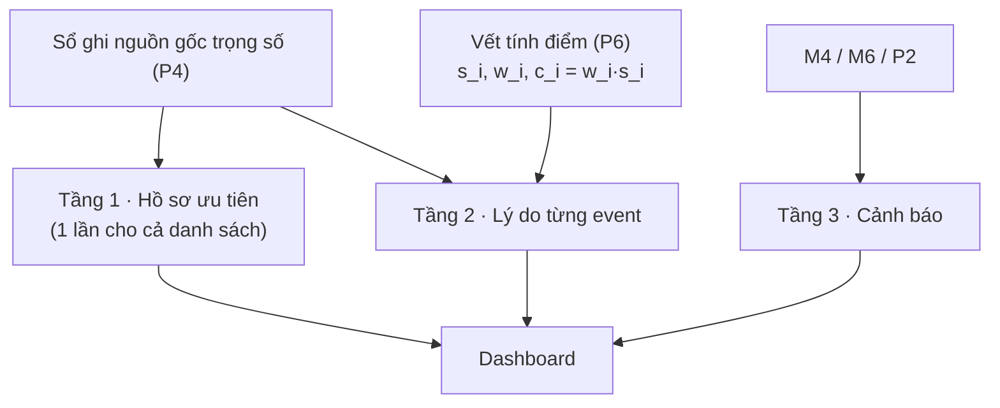
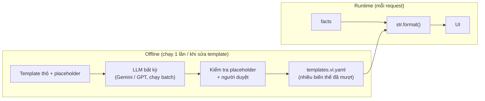

# P8 · EXPLAIN v2 — Giải thích có tính đến trọng số

> [!NOTE]
> Thay đổi so với v1: (1) bỏ phần giải thích kiểu so sánh với event khác, (2) lý do được tính từ **phần đóng góp** (trọng số × điểm) và **lịch sử thay đổi trọng số**, thay vì chỉ dùng điểm thô, (3) làm mượt câu **offline trên template**, nên lúc chạy không cần gọi LLM.

## 1. Vấn đề của v1

Tạo mã lý do chỉ từ điểm thô `s_i` sai ở hai chỗ:

- Một event có `Interest = 0.9` nhưng `w2 = 0.10` thì sở thích gần như **không** phải lý do nó lên top. Nói "vì hợp sở thích" là sai.
- Trọng số `w` thay đổi theo hành vi (`_adapt_weights` trong [user_profile.py](file:///Users/Apple/Documents/Computational%20Thinking/No-Le-DRL/src/recommendation/user_profile.py#L326-L373)). Vì vậy cùng một event, hôm nay lên top vì Fit, tuần sau có thể vì Gain. Người dùng cần biết **vì sao hệ thống đang ưu tiên như vậy**.

Vẫn cần đổi số thành mã rời rạc để ghép template, nhưng **đầu vào phải gồm 3 thứ: điểm, trọng số và nguồn gốc của trọng số**.

## 2. Giải thích theo 3 tầng



| Tầng | Trả lời câu hỏi | Tần suất | Ví dụ |
|---|---|---|---|
| 1. Hồ sơ ưu tiên | "Hệ thống đang ưu tiên gì, vì sao?" | 1 banner / danh sách | "Đang ưu tiên **thuận tiện (31%)** và **điểm ĐRL (30%)**. Mức thuận tiện tăng từ 20% vì gần đây bạn bỏ qua 3 hoạt động trùng lịch." |
| 2. Lý do từng event | "Vì sao event này?" | Mỗi event | "Online và nằm đúng giờ trống, khớp với ưu tiên thuận tiện của bạn. Cộng thêm +3 điểm mục Tình nguyện." |
| 3. Cảnh báo | "Cần lưu ý gì?" | Khi có | "Mục C3 sắp chạm trần." |

Tầng 1 tách riêng để **phần giải thích trọng số không bị lặp lại ở mỗi event**. Tầng 2 chỉ dẫn lại một câu ngắn như "khớp với ưu tiên … của bạn".

## 3. Sổ ghi nguồn gốc trọng số (Weight Attribution Ledger)

### 3.1 Ý tưởng

Code hiện tại cập nhật như sau, với `d = w − w_declared` là độ lệch so với preset:

$$
d' = \Pi\big((1-p)\,(d + \Delta_{learn} + \Delta_{boost})\big), \quad p = \text{declared\_anchor\_pull} = 0.10
$$

Mỗi lần cập nhật, các đóng góp cũ **giảm dần** theo hệ số `(1−p) = 0.9`. Ta chỉ cần lưu thêm một bộ cộng dồn cho từng nguyên nhân và giảm dần chúng với cùng hệ số:

$$
acc_c \leftarrow (1-p)\cdot acc_c \quad \forall c, \qquad acc_{cause} \mathrel{+}= (1-p)\cdot\Delta_{cause}
$$

Phần chênh do phép chiếu `Π` (giới hạn min/max và tổng bằng 1) đưa vào bucket `adjust`. Khi đó ta có **phân rã chính xác**:

$$
w_i = w^{declared}_i + \sum_{c} acc_{c,i}
$$

### 3.2 Các nguyên nhân (bucket) ứng với config hiện có

| Bucket | Nguồn trong code | Câu giải thích (template) |
|---|---|---|
| `dismiss:schedule_conflict`, `dismiss:too_busy` | `dismiss_reason_boosts → w3_fit` | "bạn đã bỏ qua {n} hoạt động vì trùng lịch / bận" |
| `dismiss:low_points` | `→ w1_gain` | "bạn đã bỏ qua {n} hoạt động vì ít điểm" |
| `dismiss:not_interested` | `→ w2_interest` | "bạn đã bỏ qua {n} hoạt động không hợp sở thích" |
| `dismiss:deadline_too_close` | `→ w4_urgency` | "bạn bỏ lỡ {n} hoạt động vì sát hạn" |
| `learn:save`, `learn:joined`, `learn:click` | `lr · (comp − mean)` | "các hoạt động bạn đã lưu/tham gia thường mạnh về {component}" (vd "{example_title}") |
| `learn:dismiss` | lr âm | "những hoạt động bạn bỏ qua thường mạnh về {component}" |
| `adjust` | phép chiếu | không nói ra (chỉ dùng nội bộ) |
| *(sau này)* `ctx:shortfall`, `ctx:exam_week` | M6 / M4 (flowchart có, code chưa có) | "bạn còn thiếu {x} điểm" / "đang trong tuần thi". Đây là **điều chỉnh tạm thời** theo từng lần gợi ý, không lưu vào sổ |

Mỗi bucket lưu `acc` (vector 4 chiều), `count`, và `last_example_event_id`. Cách này rẻ: chỉ khoảng 10 bucket × 4 số trong `UserProfileState`.

### 3.3 Chọn ý cho Tầng 1

1. Lấy 2 trọng số lớn nhất → "Đang ưu tiên A (x%) và B (y%)".
2. Với trọng số **thay đổi nhiều nhất** so với preset (`|w_i − w_decl_i| ≥ 0.05`): chọn bucket có `|acc_{c,i}|` lớn nhất → "… tăng/giảm từ x% vì {câu của bucket}".
3. Nếu không có thay đổi đáng kể → "Theo lựa chọn ban đầu của bạn: {preset_label}".
4. *(Tùy chọn, nên có)* Cho người dùng nút "Về lại mức ưu tiên ban đầu". Hàm `reset_learned_behavior` đã có sẵn.

## 4. Tầng 2: lý do từng event dựa trên phần đóng góp

### 4.1 Đại lượng dùng

- `c_i = w_i · s_i`: đóng góp thực tế vào Score.
- `share_i = c_i / Σ c_j`: tỷ lệ đóng góp.
- `prio_i`: thứ hạng của `w_i` trong 4 trọng số hiện tại (1 là được ưu tiên nhất).
- `level(s_i)`: high / mid / low (theo percentile trong tập ứng viên sau P5, kết hợp ngưỡng tuyệt đối).

> [!IMPORTANT]
> Muốn so sánh `c_i` giữa các thành phần thì 4 điểm `s_i` phải cùng thang [0,1] và có phân phối gần nhau. Cần kiểm tra khi viết P6: nếu Fit luôn khoảng 0.7 còn Urgency luôn khoảng 0.1 thì nên chuẩn hóa (min-max hoặc percentile) trước khi nhân trọng số.

### 4.2 Bảng 2×2: điểm × độ ưu tiên

| | **Ưu tiên cao** (`prio ≤ 2`) | **Ưu tiên thấp** |
|---|---|---|
| **Điểm cao** | `MATCH_PRIORITY`: lý do chính. "…, khớp với ưu tiên {component} của bạn" | `BONUS`: lý do phụ. "Cộng thêm: …" |
| **Điểm thấp** | `TRADEOFF`: nói rõ sự đánh đổi. "Dù không thật thuận tiện, hoạt động này bù lại bằng …" | bỏ qua |

Kết hợp với chi tiết của từng thành phần (lấy từ evidence như v1: `points`, `category`, `chip_label`, `mode`, `travel_min`, `days_to_deadline` …) để tạo mã cụ thể, ví dụ `MATCH_PRIORITY.FIT.ONLINE`, `BONUS.GAIN.FILL_SHORTFALL`, `TRADEOFF.FIT.CROSS_CAMPUS`.

### 4.3 Quy tắc chọn

1. **Lý do chính** = thành phần có `share_i` lớn nhất. Nếu nó cũng là ưu tiên đã bị hành vi đẩy lên (`acc` dương đáng kể) thì nối thêm câu ngắn dẫn về Tầng 1: "(theo thói quen gần đây của bạn)".
2. **Lý do phụ** (tối đa 1–2) = `BONUS` hoặc `MATCH` thuộc thành phần khác, `share ≥ 0.15`.
3. **Đánh đổi** (tối đa 1) = `TRADEOFF` nếu có. Giúp giải thích trung thực khi event có điểm yếu rõ ràng.
4. `SEL_EXPLORATION` (slot khám phá của MMR) luôn là lý do chính khi có, vì event này **không** lên top nhờ trọng số.

### 4.4 Thứ hạng nếu dùng trọng số ban đầu (tùy chọn, rất rẻ)

Điểm thành phần đã có sẵn, nên chấm lại bằng `w_declared` chỉ là một phép nhân vector. Nếu `|rank_now − rank_declared| ≥ 3` thì thêm:

> "Hoạt động này được đẩy từ hạng #8 lên #2 nhờ mức ưu tiên thuận tiện bạn hình thành gần đây."

Câu này cho thấy trực tiếp ảnh hưởng của trọng số đã học lên đề xuất. Nó không so sánh với event khác, nên không mâu thuẫn với việc bỏ phần so sánh.

## 5. Làm mượt câu mà gần như không tốn tài nguyên server

### Khuyến nghị: làm mượt **template**, không làm mượt **từng câu cụ thể**



- Cho LLM viết lại **các tổ hợp lý do** (lý do chính × lý do phụ × có/không đánh đổi) với placeholder `{points}`, `{category_name}` … Mỗi tổ hợp lấy 3–5 biến thể.
  - Số tổ hợp hợp lệ chỉ khoảng vài trăm. Có thể bắt đầu với khoảng 50 tổ hợp hay gặp nhất (lấy từ log), còn lại dùng cách ghép bằng từ nối.
- **Kiểm tra tự động**: tập placeholder của câu đầu ra phải **giống hệt** câu gốc, không được chứa số cứng, và độ dài không quá giới hạn. Sau đó người duyệt nhanh.
- Lúc chạy: **0 lần gọi LLM, 0 GPU, độ trễ ~0**. Không có rủi ro LLM bịa số liệu, vì số được điền vào sau khi câu đã được duyệt.
- Câu cho Tầng 1 (giải thích trọng số) cũng làm theo cách này.

### Phương án bổ sung (nếu muốn mượt hơn nữa)

| Phương án | Tải server | Ghi chú |
|---|---|---|
| **Template đã làm mượt offline** (khuyến nghị) | ~0 | Đủ tốt cho hầu hết trường hợp |
| AI chạy sẵn trong Chrome (Gemini Nano, Rewriter/Prompt API) | 0, chạy trên máy người dùng | Chỉ có trên Chrome và còn thử nghiệm. Chất lượng tiếng Việt chưa chắc, chỉ dùng như cải thiện thêm, luôn có template làm dự phòng |
| API nhẹ (Flash-Lite) gọi lúc chạy | Thấp (server chỉ chuyển tiếp request) | Chỉ dùng khi người dùng bấm "Xem chi tiết", có cache, và phải kiểm tra số liệu như v1 |
| Model local chạy trên server | Cao | Không khuyến nghị cho nhu cầu này |

## 6. Thay đổi dữ liệu cần làm

```python
# P4 – thêm vào UserProfileState
weight_ledger: dict[str, LedgerEntry]   # bucket -> {acc: [4 số], count, last_example_event_id}

# P6 – ScoreTrace (mỗi event)
raw, weights_snapshot, contrib, share, prio, level, evidence
rank_declared: int | None               # thứ hạng nếu dùng w_declared

# P7 – SelectionTrace (đã rút gọn)
slot_type: "relevance" | "exploration"
plan_role: str | None
```

`_adapt_weights` chỉ cần trả thêm phần thay đổi theo từng nguồn (`Δ_learn`, `Δ_boost`, phần chênh do phép chiếu) để `record_behavior` cập nhật sổ. Logic tính trọng số giữ nguyên.

## 7. Lộ trình

1. Thêm sổ ghi nguồn gốc trọng số vào P4, kèm unit test kiểm tra đẳng thức `w = w_decl + Σ acc` (sai số < 1e-6).
2. P6 sinh `ScoreTrace` (gồm `share`, `prio`, `rank_declared`), kiểm tra lại việc chuẩn hóa thang điểm.
3. Bộ luật 2×2, chọn lý do, Tầng 1/2/3, dùng template thô.
4. Chạy batch làm mượt template offline, kiểm tra placeholder, rồi duyệt.
5. Thêm nút "Lý do hữu ích?" và nút "Về lại mức ưu tiên ban đầu".
