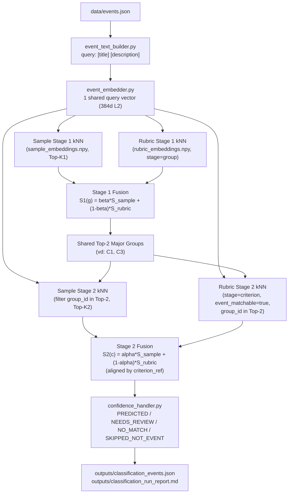

# Hệ thống Phân loại Sự kiện ĐRL HCMUS (`src/classification`)

Tài liệu này mô tả kiến trúc phân loại sự kiện Điểm Rèn Luyện (ĐRL) HCMUS theo mô hình **2 nhánh độc lập — 2 tầng phân cấp (Hierarchical 2-Stage kNN) kết hợp Stage-wise Fusion**, ý nghĩa toàn bộ các tệp dữ liệu trong thư mục `data/`, và hướng dẫn sử dụng / mở rộng.

> **Lưu ý phạm vi**: Hệ thống chỉ phân loại văn bản sự kiện vào các mục tiêu chí có `event_matchable: true` trong `data/raw/rubric.yaml`. Việc xác minh sinh viên có tham gia, xác nhận vai trò BTC/CTV và tính điểm ĐRL thuộc trách nhiệm của Module 6 và Module 7. Các trọng số (`beta`, `alpha`), `K1`, `K2` và ngưỡng quyết định hiện đang ở trạng thái **tạm thời chưa đánh giá** (`provisional_not_evaluated`, xem [`FUTURE_WORK.md`](../../FUTURE_WORK.md)).

---

## 1. Kiến trúc & Cấu trúc Classification hiện tại

### 1.1. Luồng xử lý tổng quan

Mỗi sự kiện hợp lệ trong `data/events.json` chỉ được mã hóa **đúng 1 lần** thành **1 vector truy vấn dùng chung** (`384d`, `float32`, chuẩn hóa L2, tiền tố `query: ` từ model `intfloat/multilingual-e5-small`). Vector này được truyền đồng thời cho **2 nhánh truy xuất độc lập** (Sample và Rubric) qua 2 tầng kNN:



### 1.2. Cấu trúc thư mục mã nguồn

```text
No-Le-DRL/
├── main.py                                       # CLI entrypoint chạy pipeline phân loại
├── FUTURE_WORK.md                                # Danh sách 12 hạng mục đánh giá & tinh chỉnh (Pending)
├── configs/
│   └── classification_config.yaml                # Toàn bộ đường dẫn, thuật toán, K1/K2, alpha/beta, ngưỡng tạm thời
├── scripts/
│   └── generate_embeddings.py                    # Script sinh bộ reference embeddings (Rubric & Sample)
├── outputs/
│   ├── classification_events.json                # Kết quả phân loại chính (giữ nguyên toàn bộ trường gốc + classification)
│   └── classification_run_report.md              # Báo cáo kỹ thuật sau mỗi lần chạy
├── tests/
│   └── test_classification_system.py             # Bộ test kiểm tra kỹ thuật (alignment, shared query, guard, registry)
└── src/classification/
    ├── README.md                                 # Tài liệu này
    ├── data/
    │   ├── loaders.py                            # Đọc events.json, rubric.yaml, config, và 2 bộ reference độc lập
    │   └── validators.py                         # Kiểm tra schema, shape, float32, L2 norm, toàn vẹn rubric & output
    ├── embeddings/
    │   ├── event_text_builder.py                 # Tạo văn bản truy vấn `query: [title] [description]` không rò rỉ nhãn
    │   └── event_embedder.py                     # Sinh hoặc tái sử dụng (cache) bộ query embeddings dùng chung
    ├── retrieval/
    │   ├── sample_retriever.py                   # Nhánh Sample: cosine similarity (dot product) trên mẫu đã gán nhãn
    │   └── rubric_retriever.py                   # Nhánh Rubric: cosine similarity trên prototype ngữ nghĩa từ rubric.yaml
    ├── fusion/
    │   └── score_fusion.py                       # Biến đổi trọng số similarity, chuẩn hóa điểm, Stage 1 & Stage 2 Fusion
    ├── algorithms/
    │   ├── base_algorithm.py                     # Interface chuẩn BaseClassificationAlgorithm & AlgorithmPrediction
    │   ├── hierarchical_two_stage_knn.py         # Cài đặt đầy đủ thuật toán Hierarchical 2-Stage kNN + Stage-wise Fusion
    │   └── algorithm_registry.py                 # Registry ánh xạ tên thuật toán -> lớp cài đặt (mở rộng không cần sửa pipeline)
    ├── decision/
    │   └── confidence_handler.py                 # Xử lý trạng thái quyết định & các ràng buộc biên theo rubric.yaml
    ├── pipeline/
    │   └── classification_pipeline.py            # Điều phối luồng chạy tổng thể (không chứa logic kNN/fusion nội bộ)
    └── output/
        └── result_writer.py                      # Xuất classification_events.json (UTF-8, không NaN/Inf) & báo cáo Markdown
```

### 1.3. Trạng thái quyết định & Ràng buộc theo Rubric

`confidence_handler.py` xuất 1 trong 4 trạng thái chuẩn:

| Trạng thái | Ý nghĩa | Các trường `predicted_*` |
|---|---|---|
| `PREDICTED` | Đủ ngưỡng hỗ trợ tạm thời, hai nhánh đồng thuận (khi cùng có dữ liệu tham chiếu) và không vi phạm các guard biên | Điền `group_id`, `criterion_ref`, `criterion_key`, `criterion_name` |
| `NEEDS_REVIEW` | Bằng chứng mơ hồ, khoảng cách top-1/top-2 hẹp, hai nhánh bất đồng, chỉ có anchor `draft`, hoặc rơi vào biên chưa chốt của rubric | Để `null`; cung cấp danh sách `suggested_candidates` kèm `review_reasons` |
| `NO_MATCH` | Độ tương đồng thô cao nhất ở cả hai nhánh đều thấp hơn ngưỡng tối thiểu (không tự gán nhãn `NONE` khi chưa có bộ phân loại âm được kiểm chứng) | Để `null`; giải thích lý do trong `review_reasons` |
| `SKIPPED_NOT_EVENT` | Bản ghi có `is_event: false` hoặc thiếu cả `title` lẫn `description` (không sinh vector 0) | Để `null`; ghi lý do bỏ qua trong `review_reasons` |

Các ràng buộc biên đặc thù từ `rubric.yaml` đang được bảo vệ:
- Chỉ cho phép dự đoán các tiêu chí có `event_matchable: true` thuộc nhóm dương `C1`–`C4` (không phân loại vào mục tuân thủ, hồ sơ, thành tích, điểm trừ hoặc biến thể vai trò BTC/CTV).
- **Biên `3.1` vs `3.5` (Q10)**: Nếu top-1/top-2 hoặc hai nhánh chia tách giữa `3.1` và `3.5` với khoảng cách chưa đủ lớn → chuyển `NEEDS_REVIEW`.
- **Ràng buộc `3.3` (Huy động lực lượng)**: Chỉ cho phép `PREDICTED` vào `3.3` khi văn bản sự kiện có tín hiệu huy động sinh viên rõ ràng (`huy động lực lượng`, `huy động sinh viên`, ...); nếu không → `NEEDS_REVIEW`.
- **Chống gom bừa vào `1.9` (Q23)**: Nếu `1.9` cạnh tranh sát với tiêu chí khác → chuyển `NEEDS_REVIEW`.
- **Bằng chứng `draft_only`**: Không trình bày tiêu chí chỉ có `draft_anchor` (chưa có mẫu kiểm chứng từ trường) như kết luận đã xác minh.

---

## 2. Ý nghĩa các file trong thư mục `data/`

```text
data/
├── events.json
├── raw/
│   ├── rubric.yaml
│   └── events_dataset.csv
├── processed/
│   ├── test_fixtures_events.json
│   └── cls_index/
│       ├── embedding_config.json
│       ├── rubric_embeddings.npy
│       ├── rubric_metadata.parquet
│       ├── sample_embeddings.npy
│       ├── sample_metadata.parquet
│       ├── rubric_prototypes.jsonl
│       ├── rubric_prototypes.yaml
│       └── hierarchical_dataset_demo.json
└── generated/
    ├── events_query_embeddings.npy
    └── events_query_metadata.json
```

### 2.1. Dữ liệu đầu vào gốc (`data/` và `data/raw/`)

| Tệp | Mô tả & Vai trò | Trạng thái |
|---|---|---|
| `data/events.json` | Danh sách `108` bài đăng sự kiện đầu vào cần phân loại (chứa `post_id`, `is_event`, `title`, `description`, `organizer`, `category`, `date`, `source_link`, ...). Đây là đầu vào chính của `main.py`. | **Chỉ đọc** (không sửa) |
| `data/raw/rubric.yaml` | **Nguồn chân lý (Source of Truth)** cho khung ĐRL HCMUS (`khtn-2025-26-verified-v5-mvp`, 51 mục: 21 mục `event_matchable: true`, 30 mục `event_matchable: false`). Chứa nhóm `C1`–`C5`/`P`, tiêu chí `TC1`–`TC13`, `scope_note`, `anchors`, `keywords`, `uncertain`, `open_questions`. | **Chỉ đọc** (không sửa) |
| `data/raw/events_dataset.csv` | Bộ CSV mẫu cũ dùng trong các bước thử nghiệm/kiểm thử ban đầu của Module 3. **Không được dùng** trong hệ thống phân loại 2 nhánh hiện tại (nhánh Sample dùng `res/events_full.csv`). | Dữ liệu cũ / tham chiếu |

### 2.2. Bộ chỉ mục tham chiếu đã tiền xử lý (`data/processed/cls_index/`)

Các tệp lõi phục vụ trực tiếp cho 2 nhánh truy xuất của hệ thống phân loại hiện tại (sinh ra từ `scripts/generate_embeddings.py`):

| Tệp | Kích thước / Cấu trúc | Mô tả & Vai trò |
|---|---|---|
| `rubric_embeddings.npy` | `(170, 384)`, `float32`, L2 | Ma trận vector của **nhánh Rubric** (4 prototype nhóm Stage 1 `C1`–`C4` + 166 prototype tiêu chí Stage 2 cho 21 mục `event_matchable: true`). |
| `rubric_metadata.parquet` | `170` dòng | Metadata căn khớp 1:1 theo `embedding_row` (`0..169`) với `rubric_embeddings.npy`: `prototype_id`, `stage` (`group`/`criterion`), `group_id`, `tieu_chi`, `criterion_key`, `criterion_ref`, `prototype_type`, `anchor_status`, `event_matchable`, `embedding_text`, `source_fields`, `uncertain_notes`. |
| `sample_embeddings.npy` | `(127, 384)`, `float32`, L2 | Ma trận vector của **nhánh Sample**, sinh từ `127/153` dòng hợp lệ (`event_matchable: true`) của `res/events_full.csv` (26 dòng không phải sự kiện đã bị loại). |
| `sample_metadata.parquet` | `127` dòng | Metadata căn khớp 1:1 theo `embedding_row` (`0..126`) với `sample_embeddings.npy`: `sample_id`, `source_row_index`, `event_title`, `embedding_text` (không rò rỉ nhãn), `original_label`, `criterion_ref`, `criterion_key`, `group_id`, `label_status`, `source_metadata`. |
| `embedding_config.json` | JSON cấu hình | Ghi lại chính xác model (`intfloat/multilingual-e5-small`), `model_revision`, `384d`, `pooling=mean`, `prefixes` (`passage: ` / `query: `), quy tắc tiền xử lý và mã băm SHA-256 của file nguồn để đảm bảo tái lập giữa hai nhánh. |

Các tệp hỗ trợ / di sản khác trong `data/processed/`:

| Tệp | Mô tả & Vai trò |
|---|---|
| `cls_index/rubric_prototypes.jsonl` & `rubric_prototypes.yaml` | Bản xuất văn bản trung gian các prototype ngữ nghĩa do `scripts/generate_rubric_prototypes.py` tạo ra (dùng để đọc/kiểm tra thủ công; pipeline phân loại hiện tại đọc trực tiếp `rubric_embeddings.npy` + `rubric_metadata.parquet`). |
| `cls_index/hierarchical_dataset_demo.json` | Tập dữ liệu demo phân tầng dùng cho `src/cls_index.py` / `app.py` (prototype cũ của Module 3). |
| `test_fixtures_events.json` | Tập sự kiện đã chuyển đổi sang hợp đồng `EventNormalized` dùng riêng cho kiểm thử offline của Module 3. |

### 2.3. Bộ vector truy vấn sinh tự động (`data/generated/`)

| Tệp | Kích thước / Cấu trúc | Mô tả & Vai trò |
|---|---|---|
| `events_query_embeddings.npy` | `(108, 384)`, `float32`, L2 | Ma trận vector truy vấn **dùng chung** cho tất cả sự kiện hợp lệ trong `data/events.json`. Được tái sử dụng qua cả 2 nhánh (Sample & Rubric) và cả 2 tầng (Stage 1 & Stage 2). |
| `events_query_metadata.json` | JSON (`108` bản ghi + `skipped_records`) | Ánh xạ 1:1 `embedding_row` ↔ `post_id` ↔ `source_event_index`, lưu `embedding_text`, `source_events_sha256` và thông số model. Pipeline sẽ tự động kiểm tra tính tương thích để **tái sử dụng cache** nếu `events.json` và `embedding_config.json` không đổi, hoặc tự động sinh lại khi có thay đổi. |

---

## 3. Cách sử dụng

### 3.1. Yêu cầu môi trường

Cần Python (khuyến nghị môi trường Anaconda hiện có trên máy hoặc `.venv`) với các thư viện:
- `numpy`, `pandas`, `pyarrow`, `PyYAML`
- `torch`, `sentence-transformers`, `sentencepiece` (để chạy `intfloat/multilingual-e5-small` khi cần sinh mới query/reference embeddings)
- `pytest` (để chạy bộ kiểm thử)

### 3.2. Chạy pipeline phân loại sự kiện

Từ thư mục gốc dự án (`No-Le-DRL/`):

```powershell
# Chạy với cấu hình mặc định: configs/classification_config.yaml
python main.py

# Hoặc chỉ định rõ môi trường Anaconda trên Windows:
& "C:\Users\Dell\anaconda3\python.exe" main.py

# Chạy với file cấu hình tùy chọn khác:
python main.py --config path/to/custom_config.yaml
```

Kết quả đầu ra:
- [`outputs/classification_events.json`](../../outputs/classification_events.json): Mảng JSON giữ nguyên thứ tự và toàn bộ trường gốc của `data/events.json`, bổ sung thêm object `classification` cho từng sự kiện.
- [`outputs/classification_run_report.md`](../../outputs/classification_run_report.md): Báo cáo thống kê số lượng sự kiện, phân bố trạng thái (`PREDICTED` / `NEEDS_REVIEW` / `NO_MATCH` / `SKIPPED_NOT_EVENT`), tham số tạm thời đã dùng và kết quả 32 kiểm tra kỹ thuật.

> **Mẹo tái sử dụng embedding**: Nếu `data/generated/events_query_embeddings.npy` đã tồn tại và khớp SHA-256 với `data/events.json` + `embedding_config.json`, `main.py` sẽ tự động dùng lại vector đã lưu mà không cần nạp lại model E5 (`reuse_existing_query_embeddings: true`). Để ép sinh lại vector truy vấn, đặt `reuse_existing_query_embeddings: false` trong `configs/classification_config.yaml` hoặc xóa 2 file trong `data/generated/`.

### 3.3. Tái sinh bộ Reference Embeddings (chỉ khi `rubric.yaml` hoặc `res/events_full.csv` thay đổi)

```powershell
& "C:\Users\Dell\anaconda3\python.exe" scripts/generate_embeddings.py
```

Lệnh này sẽ sinh lại toàn bộ 6 tệp trong `data/processed/cls_index/` (`rubric_embeddings.npy`, `rubric_metadata.parquet`, `sample_embeddings.npy`, `sample_metadata.parquet`, `embedding_config.json`, `embedding_generation_report.md`) và tự động chạy kiểm tra toàn vẹn sau khi ghi đĩa.

### 3.4. Chỉnh cấu hình phân loại

Mở [`configs/classification_config.yaml`](../../configs/classification_config.yaml) để thay đổi mà không cần sửa mã nguồn:
- `algorithm.name`: Tên thuật toán đã đăng ký trong `AlgorithmRegistry` (hiện tại: `hierarchical_two_stage_knn`).
- `algorithm.params`: `k1`, `k2`, `candidate_group_count`, `stage1_fusion_beta`, `stage2_fusion_alpha`, `stage1_similarity_weighting`, `stage1_score_normalization`, `rubric_prototype_type_weights`, `missing_branch_reference_policy`.
- `decision`: Các ngưỡng tạm thời `no_match_max_raw_similarity`, `min_top_raw_similarity_for_predict`, `min_group_margin`, `min_criterion_margin`, cùng các guard cho `3.1`/`3.5`, `3.3`, `1.9` và `draft_only`.

### 3.5. Cách thêm thuật toán phân loại mới (Extensible Registry)

Để thêm thuật toán mới (ví dụ: `flat_knn`, `bm25_semantic_hybrid`, `reranker`) mà **không sửa** loader, embedder, pipeline hay output writer:

1. Tạo tệp mới trong `src/classification/algorithms/` kế thừa `BaseClassificationAlgorithm` (từ `base_algorithm.py`) và cài đặt hàm `classify(self, query_vector, event_context) -> AlgorithmPrediction`.
2. Đăng ký thuật toán trong `build_default_registry()` tại `src/classification/algorithms/algorithm_registry.py`:
   ```python
   registry.register("my_new_algorithm", MyNewAlgorithm)
   ```
3. Đổi `algorithm.name: my_new_algorithm` trong `configs/classification_config.yaml` và chạy `python main.py`.

### 3.6. Chạy kiểm thử kỹ thuật

```powershell
# Chạy riêng test của hệ thống phân loại mới:
& "C:\Users\Dell\anaconda3\python.exe" -m pytest tests/test_classification_system.py -v

# Chạy toàn bộ test suite của cả dự án:
& "C:\Users\Dell\anaconda3\python.exe" -m pytest -v
```
